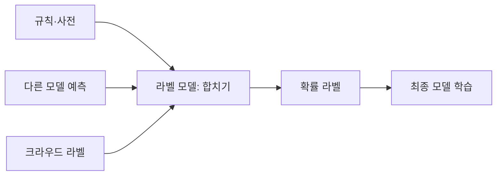
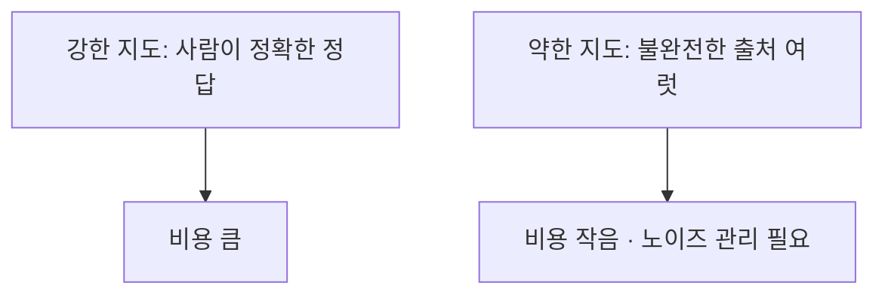

# 약한 지도(weak supervision)

> 정확한 정답 라벨을 사람이 일일이 달지 않고, 불완전하고 잡음이 있는 여러 라벨 출처(규칙·사전·다른 모델·크라우드)를 프로그램으로 합쳐 학습용 라벨을 만드는 접근이다. 프로그램으로 라벨을 만드는 방식은 특히 "programmatic weak supervision(PWS)"이라 부른다.

## 쉽게 말하면
시험지 정답 대신 "대충 맞는 힌트 여러 장"을 모아 정답을 추정하는 방식이다. 힌트 하나는 자주 틀리지만 여러 힌트를 신중히 합치면 꽤 믿을 만한 답이 나온다. 정답지를 만드는 비용을 크게 줄인다.

## 자세히
(arXiv 초록 4건 — 데이터 프로그래밍, Snorkel, PWS 서베이, WRENCH — 을 직접 열어 확인.)
- **PWS 정의(서베이, arXiv 2202.05433)**: 여러 잡음 있는 감독 출처로부터 **학습 라벨을 프로그램으로 합성**해 수동 라벨링 병목을 줄이는 방식. 서베이는 학습 워크플로의 각 구성 요소의 대표 방법, 라벨이 적을 때의 보완 패러다임, 열린 과제를 정리한다.
- **구성(제안, 서베이 초록에는 명시 없음)**: ① 라벨 출처 — [라벨링 함수](#labeling-function), 사전, 다른 모델, 크라우드 ② 합치기 — [라벨 모델](#label-model-denoising) ③ 최종 모델 — 합친 확률 라벨로 학습하는 분류기.
- **역사적 성과**: 데이터 프로그래밍(arXiv 1605.07723)은 TAC-KBP에서 LSTM 기준선을 거의 6 F1 포인트 개선, Snorkel(arXiv 1711.10160)은 사용자 연구에서 전문가가 모델을 2.8배 빠르게 만들고 평균 45.5% 성능 향상, 큰 수작업 데이터 모델과 평균 3.60% 이내라고 보고.
- **WRENCH(arXiv 2109.11377)**: 약한 지도 방법의 표준 평가를 위한 벤치마크. 분류·시퀀스 태깅의 **22개 실제 데이터셋**, 실제·합성·절차 생성 약한 출처, 모듈형 프레임워크. **120개 이상 방법 변형**을 비교했다. 기존 연구의 문제로 데이터셋이 비공개·맞춤형이고, 같은 이름의 데이터셋도 라벨·출처가 다르며, 평가 방식이 연구마다 다르다는 점을 지적했다.
- **언제 쓰나(제안)**: 라벨이 거의 없고 규칙을 쓸 수 있는 도메인 지식이 있을 때, 라벨링 규칙이 자주 바뀔 때, 라벨 정책 변경 시 코드만 고쳐 다시 라벨링해야 할 때. 반대로 규칙으로 표현하기 어려운 감성·미묘한 의미는 약하다.
- **위험(제안)**: 규칙들이 같은 방식으로 틀리면 노이즈가 체계적으로 남고, 합친 라벨의 정확도를 모르고 쓰면 위험하다. 소량의 사람 라벨 검증 세트가 필수([작은 시험 세트](#small-data-validation-strategy)).
- LLM 시대: LLM을 라벨링 함수처럼 쓰는 접근과 이어진다([LLM을 데이터 주석자로](#llm-as-data-annotator)).

## 그림으로 보기

## 예시
- 사내 계약서 조항 분류: 키워드 규칙, 조항 번호 패턴, 기존 템플릿 매칭을 LF로 쓰고 라벨 모델로 합쳐 5,000건에 라벨을 붙인 뒤, 변호사가 200건을 검수해 정확도를 확인.
- 교육 활용: "라벨이 없어도 AI를 시작할 수 있는가"라는 비개발자 질문의 답.

## 헷갈리는 것과 비교
| 개념 | 차이 |
|---|---|
| 약한 지도 | 불완전한 여러 출처로 라벨 생성 |
| 지도 학습 | 정확한 정답 라벨 사용 |
| 자기지도 학습 | 데이터 자체에서 과제를 만들어 학습(라벨 없음) |
| 준지도 학습 | 일부 정답 + 많은 라벨 없는 데이터 |
| [합성 선호 데이터](#synthetic-preference-data) | AI 판정으로 선호 라벨 생성(약한 지도의 한 형태로 볼 수 있음) |

## 더 읽을거리
- [A Survey on Programmatic Weak Supervision (arXiv 2202.05433)](https://arxiv.org/abs/2202.05433) — PWS 개요(초록 확인).
- [WRENCH: A Comprehensive Benchmark for Weak Supervision (arXiv 2109.11377)](https://arxiv.org/abs/2109.11377) — 22개 데이터셋·120개 변형(초록 확인).
- [Data Programming (arXiv 1605.07723)](https://arxiv.org/abs/1605.07723) — 원 논문(초록 확인).
