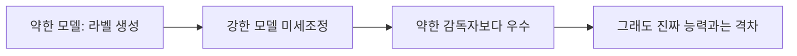
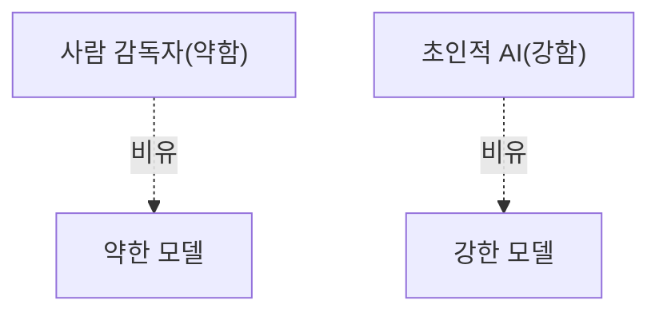

# 약한→강한 일반화

> **약한→강한 일반화(weak-to-strong generalization)** 는 **약한 모델이 단 라벨**로 **훨씬 강한 모델**을 학습시켰을 때, 강한 모델이 약한 감독자보다 잘하는지 묻는 연구다. 초인적 AI를 사람이 감독하는 상황의 모의 실험이다.

## 쉽게 말하면
초등학생이 채점한 답안으로 대학원생을 가르치면 대학원생은 학생의 실수를 따라 할까, 아니면 알아서 올바르게 풀까? 사람이 미래의 초지능 AI를 감독해야 할 때 이 질문이 현실이 된다.

## 자세히
(Burns 외, arXiv 2312.09390 초록 확인)
- **설정**: 약한 모델의 라벨로 GPT-4 계열 강한 모델을 미세조정. 과제는 NLP, 체스, 보상 모델링.
- **발견 1**: 단순 미세조정만으로도 강한 모델이 **약한 감독자를 꾸준히 능가**했다(약한→강한 일반화).
- **발견 2**: 그래도 강한 모델의 **전체 능력에는 크게 못 미친다**. 저자들은 RLHF 같은 방법이 추가 연구 없이는 잘 확장되지 않을 수 있다고 시사한다.
- **발견 3**: **보조 신뢰도 손실** 같은 간단한 방법이 크게 도움이 되었다. GPT-2급 감독자로 미세조정한 GPT-4가 NLP 과제에서 **GPT-3.5급에 가까운** 성능을 회복했다.
- 결론: 이 문제에서 지금 당장 진전이 가능하다고 주장한다.
- 한계(일반 지식): 모의 설정이어서 실제 초인적 AI에 그대로 적용되는지는 불확실.

## 그림으로 보기

## 예시
- 작은 모델이 만든 라벨로 큰 모델을 학습한 뒤, 정답 라벨로 학습했을 때와 성능 격차를 측정.
- 교육 활용: "AI가 사람을 넘어선 뒤 누가 감독하나"라는 정렬 문제의 실험 사례.

## 헷갈리는 것과 비교
| 개념 | 차이 |
|---|---|
| 약한→강한 일반화 | 약한 라벨로 강한 모델 학습 |
| [AI 토론](#ai-debate) | 두 AI가 논쟁해 사람이 판정 |
| RLHF | 사람 선호로 학습 |
| [확장 가능한 감독](#scalable-oversight) | 이 문제 영역 전체 |

## 더 읽을거리
- [Weak-to-Strong Generalization](https://arxiv.org/abs/2312.09390)
