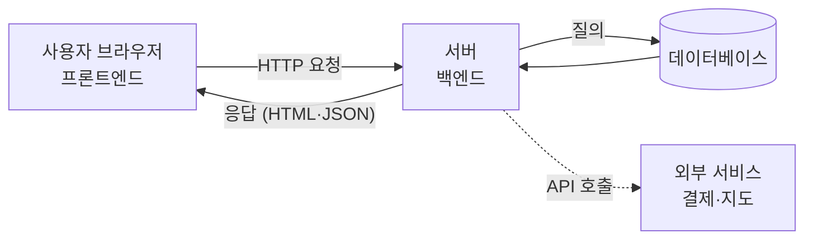
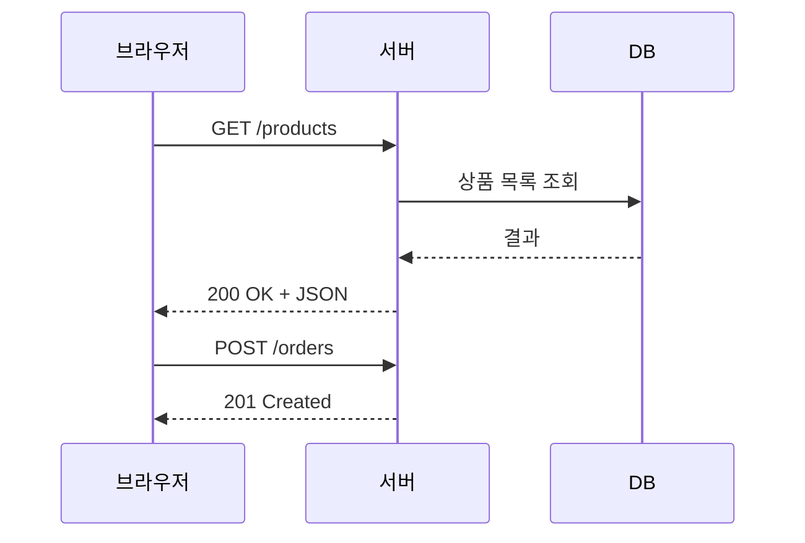

# 웹앱 개발 기초 용어

> 웹앱은 "사용자 화면(프론트엔드)"과 "뒤에서 일하는 서버(백엔드)"가 HTTP로 대화하는 구조다. 이 몇 가지 단어만 알면 AI에게 정확히 지시할 수 있다.

## 쉽게 말하면
식당과 같다. 손님이 보는 홀과 메뉴판이 프론트엔드, 주방이 백엔드, 식재료 창고가 데이터베이스다. 주문서를 주고받는 약속(양식)이 API, 가게를 열어 손님을 받는 일이 배포다. 바이브코딩에서 "주방에서 재고를 확인하고 홀 화면에 보여줘"처럼 말하면 AI가 훨씬 정확히 만든다.

## 자세히
MDN(2026-10 확인) 기준 핵심 용어:
- **클라이언트(프론트엔드)**: 사용자 기기의 브라우저에서 실행되는 HTML(구조)·CSS(모양)·JavaScript(동작).
- **서버(백엔드)**: 서버에서 실행되어 DB를 읽고 결과를 브라우저로 돌려주는 코드(Python, Node.js 등).
- **HTTP 요청/응답**: 브라우저가 URL·메서드(GET은 읽기, POST는 저장, PUT 수정, DELETE 삭제)를 보내면 서버가 상태 코드(200 성공, 404 없음, 403 금지)와 함께 응답한다.
- **정적 vs 동적 사이트**: 정적은 항상 같은 파일을 돌려주고, 동적은 요청과 DB 내용에 따라 응답을 만든다.
- **API**: 미리 만들어진 기능 묶음. 브라우저 API(DOM, 위치 정보)와 외부 API(지도, 결제)가 있다. 웹에서는 보통 JSON을 주고받는 주소 모음을 뜻한다.
- **데이터베이스**: 사용자·주문 같은 정보를 저장하는 곳.
- **배포**: 내 PC에서만 돌던 앱을 인터넷의 서버에 올려 누구나 접속하게 하는 일.

## 그림으로 보기

## 예시
- 프롬프트: "할 일 목록 웹앱을 만들어 줘. 프론트엔드는 React, 백엔드는 Node API(GET /todos, POST /todos), 저장은 SQLite로."
- 오류 보고: "브라우저 콘솔에 404가 나와. /api/todos 요청이 서버에 없는 것 같아"처럼 상태 코드를 말하면 AI가 원인을 빨리 찾는다.

## 헷갈리는 것과 비교
| 개념 | 차이 |
| --- | --- |
| [프론트엔드와 백엔드](#frontend-backend) | 화면 vs 처리. 보안 로직은 반드시 백엔드에 |
| [API](#api-basics) | 둘이 대화하는 약속된 창구 |
| [데이터베이스](#database-basics) | 영구 저장소. 서버가 대신 읽고 씀 |
| [배포와 호스팅](#deploy-hosting) | 만든 앱을 인터넷에 올리는 일 |

## 더 읽을거리
- [Client-Server overview (MDN)](https://developer.mozilla.org/en-US/docs/Learn_web_development/Extensions/Server-side/First_steps/Client-Server_overview) — 요청·응답, HTTP 메서드, 정적/동적
- [What is JavaScript (MDN)](https://developer.mozilla.org/en-US/docs/Learn_web_development/Core/Scripting/What_is_JavaScript) — 클라이언트/서버 코드, API 종류
