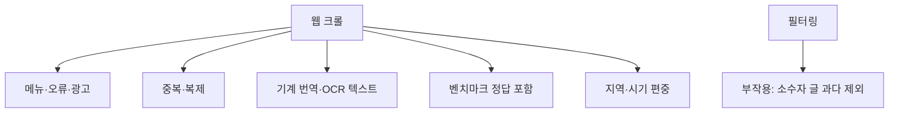
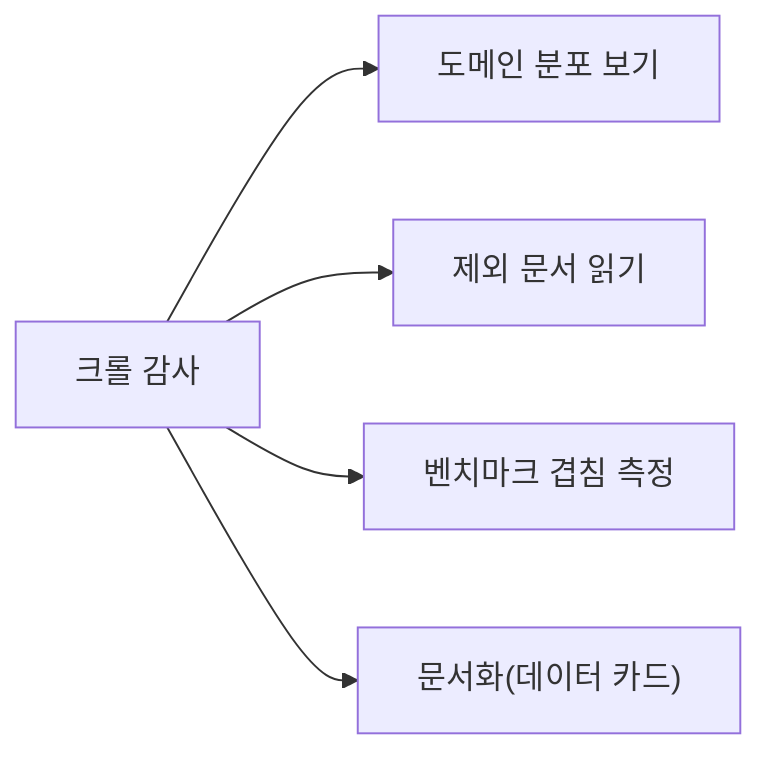

# 웹 크롤 품질 문제

> 웹 크롤 데이터에는 메뉴·광고·기계 생성문·중복·벤치마크 정답 같은 문제가 섞여 있고, 이를 걸러 내는 필터 자체가 특정 집단의 글을 더 많이 지우는 부작용도 낳는다. 크롤을 "그냥 큰 데이터"로 보면 안 되는 이유다.

## 쉽게 말하면
인터넷 전체를 트럭으로 퍼 온 흙더미에서 쓸 만한 흙을 고르는 일과 같다. 돌멩이(메뉴·오류 문구), 쓰레기(광고), 같은 흙이 여러 번 담긴 것(중복)이 섞여 있고, 체(필터)의 구멍이 어떤 종류의 흙을 더 많이 흘려보내는지도 점검해야 한다.

## 자세히
(T5 논문 arXiv 1910.10683과 C4 감사 논문 Dodge 등 arXiv 2104.08758의 PDF 본문을 직접 내려받아 확인.)
- **대부분이 자연어가 아님(T5)**: Common Crawl 웹 추출 텍스트는 매달 약 20TB인데, 논문은 대부분이 횡설수설이거나 메뉴·오류 메시지·중복 같은 상용구라고 평가했다. 그래서 C4는 휴리스틱 필터를 썼다([C4 데이터셋](#c4-dataset)).
- **출처가 예상 밖(Dodge 등)**: C4.EN에서 토큰이 가장 많은 단일 사이트는 **patents.google.com**이고 patents.com도 상위 10위. 특허 중 상당수는 OCR과 기계 번역을 거친 텍스트이며, 미국 특허청 외 비영어권 특허청 출처가 **10% 이상**이라고 한다(논문 본문). 즉 사람이 쓴 영어가 아닌 텍스트가 섞인다.
- **지리·시간 편중**: 호스팅 위치로 추정한 국가 분포에서 미국이 **51.3%**, 영어 사용 인구가 많은 인도·파키스탄·나이지리아·필리핀은 각각 3.4%, 0.06%, ... 로 매우 낮다(IP 위치는 거친 추정). 인터넷 아카이브가 색인한 URL의 약 **92%**는 2011~2019년에 쓰인 것으로 추정되며 10~20년 전 글도 일부 있다.
- **벤치마크 오염**: 요약·표-텍스트·그래프-텍스트 생성 과제의 시험 정답 텍스트가 C4에 **1.87~24.88%** 존재(표 2). LAMA의 T-REx 4.6%, Google-RE 5.7%가 그대로 존재. GLUE 입력은 데이터셋에 따라 **2% 미만~50% 이상**이 C4에서 발견. 모델이 정답을 베껴 점수가 부풀 수 있다([벤치마크 오염](#benchmark-contamination), [LLM 암기](#memorization-in-llms)).
- **필터의 부작용(블록리스트)**: 금칙어 목록으로 제외된 문서 10만 개를 분석하니 성적 내용 군집은 제외 문서의 31%였고, 나머지는 과학·의료·건강, 법률·정치 등이었다. 정체성 언급 중 성적 지향(lesbian, gay 등)이 가장 높은 비율로 제외됐고, 표본 50개를 보면 'lesbian'·'gay' 문서의 22%, 36%는 비공격적·비성적이었다. 필터가 소수자 관련 정상 글을 더 많이 지운다는 결과.
- **중복·추출 문제**: 정상 문서와 중복 문서가 섞이고, WET 추출은 메뉴 텍스트가 많이 남는다([WARC·WAT·WET 형식](#warc-wat-wet), [스냅샷별 vs 전역 중복 제거](#per-snapshot-vs-global-dedup)).
- **점검 체크리스트(제안)**: 상위 도메인 분포, 언어·국가 분포, 중복률, 벤치마크 겹침, 필터가 지운 샘플 읽어 보기, 개인정보 샘플링.

## 그림으로 보기

## 예시
- 사내 LLM 학습용 웹 수집: 수집 후 상위 20개 도메인을 먼저 본다. 한두 사이트가 대부분이면 편중이 크다.
- 필터를 추가할 때 "지운 문서 100개 읽기"를 규칙으로 정해 필터가 무엇을 지우는지 확인한다.
- 교육 활용: "큰 데이터 = 좋은 데이터가 아니다"의 근거 자료.

## 헷갈리는 것과 비교
| 개념 | 차이 |
|---|---|
| 웹 크롤 품질 문제 | 수집 원천의 잡음·편중·오염 |
| [벤치마크 라벨 노이즈](#label-noise-benchmarks) | 시험 세트 정답 자체의 오류 |
| [근접 중복 제거](#near-duplicate-removal) | 중복 해소 기법 |
| [데이터 카드](#internal-data-card) | 문제를 기록·공개하는 문서화 |

## 더 읽을거리
- [Documenting Large Webtext Corpora: A Case Study on the Colossal Clean Crawled Corpus (arXiv 2104.08758)](https://arxiv.org/abs/2104.08758) — C4 감사(PDF 본문 확인).
- [T5 논문 (arXiv 1910.10683)](https://arxiv.org/abs/1910.10683) — 웹 추출 텍스트의 문제와 필터(PDF 본문 확인).
