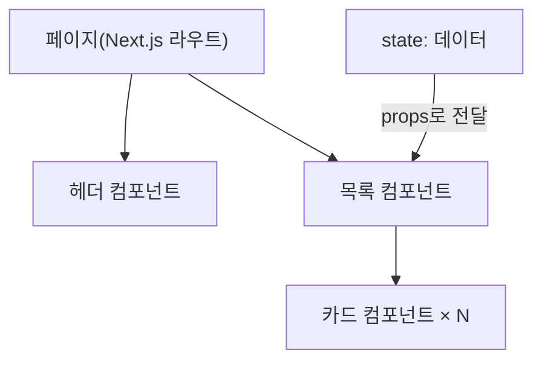
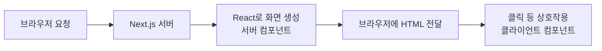

# 웹 프레임워크 (React·Next.js)

> **React**는 화면을 "컴포넌트"라는 조각으로 조립하는 자바스크립트 UI 라이브러리이고, **Next.js**는 React 위에 라우팅·서버 렌더링·빌드 설정을 얹어 **완성형 웹앱**을 만들게 해 주는 프레임워크다. 바이브코딩 도구(v0, Lovable, Bolt 등)가 만드는 앱의 단골 기술이라 코드를 읽을 때 알아 두면 좋다.

## 쉽게 말하면
React는 레고 블록(버튼·카드·메뉴)을 만드는 방법이고, Next.js는 그 블록으로 집(웹앱)을 지을 때 설계도·배관·전기(페이지 이동, 서버 처리, 배포 준비)를 미리 깔아 둔 건축 키트다.

## 자세히
- **React 공식 문서 기준**: React는 사용자 인터페이스를 만드는 자바스크립트 라이브러리이며 핵심은 **컴포넌트·JSX·props·state**다.
  - **컴포넌트**: 마크업을 반환하는 자바스크립트 함수. 이름은 **대문자로 시작**해야 HTML 태그와 구분된다.
  - **JSX**: 컴포넌트 안의 마크업 문법. HTML보다 엄격하다(예: `<br />` 자체 닫기, 하나의 부모 요소 또는 `<>…</>` 조각 반환). `{}`로 자바스크립트 값을 넣는다.
  - **props**: 부모가 자식 컴포넌트에 넘기는 정보(속성처럼 씀).
  - **state**: 컴포넌트가 렌더 사이에 기억하는 데이터(`useState`). 값을 바꾸면 화면이 다시 그려진다.
- **Next.js 공식 문서 기준**(문서 갱신일 2026-05-13): "React 위에 만든 **풀스택 웹 애플리케이션용 프레임워크**"로, UI는 React 컴포넌트로 만들고 번들러·컴파일러 같은 저수준 도구는 자동 설정한다. 라우터가 두 종류 있다: **App Router**(서버 컴포넌트 등 새 React 기능 지원, 신규 프로젝트 기본 방향)와 **Pages Router**(원조, 계속 지원). 문서는 HTML·CSS·JavaScript·React에 익숙할 것을 전제로 한다.
- **언제 쓰나**: 로그인·데이터 저장·여러 페이지가 있는 앱은 Next.js 같은 프레임워크, 아주 단순한 한 페이지는 HTML만으로도 충분.
- **AI가 만든 코드 읽는 요령**:
  1. `app/` 또는 `pages/` 폴더 = 주소(URL) 구조.
  2. 대문자 함수 = 컴포넌트, `useState` = 화면이 바뀌는 데이터.
  3. `package.json` = 사용 라이브러리와 실행 명령(`npm run dev`).
  4. API 키는 서버 코드에서만([환경 변수와 API 키](#env-secrets)).
- 한계: 프레임워크 기능과 권장 방식은 버전(Next.js 15/16 등)에 따라 바뀌므로 만들 때의 공식 문서를 확인한다.

## 그림으로 보기



## 예시
```jsx
import { useState } from 'react';

export default function MyApp() {
  const [count, setCount] = useState(0);
  return (
    <div>
      <MyButton count={count} onClick={() => setCount(count + 1)} />
      <MyButton count={count} onClick={() => setCount(count + 1)} />
    </div>
  );
}
function MyButton({ count, onClick }) {
  return <button onClick={onClick}>Clicked {count} times</button>;
}
```
- 부모가 state를 갖고 props로 내려 주면 두 버튼이 같은 숫자를 보여 준다(React 문서의 "상태 끌어올리기" 예).
- 프롬프트: "Next.js App Router로 할 일 목록 앱을 만들어 줘. 컴포넌트 구조를 먼저 그림(목록)으로 설명하고 시작해."

## 헷갈리는 것과 비교
| 개념 | 차이 |
|---|---|
| React | UI를 컴포넌트로 만드는 라이브러리 |
| Next.js | React 기반 풀스택 프레임워크(라우팅·서버 기능 포함) |
| 라이브러리 vs 프레임워크 | 라이브러리는 내가 호출, 프레임워크는 틀에 내 코드를 끼움 |
| [HTTP 요청과 상태 코드](#http-basics) | 앱이 서버·API와 대화하는 방식 |

## 더 읽을거리
- [React: Quick Start](https://react.dev/learn) — 컴포넌트·JSX·props·state 입문.
- [Next.js Docs](https://nextjs.org/docs) — App Router와 Pages Router 개요.
