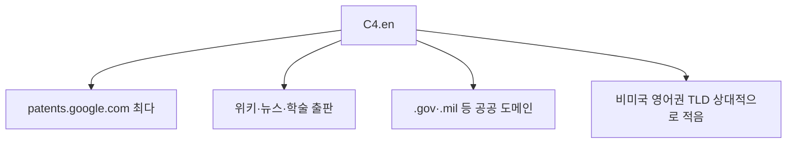

# 웹 출처 분포 분석

> 웹 크롤 코퍼스가 **어떤 사이트(도메인)와 어떤 최상위 도메인(TLD)에서 온 글로 채워져 있는지** 표로 세어 보는 감사. "웹 전체"를 대표한다는 착각을 깨 준다.

## 쉽게 말하면
"한국 사람의 의견 조사"를 했는데 응답자 대부분이 같은 회사 직원이면, 결과는 한국 전체가 아니라 그 회사의 의견이다. 코퍼스도 출처 도메인별 분량을 세어 보면 누구의 글로 만들어졌는지 보인다.

## 자세히
(Dodge 외, "Documenting Large Webtext Corpora", EMNLP 2021, arXiv 2104.08758의 C4 감사. 본문을 ar5iv로 직접 읽었으며 도메인별 정확한 비율은 그림 속 값이라 확인하지 못했다.)
- **대상**: C4.en = 3.65억 문서, 1,560억 토큰, 압축 305GB.
- **TLD 분포**: `.com`·`.org`·`.net` 같은 흔한 TLD가 잘 대표되고, 영어를 쓰는 비미국 국가의 TLD는 상대적으로 적다. 상위 25개 TLD 그림에 `.ru`가 들어 있다. `.gov`도 상당한 비중이다. 작은 예로 `.mil`은 5만 8,394개 고유 URL·약 3,387만 토큰, `.mod.uk`는 2,873개 URL·약 122만 토큰이다.
- **사이트 분포**: **patents.google.com이 가장 많이 대표되는 사이트**이고 위키백과와 뉴스(NYTimes, LATimes, Al Jazeera), 학술 출판(PLOS, Frontiers, Springer) 등이 상위 25위권에 있다. 논문은 이 분포가 Alexa의 방문 순위 상위 사이트와 다르다고 지적한다. 즉 "많이 읽는 사이트"와 "코퍼스에 많은 사이트"는 다르다.
- **만드는 방법(제안)**: ① 문서마다 URL에서 등록 도메인과 TLD 추출 ② 도메인·TLD별 문서 수·토큰 수 합산 ③ 상위 N개 표와 누적 비율 곡선 ④ 필터 전후 비교(어떤 도메인이 많이 줄었는가). Common Crawl 색인에는 `url_host_registered_domain`, `url_host_tld` 열이 있어 SQL로 바로 셀 수 있다([Athena로 색인 조회](#athena-cc-index-query)).
- **해석 주의**: 이 분포는 "누가 썼나"가 아니라 "어디에 게시됐나"다. 작성자의 지역·정체성은 별도 대리 지표로 추정해야 하고 그 한계도 있다([지리 대리 지표](#geolocation-proxy), [작성 시기 대리 지표](#utterance-date-proxy)).
- **활용**: 분포가 한쪽에 쏠렸다면 도메인별 상한, 재가중, 목표 도메인 추가로 균형을 맞출 수 있다([도메인 쏠림과 상한](#domain-concentration-cap)).

## 그림으로 보기

## 예시
| 지표 | 값(Dodge 외) |
|---|---|
| C4.en 규모 | 3.65억 문서·1,560억 토큰 |
| `.mil` | 58,394 URL·33,874,654 토큰 |
| `.mod.uk` | 2,873 URL·1,224,576 토큰 |
| 최다 사이트 | patents.google.com |
- 업무 장면: 사내 챗봇 학습용 웹 데이터를 모은 뒤 도메인·TLD 표를 먼저 만들어 특정 사이트 한두 개가 반을 넘지 않는지 확인한다.

## 헷갈리는 것과 비교
| 개념 | 차이 |
|---|---|
| 웹 출처 분포 | 어디에 게시됐나(도메인·TLD) |
| [방언별 필터링 편향](#dialect-filtering-bias) | 글쓴이 방언과 필터의 관계 |
| [도메인 쏠림과 상한](#domain-concentration-cap) | 분포를 보고 조정하는 방법 |
| [C4 감사](#c4-audit-dodge) | 이 분석이 속한 상위 사례 |

## 더 읽을거리
- [Documenting Large Webtext Corpora (arXiv 2104.08758)](https://arxiv.org/abs/2104.08758) — C4 출처 분포 분석(ar5iv 본문 직접 읽음).
