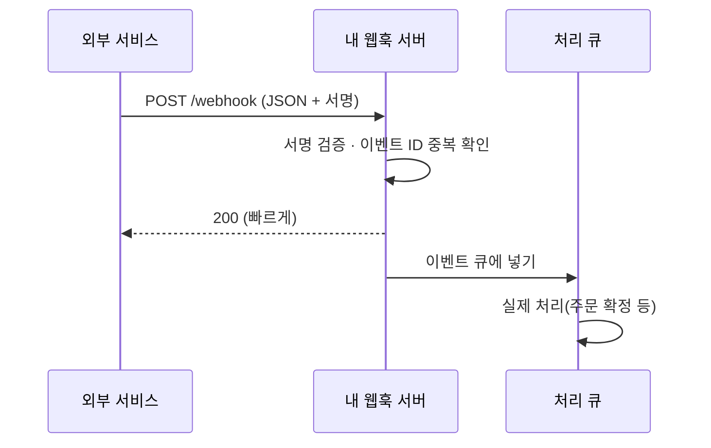
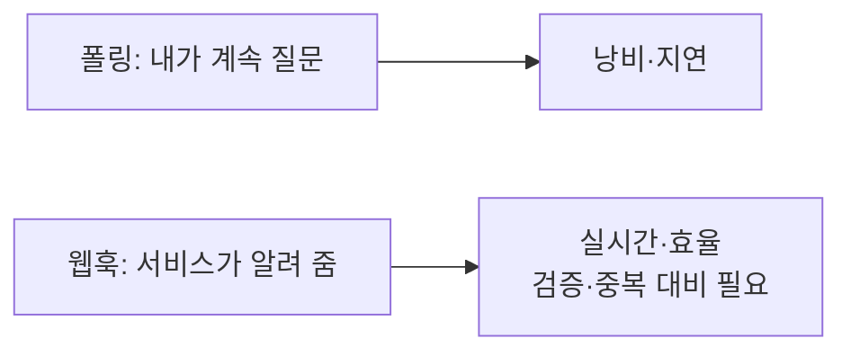

# 웹훅

> **내가 서버에 계속 물어보는(폴링) 대신, 서버가 "일이 생겼어요"라며 내 주소로 먼저 HTTP 요청을 보내 주는** 방식. 결제 완료, 메시지 도착, 코드 푸시처럼 **나중에 일어나는 사건**을 받을 때 쓴다. 받는 쪽은 **서명 검증·빠른 응답·중복 처리**를 꼭 챙겨야 한다.

## 쉽게 말하면
택배가 왔는지 현관을 10분마다 확인하는 대신, 택배 기사가 도착하면 초인종을 눌러 주는 방식이다. 다만 아무나 초인종을 눌러 "택배왔어요" 할 수 있으니 진짜 택배사인지 확인(서명 검증)해야 하고, 같은 택배를 두 번 알려 줄 수도 있다(중복 전송).

## 자세히
(Stripe 공식 문서 "webhooks" 기준 — 결제 서비스의 사례로 일반 원칙을 설명)
- **동작**: 이벤트 발생 → 서비스가 등록된 **HTTPS 주소**로 JSON을 담은 POST 요청을 보냄 → 내 서버가 처리 후 응답. 문서는 고객의 은행이 결제를 확인하거나 분쟁이 생기거나 정기 결제가 성공하는 등 **비동기 사건**에 쓴다고 설명한다.
- **받는 서버가 지킬 것**(문서의 모범 사례):
  1. **서명 검증**: 요청 헤더의 서명과 서버만 아는 비밀(`whsec_…`)로 요청이 진짜인지 확인. 검증 없이는 공격자가 가짜 이벤트로 주문 처리·권한 부여를 유발할 수 있다. 서명은 **원본 본문(raw body)** 으로 계산하므로 프레임워크가 본문을 가공하면 검증이 실패한다. 시각(timestamp)도 서명에 포함해 오래된 요청을 거부(리플레이 공격 방지, 라이브러리 기본 허용 5분).
  2. **빠르게 2xx 응답**: 복잡한 처리 **전에** 먼저 200대 응답을 돌려준다(시간 초과 방지). 무거운 일은 **비동기 큐**로 처리.
  3. **중복 대비**: 같은 이벤트가 **여러 번** 올 수 있으므로 처리한 **이벤트 ID를 기록**해 이미 처리한 것은 무시.
  4. **순서 보장 없음**: 이벤트가 생성 순서대로 도착한다는 보장이 없으니 순서에 의존하지 않는다.
  5. 필요한 이벤트 종류만 구독, 비밀은 주기적으로 교체, HTTPS 사용.
- **재시도**: Stripe는 실패 시 라이브 모드에서 지수 백오프로 **최대 3일** 재전송한다고 안내한다(서비스마다 다름).
- **직접 실행**(파이썬 내장 서버, HMAC-SHA256 서명, 이벤트 ID 기록):

| 요청 | 응답 |
|---|---|
| 올바른 서명의 `evt_1` 이벤트 | 200 `processed` |
| 같은 `evt_1` 재전송 | 200 `duplicate-ignored` (중복 무시) |
| 틀린 비밀로 서명 | **401** |
| 본문을 바꾼 요청(서명은 원래 본문 기준) | **401** |

  서명이 맞지 않으면 처리하지 않고, 같은 이벤트는 한 번만 처리됐다. (이 예시의 서명 방식은 단순화한 것이며 Stripe의 실제 서명은 `t`와 `v1`을 쓰는 형식이다.)
- 한계: 로컬 개발 중에는 외부에서 내 PC로 요청을 못 보내므로 터널링 도구나 서비스 제공 CLI를 쓴다.

## 그림으로 보기



## 예시
```python
import hmac, hashlib, json
def verify(body: bytes, sig: str, secret: bytes) -> bool:
    good = hmac.new(secret, body, hashlib.sha256).hexdigest()
    return hmac.compare_digest(sig, good)   # 항상 일정 시간 비교

# 처리 흐름: 서명 검증 → 이미 처리한 id면 무시 → 큐에 넣고 즉시 200
```
- 바이브코딩 프롬프트: "결제 웹훅 엔드포인트를 만들어 줘. 서명 검증, 이벤트 ID 중복 방지, 즉시 200 응답 후 큐 처리를 포함해."

## 헷갈리는 것과 비교
| 개념 | 차이 |
|---|---|
| 웹훅 | 서비스가 내 주소로 먼저 알려 줌 |
| 폴링 | 내가 주기적으로 확인 |
| API 호출 | 내가 요청하고 응답을 받음 |
| [HTTP 요청과 상태 코드](#http-basics) | 웹훅도 HTTP POST와 상태 코드로 오감 |

## 더 읽을거리
- [Stripe: Receive events in your webhook endpoint](https://docs.stripe.com/webhooks) — 검증·재시도·모범 사례의 대표 문서.
