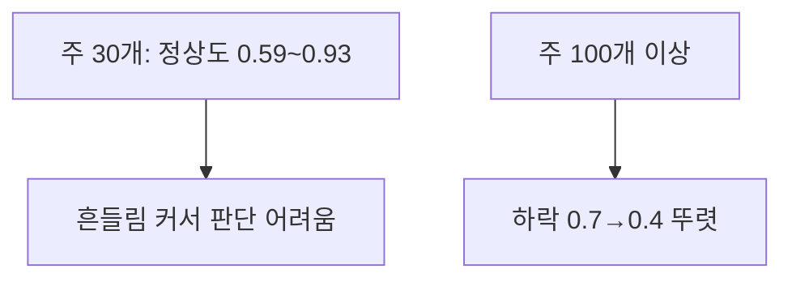

# 주간 일치도 대시보드

> 주간 일치도 대시보드는 라벨링 프로젝트 중 매주 일부 샘플을 이중 라벨해 kappa 같은 일치도를 주차별로 기록·표시하는 모니터링 화면이다. 지침 변경·작업자 교체·피로로 인한 라벨 품질 하락(드리프트)을 일찍 알아챈다.

## 쉽게 말하면
체중을 매주 재서 그래프로 그리면 갑자기 늘었을 때 바로 알아챈다. 라벨 품질도 매주 재야 "언제부터 나빠졌는지"를 안다.

## 자세히
- **직접 시뮬레이션(12주, 이진 균형, 주석자 2명 정확도 0.92가 8주차까지 유지되다 9주차부터 0.82로 하락, kappa 이론값 약 0.70 → 0.41)**: 주당 표본 수별 kappa 추이는 다음과 같았다.

| 주당 표본 | 1~8주(정상) kappa | 9~12주(하락) kappa |
| --- | --- | --- |
| 30 | 0.73, 0.93, 0.78, 0.59, 0.73, 0.93, 0.73, 0.74 | 0.34, 0.41, 0.40, 0.66 |
| 100 | 0.72, 0.68, 0.76, 0.72, 0.68, 0.64, 0.75, 0.78 | 0.40, 0.34, 0.46, 0.43 |
| 300 | 0.74, 0.69, 0.67, 0.66, 0.70, 0.71, 0.69, 0.74 | 0.33, 0.41, 0.40, 0.43 |

  30개/주는 정상일 때도 0.59~0.93으로 크게 흔들리고 하락 기간에도 0.66이 나오는 주가 있다. 100개 이상이면 하락이 뚜렷하다.
- **경보 규칙 시험(초기 8주 평균−2표준편차 아래로 4주 안에 한 번이라도 내려가면 경보, 500회 반복)**: 하락을 4주 안에 잡을 확률은 30개/주에서 0.90, 100개 이상에서 1.00이었다. 하지만 정상일 때의 오경보 확률(4주 안에 한 번이라도 한계 미만)이 약 19~22%였다. 한 번의 하회로 경보를 올리면 정상에서도 5주에 한 번꼴로 울릴 수 있다는 뜻이다. 가정된 시뮬레이션이며 규칙을 "2주 연속 하회"처럼 바꾸면 오경보가 줄어든다.
- **구성(해석)**: ① 주차별 kappa와 표본 수·신뢰구간 ② 일치율 병행(쏠림 확인, [kappa와 클래스 불균형](#kappa-class-imbalance)) ③ 클래스별 일치도([클래스별 일치도](#specific-agreement)) ④ 주석자별 통계([주석자 품질 통계](#annotator-quality-stats)) ⑤ 지침 변경·인력 변동 이벤트를 그래프에 표시.
- **운영(해석)**: 표본은 무작위로 뽑고([품질 표본 추출 계획](#quality-sampling-plan)), 하락 시 [불일치 샘플 토론](#disagreement-discussion)으로 원인을 찾는다.

## 그림으로 보기

## 예시
- 주 100개 이중 라벨, 직전 8주 평균 0.71에서 2주 연속 0.55 아래로 내려가면 경보.
- 교육 활용: 위 시뮬레이션 코드를 돌려 표본 수에 따른 그래프 흔들림을 직접 본다.

## 헷갈리는 것과 비교
| 개념 | 차이 |
| --- | --- |
| 주간 일치도 대시보드 | 시간 흐름에 따른 품질 감시 |
| 시범 일치도 측정 | 시작 전 한 번 측정 |
| [품질 표본 추출 계획](#quality-sampling-plan) | 무엇을 뽑을지 |
| [kappa용 시범 크기](#pilot-size-for-kappa) | 표본 수와 흔들림의 관계 |

## 더 읽을거리
- [Interrater reliability: the kappa statistic (McHugh, 2012)](https://pmc.ncbi.nlm.nih.gov/articles/PMC3900052/) — kappa 해석과 한계
