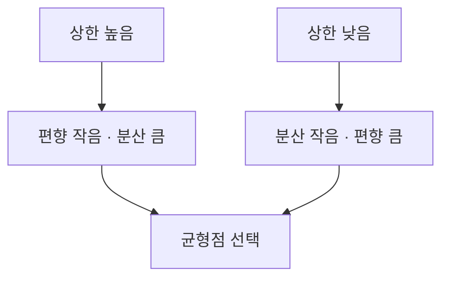

# 가중치 트리밍

> 가중 표본에서 **극단적으로 큰 가중치를 상한선으로 잘라** 소수 응답이 결과를 좌우하는 것을 막고 분산을 줄이는 후처리다. 편향을 조금 감수하고 분산을 크게 줄이는 거래다.

## 쉽게 말하면
회의에서 한 사람의 발언을 12배 크게 반영하면 회의 결과가 그 한 사람에게 좌우된다. "아무리 대표성이 커도 최대 3배까지만 반영"이라고 상한을 두는 것이 트리밍이다. 대신 그 사람이 진짜 대표하던 집단은 조금 덜 반영되어 약간의 왜곡이 남는다.

## 자세히
(Meta의 `balance` 논문 arXiv 2307.06024의 해당 부분을 PDF에서 직접 읽었다. 논문이 트리밍을 자세히 규정하진 않아 구체 상한 선택법은 없다. 계산 예시는 이 지도에서 직접 계산한 것이다.)
- **왜 하나(논문)**: 공변량이 많은 모델은 가중치 분산이 커져 추정이 불필요하게 부풀 수 있다. 극단 가중치가 몇 개뿐이면 그 특징을 살펴 일부 범주를 묶거나 가중 모델에서 변수를 빼거나 **트리밍**이나 다른 후처리를 고려한다고 한다.
- **balance의 방식(논문)**: 가중치를 추정해 모집단 크기로 스케일한 뒤 **위쪽에서만(from above)** 트리밍한다. 과적합과 불필요한 분산 증가를 피하기 위해서이며, 트리밍·재스케일 후에도 **가중치의 평균과 합이 이전과 같도록** 맞춰 "이 단위가 목표 모집단의 몇 명을 대표한다"는 해석이 유지된다.
- **상충 관계(논문의 향후 과제)**: 현재 패키지는 사용자에게 가중치를 주지만 트리밍 수준별 편향-분산 절충을 쉽게 확인하게 해 주진 않는다. 향후 특정 결과에 대한 경험적 MSE 추정을 바탕으로 여러 트리밍 값 중 고르는 자동 함수를 넣을 수 있다고 적는다. 즉 **최적 상한은 정해진 공식이 아니라 편향과 분산의 균형 문제**다.
- **직접 계산한 예시(이 지도 계산)**: 12명의 가중치가 0.5~2.0이 11개, 한 명이 12.0이라면 합 23.3, Kish Deff ≈ 3.48, 유효 표본 크기 ≈ 3.45(명목 12명). 상한 3.0으로 자르고 합이 23.3으로 유지되도록 재스케일하면 최대 가중치가 약 4.89, Deff ≈ 1.32, 유효 표본 크기 ≈ 9.1로 개선된다. 대신 큰 가중치를 가졌던 사례가 대표하던 집단은 덜 반영된다. 이 수치는 임의의 예시이며 일반 효과가 아니다.
- **같이 볼 지표**: [Kish 설계 효과](#kish-design-effect)로 트리밍 전후 유효 표본 크기를 비교하고, 가중치 분포(사분위, 2 초과·0.5 미만 비율)를 확인한다.
- **주의**: 트리밍하면 가중 표본이 목표 분포에서 약간 멀어질 수 있다. 래킹·사후 층화 후 보정 효과(공변량 균형)를 다시 확인해야 한다(일반 원칙).

## 그림으로 보기

## 예시
| 상태 | 최대 가중치 | Deff | 유효 표본 크기 |
|---|---|---|---|
| 트리밍 전 | 12.0 | 약 3.48 | 약 3.45 |
| 상한 3.0 + 재스케일 | 약 4.89 | 약 1.32 | 약 9.1 |
(12명, 합 23.3 예시. 재스케일로 상한값이 3.0을 넘는 점에 주의.)
- 교육 소재: 상한을 바꿔 가며 "분산과 편향의 거래"를 직접 느껴 보기.

## 헷갈리는 것과 비교
| 개념 | 차이 |
|---|---|
| 트리밍 | 큰 가중치를 상한으로 자름 |
| 정규화 | 가중치 합을 표본 크기 등으로 맞춤 |
| [Kish 설계 효과](#kish-design-effect) | 트리밍 효과를 평가하는 지표 |
| [역성향점수 가중(IPW)](#inverse-propensity-score-weighting) | 극단 가중치가 잘 생기는 방법 |

## 더 읽을거리
- [balance (arXiv 2307.06024)](https://arxiv.org/pdf/2307.06024) — 위쪽 트리밍과 합·평균 유지, 향후 과제(PDF 직접 읽음).
