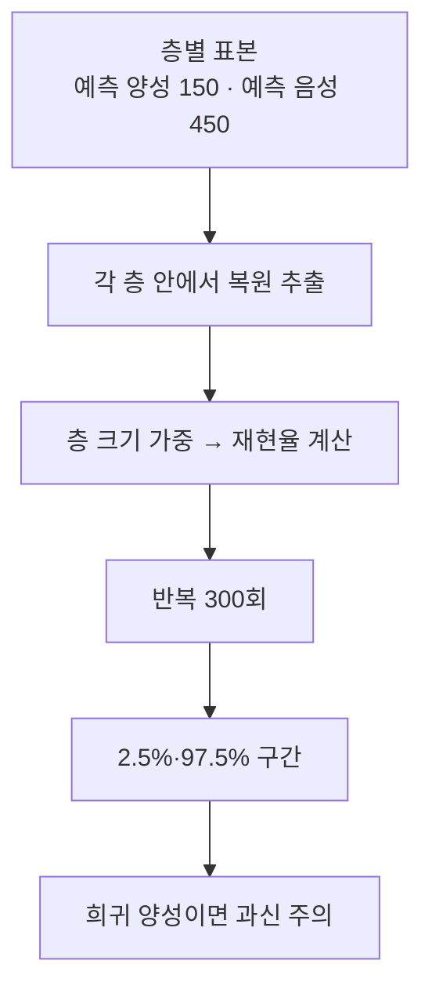

# 가중 추정의 신뢰구간

> 층화 표집으로 구한 정밀도·재현율 같은 **가중 추정치**의 불확실성은 층별로 따로 다시 뽑는 **층화 부트스트랩**으로 구간을 낸다. 다만 표본에 희귀 양성이 거의 없으면 구간이 **실제보다 좁게(과신)** 나올 수 있다.

## 쉽게 말하면
여론조사에서 "20대 150명, 60대 450명"을 뽑아 전체 의견을 추정하면 각 연령층 크기로 가중해야 한다. 오차 범위도 연령층별로 따로 계산해 합쳐야지, 전체를 한 덩어리로 보면 틀린다.

## 자세히
- **가중 없이 합치면 편향**: 예측 양성 칸 150개와 음성 칸 450개를 그냥 합쳐 양성 비율을 구하면 0.053으로, 진짜 양성 비율 0.020과 크게 다르다(직접 계산). 층 크기로 가중해야 한다.
- **층화 부트스트랩**: 각 층의 표본을 그 층 안에서 복원 추출 → 가중 추정치를 다시 계산 → 반복(예: 300~2,000회) → 2.5·97.5 백분위를 구간으로.
- **직접 실행**(numpy: 데이터 100,000개, 양성 2%, 진짜 재현율 0.832; 예측 양성 150·예측 음성 450개 표집, 부트스트랩 300회, 400번 반복해 구간 적중률 측정):

| 항목 | 값 |
|---|---|
| 명목 신뢰수준 | 95% |
| **실제 적중률(진짜 재현율이 구간 안에 있던 비율)** | **0.777** |
| 평균 구간 폭 | 0.309 |
| 재현율 추정 평균 | 0.839 |

  명목 95%인데 실제로는 약 78%만 맞았다. 음성 칸 450개에 양성이 평균 1~2개뿐이라 부트스트랩이 분산을 과소 추정한 것이다.
- **대응**: ① 음성 칸 양성이 적으면 점수 구간으로 더 층화([거짓 음성 표집](#false-negative-sampling)), ② 베이지안 구간·Wilson/Clopper–Pearson 같은 정확 구간을 층별로 사용, ③ 표본 수를 늘리고 구간을 "대략적"이라고 명시, ④ 양성 수가 너무 적으면 재현율 추정 자체를 보류.
- 한계: 한 가지 설정의 시뮬레이션이다. 표본 수·양성 비율에 따라 적중률은 달라진다.

## 그림으로 보기


## 예시
```python
a = y_pos_stratum; b = y_neg_stratum
est = []
for _ in range(1000):
    aa = rng.choice(a, len(a)); bb = rng.choice(b, len(b))
    tp = aa.mean()*N_pos; fn = bb.mean()*N_neg
    est.append(tp/(tp+fn))
lo, hi = np.percentile(est, [2.5, 97.5])
```

## 헷갈리는 것과 비교
| 개념 | 차이 |
|---|---|
| 층화 부트스트랩 | 층 안에서 재표집해 가중 추정 |
| 일반 부트스트랩 | 전체를 한 덩어리로 재표집(층화 표본에는 부적절) |
| [점수 평균의 표준오차](#standard-error-of-mean-score) | 단순 평균의 SE |
| [층화 평가 표집](#stratified-evaluation-sampling) | 이 추정의 표집 설계 |

## 더 읽을거리
- [Wikipedia: Bootstrapping (statistics)](https://en.wikipedia.org/wiki/Bootstrapping_%28statistics%29) — 부트스트랩의 원리와 한계.
- [scipy.stats.bootstrap](https://docs.scipy.org/doc/scipy/reference/generated/scipy.stats.bootstrap.html) — 신뢰구간 구현.
