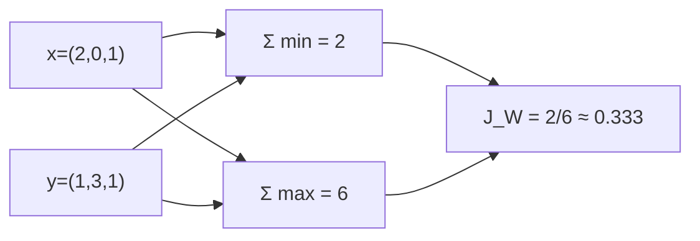
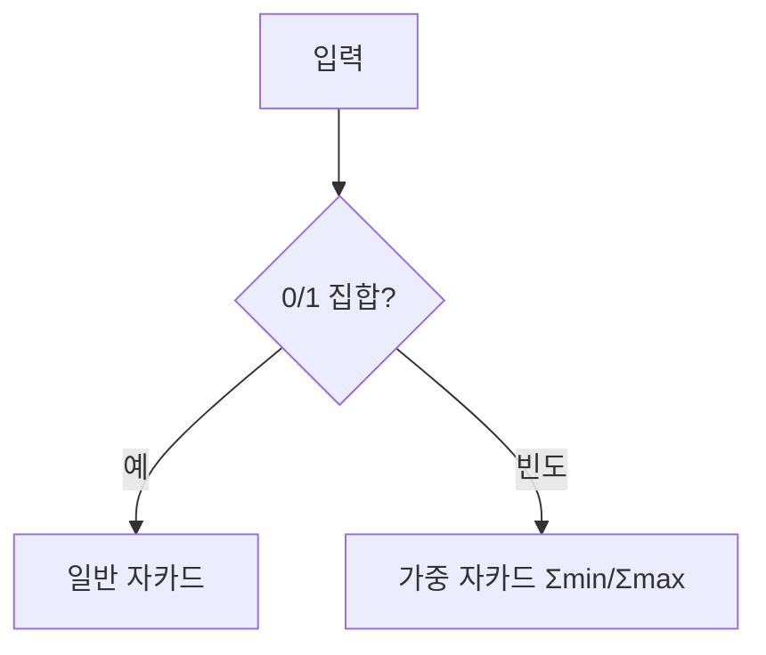

# 가중 자카드

> 집합이 아니라 **빈도(횟수)를 가진 벡터**를 비교하도록 자카드를 확장한 것. **원소별 최솟값의 합 ÷ 최댓값의 합**(Ruzicka)이며 0/1 입력이면 일반 자카드와 같다.

## 쉽게 말하면
두 사람의 장바구니를 "무엇을 샀나"(집합)가 아니라 "몇 개씩 샀나"(횟수)로 비교한다. 우유 2개와 우유 1개는 같은 품목이지만 가중 자카드는 "겹친 양 1개 / 큰 쪽 양 2개"로 센다.

## 자세히
(Wikipedia "Jaccard index" 본문 확인)
- **정의**: 음이 아닌 벡터 x, y에 대해 J_W(x, y) = Σᵢ min(xᵢ, yᵢ) / Σᵢ max(xᵢ, yᵢ). 원소가 0 또는 1이면 **일반 자카드와 일치**한다. 문서의 예: x=(2,0,1), y=(1,3,1) → Σmin=1+0+1=2, Σmax=2+3+1=6, J_W = 2/6 ≈ 0.333.
- **일반 자카드와의 차이(직접 계산)**: 문서 A="the cat sat on the mat", B="the cat sat"를 단어 빈도로 보면
  | 방식 | 계산 | 값 |
  |---|---|---|
  | 일반 자카드(단어 집합) | A={the,cat,sat,on,mat}, B={the,cat,sat} → 3/5 | **0.600** |
  | 가중 자카드(단어 빈도) | Σmin=3(the:1, cat:1, sat:1), Σmax=6(the:2, cat:1, sat:1, on:1, mat:1) → 3/6 | **0.500** |
  A에서 "the"가 두 번 나온다는 정보가 반영돼 가중 값이 낮아진다.
- **비례 벡터 예(직접 계산)**: u=(3,0,1,0), v=(6,0,2,0)은 방향이 같아 코사인은 1.0이지만 가중 자카드는 Σmin 4 / Σmax 8 = **0.5**다. 가중 자카드는 **양의 크기 차이**를 벌점으로 준다([자카드 vs 코사인](#jaccard-vs-cosine)).
- **Tanimoto 주의(Wikipedia)**: 벡터식 A·B/(‖A‖²+‖B‖²−A·B)는 **비트 벡터에서만** 자카드와 같다. 일반 벡터에서 1−그 값은 삼각 부등식을 어길 수 있어 거리로 쓰면 안 된다. 같은 u, v에 대해 이 식은 0.667로 가중 자카드(0.5)와 다르다.
- **쓰임**: 단어 빈도·토큰 빈도 기반 문서 유사도, 장바구니·행동 로그 비교, 중복 탐지에서 반복 내용이 있는 문서(템플릿 반복), 히스토그램 비교.
- **주의**: 가중치 입력이 음수면 정의되지 않는다(음이 아닌 벡터 전제). 빈도가 매우 큰 원소가 지배할 수 있으므로 로그 변환·TF-IDF 가중을 고려한다(일반 관행).
- **중복 탐지에서**: 문서를 섀글(n-gram) 집합이 아니라 빈도 벡터로 쓰면 반복 문구가 많은 문서가 다르게 평가된다([섀글 크기](#shingle-size-choice)).

## 그림으로 보기



## 예시
```python
def weighted_jaccard(x, y):
    num = sum(min(a, b) for a, b in zip(x, y))
    den = sum(max(a, b) for a, b in zip(x, y))
    return num / den
print(weighted_jaccard((2, 0, 1), (1, 3, 1)))   # 0.333...
```
- 고객 두 명의 월간 앱 기능 사용 횟수 벡터를 비교해 행동 유사 고객을 찾을 때.

## 헷갈리는 것과 비교
| 지표 | 입력 | 양 크기 반영 |
|---|---|---|
| 자카드 | 집합 | X |
| 가중 자카드 | 빈도 벡터 | O(최솟값/최댓값) |
| 코사인 | 실수 벡터 | X(방향만) |
| Tanimoto 벡터식 | 실수 벡터 | 거리 공리 불성립 주의 |

## 더 읽을거리
- [Wikipedia: Jaccard index](https://en.wikipedia.org/wiki/Jaccard_index) — 가중 자카드·Tanimoto 주의(본문 열어 확인). 단어 빈도 예시는 이 글의 직접 계산.
