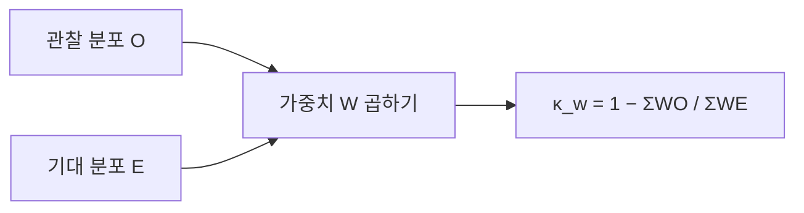
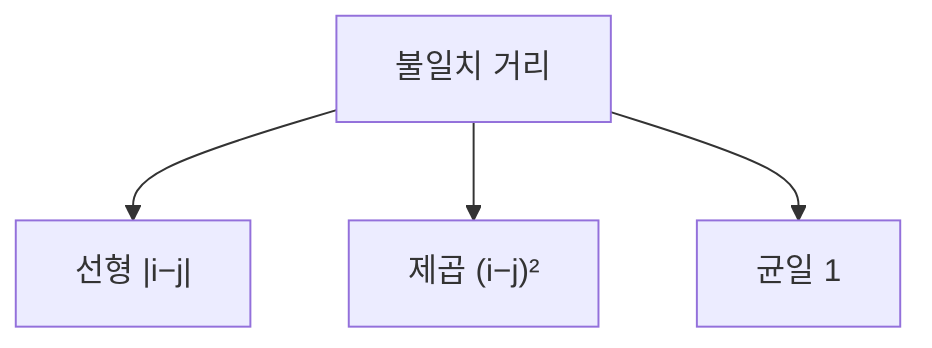

# 가중 kappa

> 등급이 순서가 있는 라벨(1~3단계 등)에서 "한 칸 어긋난 불일치"와 "두 칸 어긋난 불일치"를 다르게 취급해 계산하는 kappa. 선형 가중과 제곱 가중(QWK)이 대표적이다.

## 쉽게 말하면
시험 채점에서 A를 B로 매긴 것과 A를 D로 매긴 것은 둘 다 틀렸지만 크기가 다르다. 가중 kappa는 틀린 정도의 크기를 반영해 일치도를 계산한다.

## 자세히
출처는 위키백과 "Cohen's kappa"(열람, 2차 출처)다.
- **식**: κ_w = 1 − (Σ W_ij Õ_ij) / (Σ W_ij Ẽ_ij). Õ는 관찰 분포(N으로 정규화), Ẽ는 두 평가자의 주변 분포 외적으로 만든 기대 분포, W는 불일치 가중치다.
- **가중치**: 대각선은 0. 선형은 W_ij = |i − j|, 제곱은 W_ij = (i − j)²이며 제곱 가중 kappa를 QWK라 한다. 균일 가중(비대각선 1)이면 가중치 없는 kappa와 같다.
- **언제 쓰나(해석)**: 라벨이 서열형(품질 등급, 심각도 등급)일 때. 명목형(환불/교환/기타)에는 가중치가 의미 없다.
- **한계**: 가중치 선택이 값을 바꾸므로 보고할 때 가중 방식을 명시한다. 분포·범주 수에 따라 kappa가 달라지는 문제는 가중 kappa에도 남는다([kappa의 유병률 문제](#kappa-prevalence-problem)).

## 직접 계산한 가상 예시
품질 등급 3단계(1=낮음, 2=보통, 3=높음)를 두 평가자가 100건에 매긴 교차표(행 A, 열 B)다.

| A \ B | 1 | 2 | 3 |
|---|---|---|---|
| 1 | 40 | 6 | 1 |
| 2 | 5 | 20 | 5 |
| 3 | 1 | 4 | 18 |

- 가중치 없는 κ ≈ 0.656
- 선형 가중 κ ≈ 0.720
- 제곱 가중 κ(QWK) ≈ 0.784
→ 어긋남 대부분이 한 칸 차이라 가중할수록 값이 올라간다. 값은 스크립트로 계산해 확인했다.

## 그림으로 보기

## 예시
- 에세이 점수(1~5점) 채점자 일치도는 제곱 가중 kappa를 흔히 쓴다(일반 관행, 이번에 별도 출처 확인은 안 함).
- 교육 실습: 위 교차표를 스프레드시트에 넣어 세 가지 κ를 계산해 비교.

## 헷갈리는 것과 비교
| 개념 | 차이 |
|---|---|
| 가중 kappa | 등급 간 거리를 반영 |
| 가중치 없는 kappa | 일치/불일치 이분 |
| [Fleiss kappa](#fleiss-kappa) | 평가자 3명 이상 |
| [코헨 카파](#cohens-kappa) | 기본형 |

## 더 읽을거리
- [Wikipedia: Cohen's kappa](https://en.wikipedia.org/wiki/Cohen%27s_kappa) — 가중 kappa 식(열람, 2차 출처)
