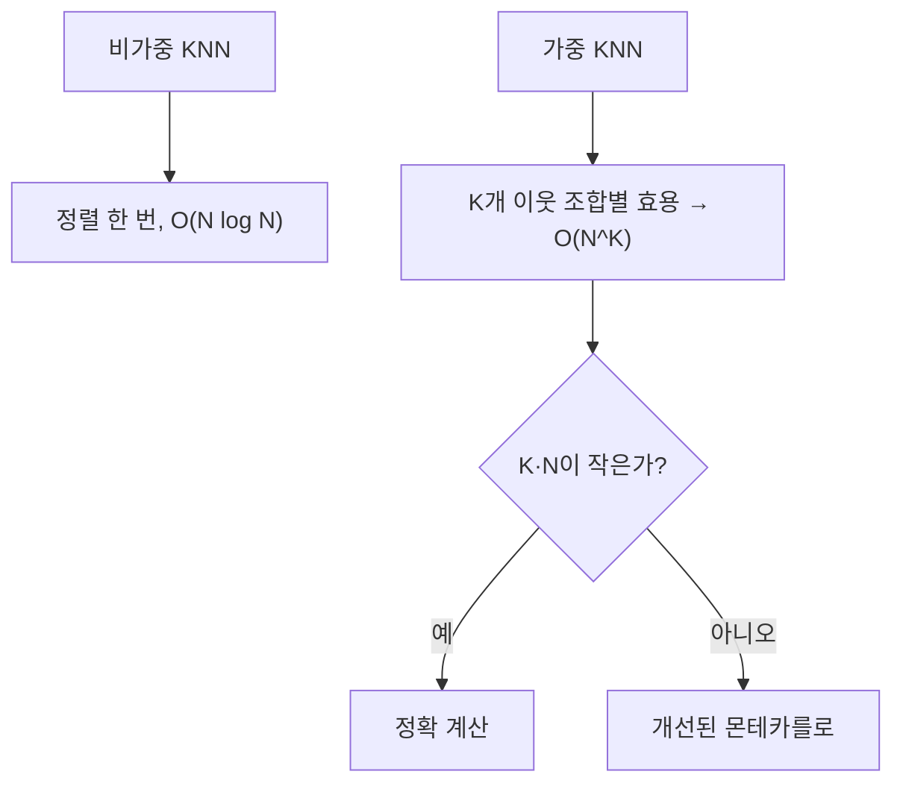
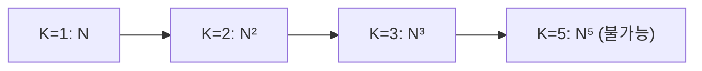

# 가중 KNN 샤플리

> 이웃의 **거리에 따라 가중치를 달리 주는 KNN**(가까울수록 더 큰 영향)에서의 데이터 샤플리. 비가중 KNN처럼 O(N log N)으로는 정확히 못 구하고, **O(N^K)** 로 정확 계산하거나 몬테카를로로 근사해야 한다.

## 쉽게 말하면
이웃 3명의 의견을 똑같이 한 표씩 세던 방식에서, 가까이 사는 이웃의 말에 더 큰 무게를 주는 방식으로 바꾸면 "누가 몇 번째 이웃인지"뿐 아니라 "얼마나 가까운지"도 점수에 들어와 계산이 훨씬 복잡해진다.

## 자세히
(Jia 외, arXiv 1908.08619 본문 확인)
- **효용 정의**: 가중 KNN 분류는 U(S) = Σ_{k=1}^{min(K,|S|)} w_{α_k(S)} · 1[y_{α_k(S)} = y_test], 회귀는 U(S) = −(Σ_k w_{α_k(S)} y_{α_k(S)} − y_test)². w는 이웃-테스트 점 **거리에 따라 달라지는 가중치**(가까울수록 큼).
- **왜 어려운가**: 비가중 경우는 인접한 두 점의 값 차이가 닫힌 형식으로 정리되지만, 가중 경우는 **K개 이웃의 조합에 따라 효용이 달라져** 이런 단순 재귀가 안 된다. 논문은 정확 계산이 **O(N^K)** 로 가능하다는 정리(부록 E.2)를 제시한다. 서로 다른 효용 값의 개수가 "K개 이웃의 가능한 조합 수 N^K"로 상한되기 때문이다(그림 4).
- **복잡도 비교(논문 요약표 + 직접 계산)**
  | 설정 | 정확 계산 복잡도 |
  |---|---|
  | 비가중 KNN 분류/회귀 | O(N log N) |
  | **가중 KNN** | **O(N^K)** |
  | 판매자당 여러 점(M명) | O(M^K) |
  | 일반 효용(기준선) | O(2^N) |
  N^K의 크기(직접 계산)
  | N | K=1 | K=2 | K=3 | K=5 |
  |---|---|---|---|---|
  | 100 | 1×10² | 1×10⁴ | 1×10⁶ | 1×10¹⁰ |
  | 1,000 | 1×10³ | 1×10⁶ | 1×10⁹ | 1×10¹⁵ |
  | 10,000 | 1×10⁴ | 1×10⁸ | 1×10¹² | 1×10²⁰ |
  K가 작고 N이 작을 때만 실용적이다(K=1이면 N, K=2·N=1,000이면 100만). 그래서 논문은 **지수적으로 개선되었지만 정확 계산이 덜 실용적**이라고 평가한다.
- **대안: 개선된 몬테카를로**: 논문은 기존 최신 근사의 표본 복잡도를 강화해 **O(N log²N / log²K) 배** 효율을 높인 알고리즘을 제안한다. 총계산 O(N/ε² log²K)로 합리적인 ε에서 자주 실용적이라고 한다(저자 주장).
- **판매자(여러 점) 확장**: 한 데이터 제공자가 여러 점을 내는 경우 제공자 단위로 가치를 계산한다. 정확 계산 O(M^K), K=1이면 효용이 제공자의 가장 가까운 점에만 의존하는 특성.
- **권장**: 거리 가중이 꼭 필요하지 않으면 **비가중 KNN으로 가치**를 계산하고, 필요하면 K를 작게 하거나 몬테카를로 근사를 쓴다. 가치는 대리 모델 가정에 의존한다([임베딩 공간 가치 평가](#embedding-space-valuation)).

## 그림으로 보기



## 예시
```python
def weighted_knn_utility(S, x_test, y_test, K, weight_fn):
    nb = sorted(S, key=lambda i: dist(x[i], x_test))[:K]
    return sum(weight_fn(dist(x[i], x_test)) * (y[i] == y_test) for i in nb)
# 정확 샤플리는 N^K 조합 → K=2, N=1000에서 약 100만 조합, K=5는 비현실적
```
- 추천 시스템처럼 최근접 이웃이 더 중요한 경우에 가중 KNN을 쓰되, 가치 계산은 비가중으로 근사해 보고 순위가 크게 다른지 확인.

## 헷갈리는 것과 비교
| 항목 | 비가중 | 가중 |
|---|---|---|
| 이웃 영향 | 모두 1/K | 거리 가중 |
| 정확 샤플리 | O(N log N) | O(N^K) |
| 재귀 닫힌 형식 | 있음([KNN 효용](#knn-utility)) | 없음 |
| LSH 근사 | 가능(분류) | 해당 논문 근사 대상 아님 |

## 더 읽을거리
- [Efficient Task-Specific Data Valuation for Nearest Neighbor Algorithms (arXiv 1908.08619)](https://arxiv.org/abs/1908.08619) — 가중 KNN·판매자 확장·개선 몬테카를로(PDF 본문 확인). N^K 표는 이 글의 직접 계산.
