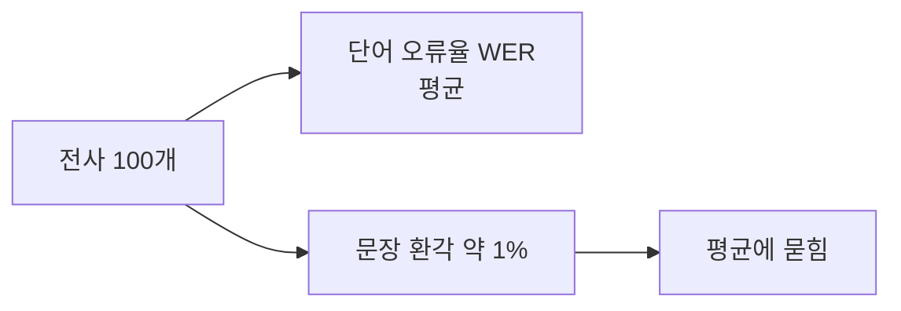
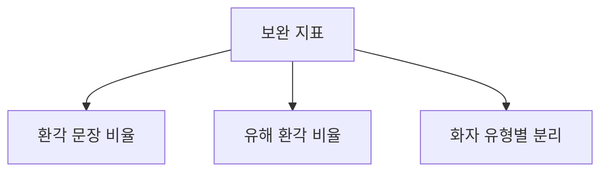

# WER의 한계

> 음성 인식(STT)의 표준 지표인 단어 오류율(WER)은 단어 단위 오류의 평균 비율이라, 오디오에 없는 문장을 통째로 지어내는 환각(hallucination)이 드물게 섞여 있어도 평균에 묻혀 잘 드러나지 않는다.

## 쉽게 말하면
시험 전체 평균 점수가 98점이어도, 한 장에 "없는 내용"이 통째로 적혀 있다면 그 한 장이 환자 안전에 치명적일 수 있다. 평균 점수는 그 한 장을 알려 주지 않는다.

## 자세히
출처는 "Careless Whisper"(arXiv 2402.08021, 초록 열람)와 Whisper의 비음성 구간 환각 연구(arXiv 2501.11378, 초록 열람)다. WER 정의 자체(대체·삭제·삽입 수 ÷ 기준 단어 수)는 일반적으로 알려진 식이며 이번에 열람한 자료의 설명이 아니다.
- **환각 빈도(Careless Whisper)**: OpenAI Whisper 전사의 약 1%에 오디오에 없던 구절이나 문장 전체가 포함됐다. 이 중 38%는 폭력 조장, 부정확한 연관 짓기, 거짓 권위 암시 같은 명시적 해악을 담았다. 실어증 화자, 특히 비발화 정지 시간이 긴 화자에서 대조군보다 불균형적으로 많이 발생했다. 저자들은 업계에 이를 줄이라고 촉구하고 편향이 하류 응용에 이어질 수 있다고 경고한다. 평가 시점 2023년 Whisper 기준이다.
- **비음성 소리가 유발(2501.11378, ICASSP 2025)**: 다양한 소리로 환각을 유도하면 자주 나타나는 환각 집합이 존재했고, 음성에 그런 소리를 더해도 환각이 생긴다. 저자들은 "환각 모음(Bag of Hallucinations)"을 만들어 후처리로 환각 텍스트를 제거하면 WER이 줄고 문제 환각을 막는다고 보고한다. 초록에는 VAD(음성 구간 검출)가 언급되지 않아 이 출처로는 VAD의 효과를 확인할 수 없다.
- **왜 WER이 놓치나(해석)**: 환각 문장은 전체 단어 수에 비하면 작은 비율이라 평균 WER에 크게 반영되지 않을 수 있다. 문장 단위 환각 비율, 유해 환각 비율, 무음 구간 출력 같은 별도 지표가 필요하다. 이 설명은 두 연구가 직접 비교한 결과가 아니라 지표 구조에서 나온 추론이다.
- **보조 지표 제안(해석)**: 전사에서 입력 오디오에 대응하지 않는 구간의 비율, 환각 문장 수, 유해 환각 수, 화자 유형별 분리(예: 비발화 정지가 긴 화자) 보고.

## 그림으로 보기

## 예시
- 진료 녹음에서 침묵 구간에 "감사합니다 시청해 주셔서"처럼 없는 문장이 생기는 경우를 별도 집계(환각 유형은 일반적 예시, 이번 열람 초록에 구체 문장 없음).
- 교육 실습: 전사 샘플 20개에서 WER과 별도로 "오디오에 없는 문장" 개수를 사람 검토로 센다.

## 헷갈리는 것과 비교
| 개념 | 차이 |
|---|---|
| WER | 단어 단위 오류의 평균 비율 |
| 문장 환각률 | 없는 문장이 얼마나 생기는지 |
| [음성 구간 검출(VAD)](#voice-activity-detection) | 무음을 걸러 입력을 줄이는 전처리 |
| [오류율 분모 문제](#error-denominator) | 비율의 분모를 정하는 문제 |

## 더 읽을거리
- [Careless Whisper (arXiv 2402.08021)](https://arxiv.org/abs/2402.08021) — 환각 약 1%(초록 열람)
- [Whisper 비음성 환각 (arXiv 2501.11378)](https://arxiv.org/abs/2501.11378) — Bag of Hallucinations(초록 열람)
