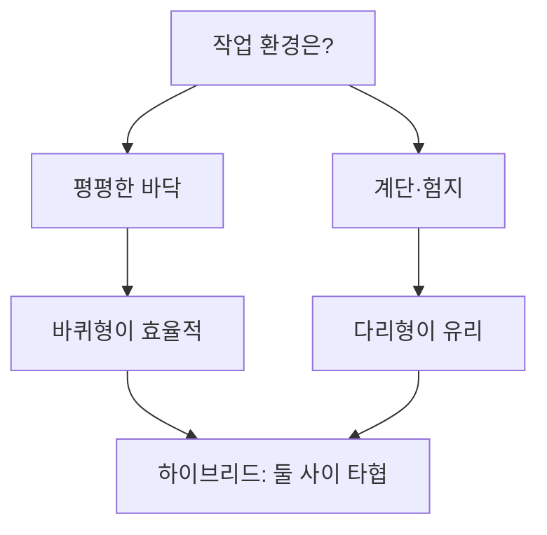

# 바퀴형 vs 다리형

> 로봇이 움직이는 방식의 선택. **바퀴는 평평한 바닥에서 효율적**이고, **다리는 계단·울퉁불퉁한 곳에서 유리**하다. 둘을 섞은 바퀴-다리 하이브리드도 있다.

## 쉽게 말하면
자전거와 두 발 걷기의 차이다. 포장도로에선 자전거가 훨씬 편하지만 계단 앞에서는 걸어야 한다. 일할 곳의 바닥이 어떤지가 몸 모양을 정한다.

## 자세히
(검색 요약 기준. 상용 휴머노이드의 실측 비교는 확인하지 못했고 대부분 학술 프로토타입과 업계 논평이다.)
- 에너지: 이상적인 바퀴는 구르며 에너지를 거의 잃지 않는 반면, 다리는 발이 땅에 닿을 때마다 충격 손실이 생긴다. 그래서 단단하고 평평한 바닥에선 바퀴가 가장 효율적이다.
- 지형: 다리는 계단·단차·불규칙한 면을 넘을 수 있고, 바퀴는 계단과 험지에서 성능이 크게 떨어진다.
- 하이브리드: 2026년 X2-N 논문(저자 주장)은 바퀴-다리 구름 이동이 같은 속도에서 관절 최대 부하와 에너지를 줄일 수 있다고 보고. SWhegPro 연구는 같은 속도에서 바퀴 모드의 비저항이 다리 모드보다 낮았다고 한다.
- 비용: 다리 두 개와 구동계를 합치면 기계·제어 복잡도가 늘고, 완전한 이족 보행의 계단 능력은 부족할 수 있다.
- 실무 프레임(Automate 업계 가이드): 창고처럼 평평하게 설계된 바닥에선 그 손실이 거의 없다. 몸을 작업에 맞춘다.

## 그림으로 보기

## 예시
- 물류 창고: 평평한 바닥이라 바퀴 베이스에 팔 달린 로봇이 합리적.
- 교육: "범용성 vs 효율" 트레이드오프를 업무 도구 선택에 빗대어 설명.

## 헷갈리는 것과 비교
| 개념 | 차이 |
|---|---|
| 바퀴형 | 평지 효율, 지형 제약 |
| 다리형 | 지형 적응, 복잡·충격 손실 |
| [휴머노이드 단가](#humanoid-unit-economics) | 형태 선택이 비용에도 영향 |

## 더 읽을거리
- [Automate: Field Guide to Humanoid Robots](https://www.automate.org/blogs/a-field-guide-to-humanoid-forum-robots-matching-the-body-to-the-task) — 몸과 작업 맞추기(검색 요약).
- [Wikipedia: Robot locomotion](https://en.wikipedia.org/wiki/Robot_locomotion) — 이동 방식 개괄.
