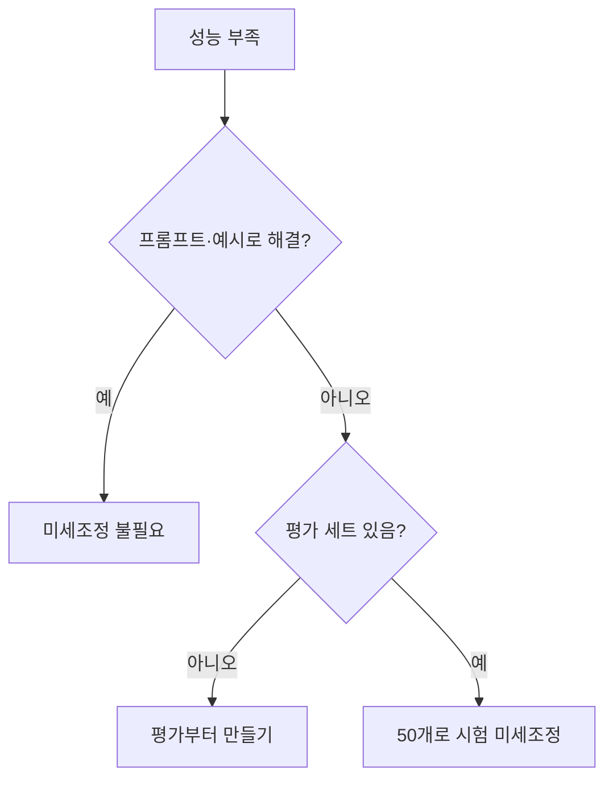

# 미세조정하지 말아야 할 때

> 미세조정은 만능이 아니다. **평가 세트로 효과를 확인하지 못했거나, 50개 예시로도 변화가 없다면** 학습 데이터를 더 늘리기 전에 과제 정의와 프롬프트부터 다시 본다.

## 쉽게 말하면
요리가 맛없는 이유가 레시피(프롬프트)에 있는데 재료만 더 사 오는 것(데이터 추가)은 소용없다. 먼저 레시피를 고친다.

## 자세히
(OpenAI 미세조정 가이드를 직접 읽었다. 문서는 포괄적인 비교표를 주지 않는다.)
- **먼저 평가(문서)**: 미세조정 모델이 기본 모델보다 낫다는 것을 확인할 **evals를 먼저** 만들어 둔다.
- **작게 시작(문서)**: 잘 만든 50개 시연으로 시작. "50개가 영향이 없다면 훈련 데이터를 더 넣기 전에 **과제나 프롬프트를 다시 생각하라**."
- **예시 수 관점(문서)**: 50~100개에서 향상이 보고된다.
- **LIMA의 시사(논문)**: 데이터의 **질과 다양성**이 양보다 중요. 노력이 크므로 목적이 분명할 때만(한계로 논문이 적음).
- **판단 질문(해석)**: ① 프롬프트·few-shot·캐싱으로 해결되지 않나? ② 평가 세트가 있나? ③ 예시를 만들 전문가 시간이 있나? ④ 모델·정책 변경 때 재학습할 여력이 있나?

## 그림으로 보기

## 예시
- 사내 FAQ 봇: 프롬프트와 RAG로 정답률 85%라면 미세조정 전에 오답 분석부터(제안).

## 헷갈리는 것과 비교
| 상황 | 권장 |
|---|---|
| 형식·스타일 고정 필요 | 미세조정 후보 |
| 최신 지식 필요 | RAG |
| 평가 세트 없음 | 평가부터 |

## 더 읽을거리
- [OpenAI — Supervised fine-tuning](https://developers.openai.com/api/docs/guides/supervised-fine-tuning) — 직접 읽음.
