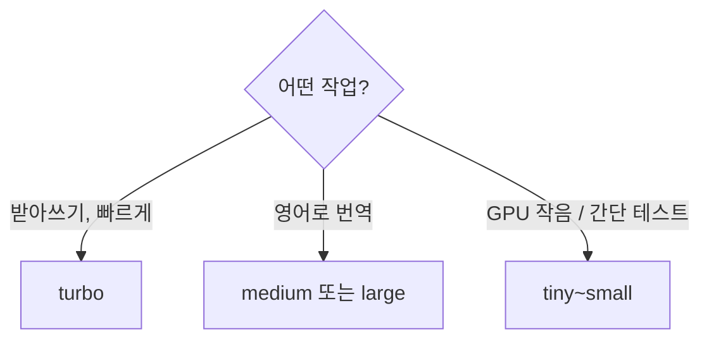

# Whisper

> Whisper는 OpenAI가 공개한 범용 음성 인식(ASR) 모델이다. 다국어 받아쓰기·영어 번역·언어 감지를 한 모델로 하며, 코드와 가중치가 MIT 라이선스라 내 PC에서 무료로 돌릴 수 있다.

## 쉽게 말하면
회의 녹음을 받아 적어 주는 속기사인데, 여러 나라 말을 알아듣고 인터넷 없이 내 컴퓨터에서 일한다. 크기가 다른 속기사 여럿(tiny~large) 중에서 "빠르지만 덜 정확" ~ "느리지만 정확"을 골라 고용하는 셈이다.

## 자세히
- **구조**: 트랜스포머 인코더-디코더. 오디오를 로그-멜 스펙트로그램으로 바꿔 넣고, 30초 창을 밀어 가며 텍스트를 낸다.
- **작업**: 다국어 인식, 영어로의 번역, 언어 식별, 음성 구간 검출.
- **모델 크기**(README 기준, VRAM은 대략치):

| 크기 | 파라미터 | VRAM | 상대 속도 |
|---|---|---|---|
| tiny | 39M | ~1GB | ~10배 |
| base | 74M | ~1GB | ~7배 |
| small | 244M | ~2GB | ~4배 |
| medium | 769M | ~5GB | ~2배 |
| large | 1550M | ~10GB | 1배 |
| turbo | 809M | ~6GB | ~8배 |

- `turbo`는 large-v3를 최적화한 것으로 정확도 손실이 적지만 **번역용으로는 학습되지 않았다**. 번역은 medium·large를 쓴다. 영어 전용(`.en`)은 작은 크기에서 더 낫다.
- 설치: `pip install -U openai-whisper` + 별도 `ffmpeg`. README는 Python 3.8~3.11 기준.
- 정확도는 언어마다 다르다(언어별 WER·CER는 논문 부록).

## 그림으로 보기



## 예시
```bash
pip install -U openai-whisper
whisper meeting.mp3 --model turbo --language Korean
whisper japanese.wav --model medium --language Japanese --task translate
```
회의 녹음을 받아쓴 뒤 LLM에 요약·액션 아이템 추출을 시키는 파이프라인이 대표적 활용이다.

## 헷갈리는 것과 비교
| 개념 | 차이 |
| --- | --- |
| [음성 인식·합성](#speech-asr-tts) | 상위 주제. Whisper는 ASR(음성→글) 쪽 모델 |
| TTS | 글→음성. 방향이 반대 |
| [음성 에이전트](#voice-agent) | ASR·LLM·TTS를 이어 대화하게 만든 시스템 |

## 더 읽을거리
- [openai/whisper (GitHub)](https://github.com/openai/whisper) — 모델 표, 설치, CLI·Python 사용법
