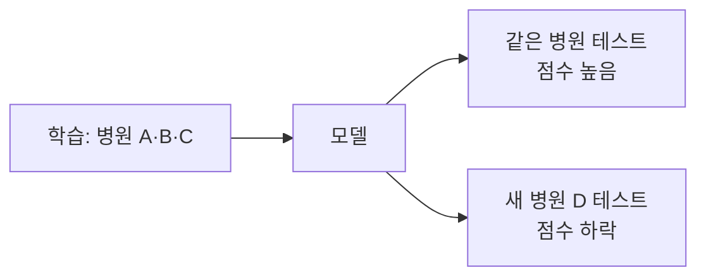
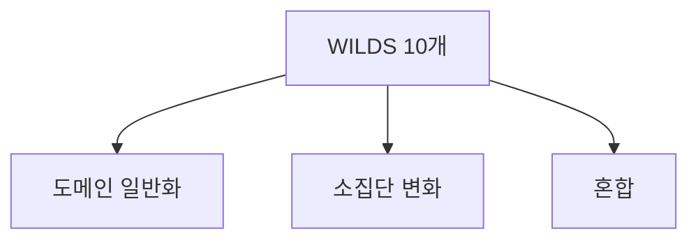

# WILDS 벤치마크

> WILDS는 실제 배포 환경에서 일어나는 **분포 변화**(병원이 바뀌거나, 카메라가 바뀌거나, 시간·지역이 바뀌는 상황) 10개를 모아, 모델이 학습 때와 다른 데이터에서 얼마나 떨어지는지 재는 벤치마크다(Koh, Sagawa 외 21명, arXiv 2012.07421).

## 쉽게 말하면
한 학교 시험 기출만 풀던 학생을 다른 학교 시험장에 보내는 것이다. 같은 과목인데도 문제 스타일이 달라 점수가 뚝 떨어진다. WILDS는 그런 "다른 시험장"을 현실에서 가져온 모음이다.

## 자세히
- **구성(논문 초록·공식 사이트 직접 확인)**: 10개 데이터셋. 변화 유형은 ① 도메인 일반화(새로운 도메인에서 평가, 예: 새 병원·새 카메라) ② 소집단 변화(subpopulation shift, 특정 집단의 성능) ③ 둘의 혼합.
- **데이터셋 예**: iWildCam(카메라 트랩 종 분류, 182 클래스), Camelyon17(병원별 조직 이미지 96×96), RxRx1(실험 배치), OGB-MolPCBA(분자 스캐폴드), GlobalWheat(촬영 세션), CivilComments(언급된 인구 집단, 텍스트), FMoW(연도·지역 위성), PovertyMap(국가·도시/농촌), Amazon(리뷰어), Py150(코드 저장소).
- **핵심 발견(논문 주장)**: 표준 학습은 분포 밖(OOD)에서 분포 내보다 훨씬 나쁘고, 분포 변화용 방법을 써도 격차가 남아 더 견고한 학습법이 필요하다.
- **도구**: 데이터 로딩·기본 모델·표준 평가를 제공하는 오픈소스 패키지. 사이트는 "v2 Update"(arXiv 2112.05090)를 링크하지만 어떤 데이터셋이 바뀌었는지는 확인하지 못했다. 데이터셋별 평가 지표도 사이트 표에는 없었다(보통 최악 도메인 성능을 본다고만 언급).
- **게시 상태**: 논문은 arXiv 프리프린트로 확인했으며 학회명은 이번에 확인하지 않았다.

## 그림으로 보기

## 예시
- 한 병원 데이터로 만든 병리 분류 AI를 다른 병원에 도입하기 전 Camelyon17 유형의 검증을 요구.
- 교육 소재: "데모에서 잘 되던 AI가 현장에서 안 되는 이유"를 설명하는 사례.

## 헷갈리는 것과 비교
| 개념 | 차이 |
|---|---|
| 일반 hold-out 평가 | 학습과 같은 분포의 테스트 |
| WILDS | 현실 분포 변화에서의 OOD 평가 |
| [CheckList 행동 테스트](#checklist-behavioral-testing) | 능력별 행동 점검 |
| [Domino 슬라이스 발견](#domino-slice-discovery) | 약한 슬라이스 자동 발견 |

## 더 읽을거리
- [WILDS (arXiv 2012.07421)](https://arxiv.org/abs/2012.07421) — 논문 초록(직접 확인).
- [WILDS datasets 목록](https://wilds.stanford.edu/datasets/) — 10개 데이터셋 표(직접 확인).
