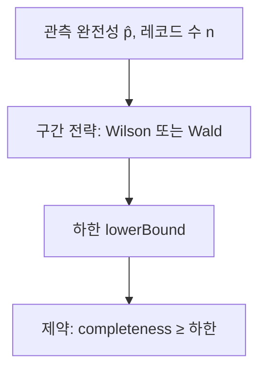
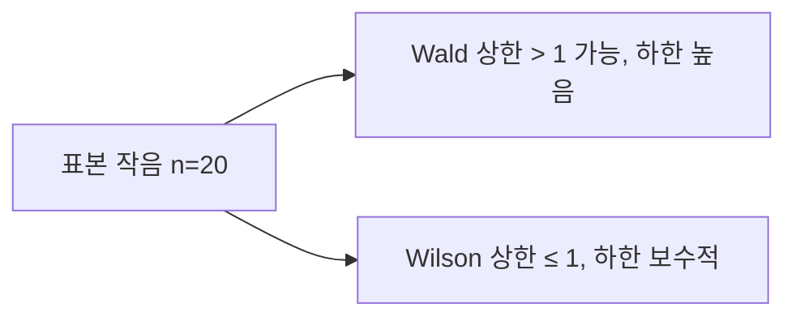

# Wilson 구간 기반 완전성 하한

> 데이터 검증 도구 Deequ가 컬럼의 **완전성(결측 없이 채워진 비율)** 제약을 자동 제안할 때, 관측한 비율을 그대로 쓰지 않고 **신뢰구간의 하한**을 기준선으로 삼는다. 이때 구간 계산법으로 **Wilson 점수 구간**이 권장된다.

## 쉽게 말하면
표본 20명 중 18명(90%)이 응답했다고 해서 "전체 응답률은 정확히 90% 이상"이라고 못 박으면 위험하다. 표본이 작으면 진짜 비율은 더 낮을 수 있으니, "95% 확률로 이 이상"이라는 **보수적인 하한**을 기준선으로 쓴다.

## 자세히
(Deequ GitHub 소스(`awslabs/deequ`, master)의 `RetainCompletenessRule.scala`, `ConfidenceIntervalStrategy.scala`, `WilsonScoreIntervalStrategy.scala`, `WaldIntervalStrategy.scala`를 직접 읽고, 같은 공식을 **파이썬으로 옮겨 계산**했다. Deequ를 실제 실행한 것이 아니라 읽은 코드를 재구현한 값이며, 소스는 확인 시점(2026-11-22)의 master다.)
- **규칙의 동작(소스)**: `RetainCompletenessRule`은 컬럼의 관측 완전성 `p̂`와 레코드 수 `n`을 구간 전략에 넘겨 구간의 **lowerBound**를 목표 완전성으로 삼고, 제약 `completenessConstraint(컬럼, _ >= 목표)`를 제안한다. 적용 조건은 **관측 완전성이 0.2 초과 1.0 미만**일 때뿐이다(100% 채워졌거나 20% 이하면 제안 없음). 설명 문구는 "`<컬럼>` has less than `<(1−목표)×100을 정수 절단>`% missing values".
- **두 가지 구간(소스)**: 신뢰수준 기본 **0.95**(z≈1.96).
  - **Wald**: `p̂ ± z·√(p̂(1−p̂)/n)`. 소스는 이 클래스를 `@deprecated`로 표시하며 "Wilson 사용을 권장", "경계가 [0,1]을 벗어날 수 있고 포괄률(coverage)이 낮으며 표본이 작거나 비율이 0·1에 가까우면 문제"라고 주석한다.
  - **Wilson**: `(p̂ + z²/2n ± z·√(p̂(1−p̂)/n + z²/4n²)) / (1 + z²/n)`. 하한은 소수 둘째 자리로 **내림**, 상한은 **올림**한다.
  - ⚠️ 소스의 `defaultIntervalStrategy`는 확인 시점에 **`WaldIntervalStrategy()`**로 적혀 있었다(`ConfidenceIntervalStrategy.scala`). 권장(Wilson)과 기본값(Wald)이 어긋나 보이므로, 사용 중인 Deequ 버전에서 전략을 명시했는지 확인해야 한다.
- **직접 계산한 비교(95%, 하한/상한)**
  | n | p̂ | Wald | Wilson |
  |---|---|---|---|
  | 20 | 0.90 | 0.76 / **1.04** | 0.69 / 0.98 |
  | 20 | 0.98 | 0.91 / **1.05** | 0.80 / 1.00 |
  | 100 | 0.98 | 0.95 / **1.01** | 0.92 / 1.00 |
  | 1,000 | 0.98 | 0.97 / 0.99 | 0.96 / 0.99 |
  | 100,000 | 0.98 | 0.97 / 0.99 | 0.97 / 0.99 |
  → **표본이 작을수록(n=20) Wald는 상한이 1을 넘는 불가능한 값**(1.04, 1.05)을 내고 **하한이 더 높아(낙관적)** 기준이 빡빡해진다. Wilson은 상한이 1 이내이고 하한이 더 낮아 **보수적**이다(n=20, p̂=0.98: Wald 0.91 vs Wilson 0.80). n이 커지면 두 방법이 수렴한다.
- **실무 의미(해석)**: 작은 표본으로 제안받은 완전성 기준(예: ≥0.91)은 **정상 데이터에서도 자주 실패**할 수 있다. 표본이 작을 때는 Wilson 쪽이 더 느슨한(안전한) 하한을 준다. → [제약 자동 제안](#constraint-suggestion), [자동 제안 사람 검토](#suggestion-human-review)
- **한계**: 이 계산은 소스 공식을 파이썬으로 옮긴 것이다. Deequ의 반올림·검증 로직(`validateInput`)은 열어 보지 못해 완전히 동일하다고 보장하지 못한다.

## 그림으로 보기

## 예시
- 신규 테이블 100행에서 `email` 완전성이 0.98이면 Wilson 하한 0.92, Wald 하한 0.95. 이후 데이터의 결측이 6%가 되어도 Wilson 기준은 통과하지만 Wald 기준은 실패한다.
- 교육 활동: n=20, p̂=0.9로 두 공식을 손(또는 스프레드시트)으로 계산해 상한 1.04의 의미를 토론.

## 헷갈리는 것과 비교
| 개념 | 차이 |
|---|---|
| Wilson 구간 | 소표본·극단 비율에서 안정적 |
| Wald 구간 | 단순 공식. 소표본에서 [0,1] 이탈·낮은 coverage |
| [제약 자동 제안](#constraint-suggestion) | 이 하한을 쓰는 상위 기능 |
| 신뢰구간 하한 vs 관측값 | 관측값은 표본 잡음을 무시 |

## 더 읽을거리
- [Deequ RetainCompletenessRule (GitHub 소스)](https://github.com/awslabs/deequ/blob/master/src/main/scala/com/amazon/deequ/suggestions/rules/RetainCompletenessRule.scala) — 하한 사용과 적용 조건(직접 확인).
- [Deequ WilsonScoreIntervalStrategy (GitHub 소스)](https://github.com/awslabs/deequ/blob/master/src/main/scala/com/amazon/deequ/suggestions/rules/interval/WilsonScoreIntervalStrategy.scala) — Wilson 공식(직접 확인). 표의 수치는 이 공식을 파이썬으로 옮긴 직접 계산이다.
