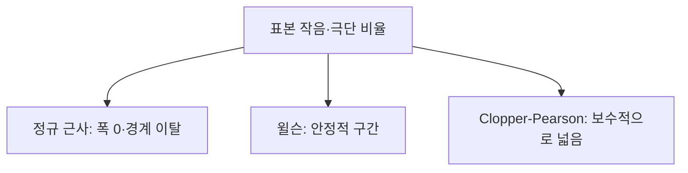

# 윌슨 신뢰구간

> 성공 k번/시도 n번 같은 비율(정확도·재현율·승인율)의 신뢰구간을 구하는 방법이다. 표본이 작거나 비율이 0·1 근처여도 정규 근사보다 훨씬 안정적이어서 AI 평가에서 작은 시험 세트의 점수를 보고할 때 권장된다.

## 쉽게 말하면
"9번 중 7번 맞혔다"는 78%지만 진짜 실력이 78%라고 말하기엔 표본이 너무 작다. 윌슨 구간은 "진짜 실력은 대략 45%~94% 사이일 것"이라고 정직하게 말해 준다. 정규 근사는 "51%~100%"처럼 위쪽이 1에 걸려 이상한 결과를 낼 수 있다.

## 자세히
(statsmodels `proportion_confint` 문서를 직접 열어 확인하고, 같은 함수로 직접 계산해 검증.)
- **정의**: 윌슨 점수(score) 구간. 구간의 중심이 관측 비율이 아니라 약간 0.5 쪽으로 당겨지고, 구간 폭이 표본 수와 비율에 따라 자동 조정된다. 계산 공식: z=1.96일 때 중심 = (p̂ + z²/2n) / (1 + z²/n), 반폭 = z·√(p̂(1−p̂)/n + z²/4n²) / (1 + z²/n).
- **statsmodels 방법 목록(문서)**: `normal`(정규 근사, 기본값), `agresti_coull`, `beta`(Clopper-Pearson), `wilson`, `jeffreys`, `binom_test`. 문서는 `beta`가 최소 1−α 커버리지를 보장하지만 대체로 보수적이고, 다른 방법은 평균적으로 1−α에 가깝지만 일부 경우 낮을 수 있다고 설명한다. `normal`·`agresti_coull`·`wilson`은 [0,1]로 잘린다.
- **직접 계산(statsmodels, 95%)**
  | 관측 | 정규 근사 | 윌슨 | Clopper-Pearson |
  |---|---|---|---|
  | 7/9 | 0.506~1.000 | **0.453~0.937** | 0.400~0.972 |
  | 8/10 | 0.552~1.000 | 0.490~0.943 | 0.444~0.975 |
  | 0/20 | 0.000~0.000 | **0.000~0.161** | 0.000~0.168 |
  | 10/10 | 1.000~1.000 | 0.722~1.000 | 0.692~1.000 |
  | 80/100 | 0.722~0.878 | 0.711~0.867 | 0.708~0.873 |
  작은 표본이나 극단 값에서 정규 근사는 **폭이 0인 구간(0/20, 10/10)** 이나 한쪽이 1에 붙은 구간을 내 부적절하다. 윌슨은 0/20에서도 "진짜 비율이 16%까지 가능"이라고 답하고 10/10에서도 "72% 이상"으로 현실적이다. n=100에서는 세 방법이 비슷해진다.
- **AI 평가에서(제안)**: 시험 세트가 수십~수백 개일 때 정확도·재현율·합격률은 점 추정치와 윌슨 구간을 함께 보고한다. 두 모델의 점수 차이가 구간 겹침 안에 있으면 우열을 단정하지 않는다([작은 시험셋의 변동](#small-test-set-variance), [소규모 데이터 검증 전략](#small-data-validation-strategy)).
- **사용 예**: 희귀 클래스 재현율은 양성 수가 분모이므로 그 수로 구간을 계산([희귀 클래스 기준 시험 크기](#test-set-size-rare-class)).
- **주의**: 윌슨도 독립 시행을 가정한다. 같은 환자·문서에서 나온 샘플은 독립이 아니므로 그룹 단위로 묶어 계산해야 한다([그룹 정의하기](#group-definition)).

## 그림으로 보기



## 예시
```python
from statsmodels.stats.proportion import proportion_confint
lo, hi = proportion_confint(7, 9, alpha=0.05, method="wilson")
print(round(lo, 3), round(hi, 3))   # 0.453 0.937
```
- 사내 챗봇 평가 50문항 중 41개 정답(82%): 윌슨 구간을 함께 적어 "약 69~91%"처럼 보고(계산 방법은 위 코드).

## 헷갈리는 것과 비교
| 개념 | 차이 |
|---|---|
| 윌슨 구간 | 점수 기반, 작은 표본에서 안정적 |
| 정규 근사(Wald) | 단순하지만 극단 비율·작은 n에서 부정확 |
| Clopper-Pearson | 정확하지만 보수적(넓음) |
| 부트스트랩 구간 | 표본을 다시 뽑아 구간 추정(비율 외 지표에도 가능) |

## 더 읽을거리
- [statsmodels: proportion_confint](https://www.statsmodels.org/stable/generated/statsmodels.stats.proportion.proportion_confint.html) — 방법 목록·커버리지 설명(열어 확인).
