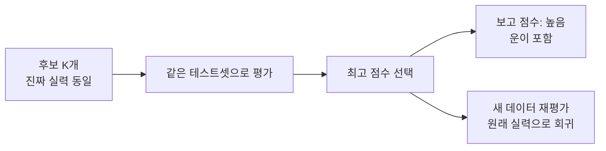
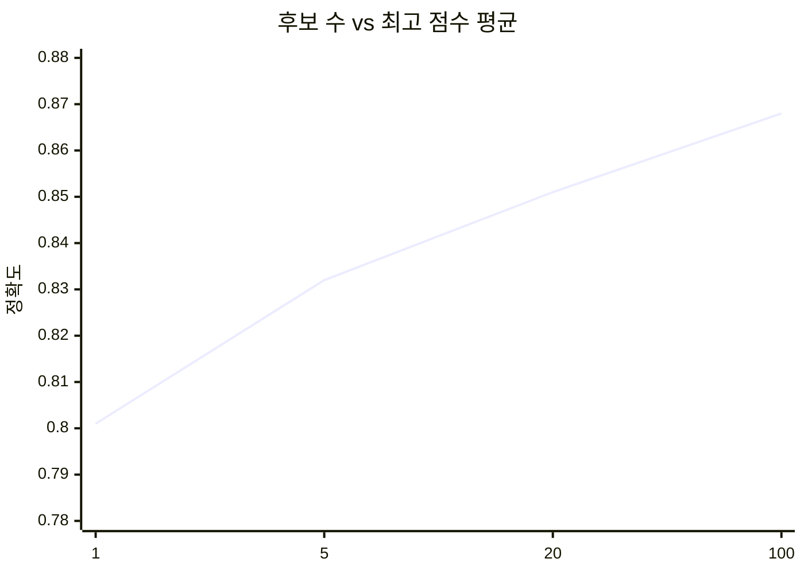

# 승자의 저주

> 여러 후보 중 **평가 점수가 가장 높은 것**을 고르면, 그 점수에는 실력뿐 아니라 운(노이즈)이 얹혀 있어 **새 데이터에서는 평균적으로 더 낮게** 나온다. 후보가 많을수록 과대평가가 커진다.

## 쉽게 말하면
실력이 똑같은 사수 100명에게 10발씩 쏘게 하고 최고 득점자를 "명사수"로 뽑는다. 그 사람은 오늘 운이 좋았을 뿐이라 다음 날 다시 쏘면 평균으로 돌아간다.

## 자세히
- **직접 실행**(numpy 시뮬레이션: 모든 모델의 진짜 정확도 0.80, 테스트 200문항, 5,000회 반복):

| 후보 수 K | 최고 점수의 평균 | 과대평가 |
|---|---|---|
| 1 | 0.801 | +0.001 |
| 5 | 0.832 | +0.032 |
| 20 | 0.851 | +0.051 |
| 100 | 0.868 | +0.068 |

- K=20일 때 고른 모델을 **새 테스트셋**에서 다시 재면 평균 0.800으로 돌아왔다(선택 시 0.851).
- 원인: 점수 = 실력 + 노이즈, 최댓값을 고르는 순간 노이즈가 양(+)인 후보가 뽑힌다. 테스트셋이 작을수록(노이즈 큼), 후보 간 실력 차가 작을수록 심하다.
- **대응**: 선택용(검증)과 보고용(테스트) 데이터를 분리, 후보 수와 시도 횟수를 기록·보고, 테스트셋 키우기, 신뢰구간 함께 제시, 최종 후보는 새 데이터로 재평가.
- 한계: 위 수치는 "모든 후보가 동일 실력"이라는 극단적 가정의 시뮬레이션이다. 실제 후보 간 실력 차가 있으면 과대평가는 이보다 작다.

## 그림으로 보기

## 예시
- 프롬프트 변형 50개를 같은 평가 질문 100개로 시험해 1등을 채택했더니, 운영에서는 점수가 3~5점 낮았다 → 선택용 평가셋과 최종 확인용 평가셋을 분리했어야 한다.
- 리더보드에서 소수점 차로 1등을 한 모델의 우위는 신뢰구간 안에 묻힐 수 있다.

## 헷갈리는 것과 비교
| 개념 | 차이 |
|---|---|
| 승자의 저주 | 최댓값 선택에서 생기는 노이즈 편향 |
| [시드 골라 쓰기](#seed-cherry-picking) | 같은 모델의 시드를 바꿔 좋은 결과만 보고 |
| [머신러닝의 다중 비교](#multiple-comparisons-in-ml) | 시도 횟수가 늘 때 우연한 승리의 확률 |
| [적응적 과적합](#adaptive-overfitting) | 평가셋을 반복 사용하며 서서히 맞춰짐 |

## 더 읽을거리
- [Roelofs et al., A Meta-Analysis of Overfitting in Machine Learning (NeurIPS 2019)](https://papers.nips.cc/paper/2019/hash/ee39e503b6bedf0c98c388b7e8589aca-Abstract.html) — Kaggle 대회 다수를 분석해 반복 사용에도 과적합이 크지 않았다는 결과(해석 주의).
- [Hastie et al., Elements of Statistical Learning](https://hastie.su.domains/ElemStatLearn/) — 모델 선택과 평가의 분리 설명.
