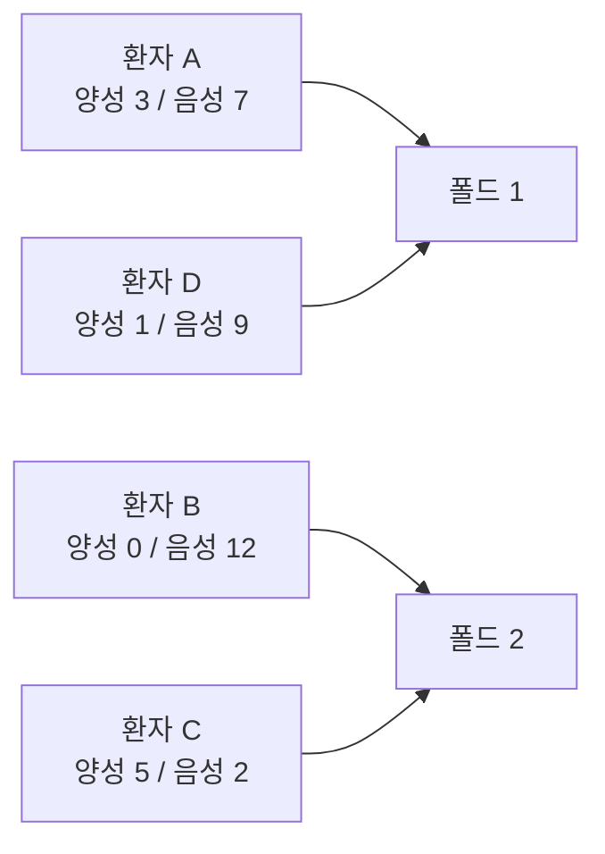
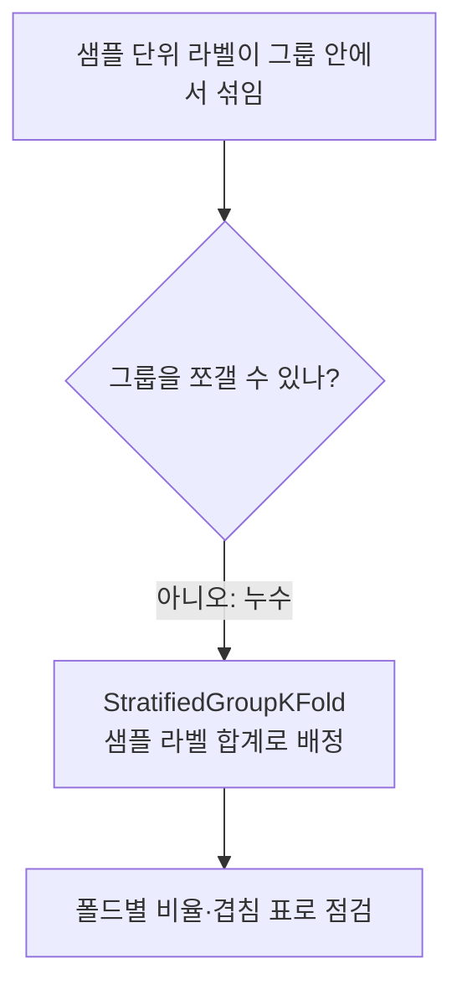

# 그룹 내 라벨 혼재

> 한 그룹(환자·사용자·문서) 안에 양성과 음성 샘플이 **섞여 있는** 상태. 이때 층화는 그룹 단위가 아니라 **샘플 단위 라벨 비율**을 기준으로 하게 되며, 그룹을 쪼갤 수 없으므로 비율 맞추기가 근사에 그친다.

## 쉽게 말하면
한 가족(그룹)을 통째로 한 반에 배정해야 하는데, 가족마다 남녀가 섞여 있다. 가족을 쪼갤 수 없으니 반별 남녀 비율은 "가족 단위로 짜 맞춘 만큼"만 비슷해진다. 가족 안이 한 성별로만 되어 있을 때(그룹 단위 라벨)보다 오히려 맞추기가 쉬운 면도 있다.

## 자세히
- **그룹 라벨 vs 샘플 라벨**: 환자 단위 라벨(환자가 양성이면 모든 샘플 양성)이면 그룹이 곧 클래스라 층화 대상이 명확하다. 샘플 단위 라벨이 환자 안에서 섞이면 `StratifiedGroupKFold`는 그룹의 클래스 분포 합이 폴드 간에 비슷해지도록 그룹을 배정한다(scikit-learn 문서: 그룹을 한 폴드에만 두고 가능한 한 클래스 분포 유지, 최선 노력).
- **직접 실행**(scikit-learn 1.9.1, 합성 데이터: 환자 100명, 환자당 샘플 1~30개, 환자별 양성 확률 Beta(0.5, 2.5), 샘플 1,579개, 양성 비율 0.199, 양·음성이 섞인 환자 59명, 5-폴드):

| 분할기 | 폴드별 테스트 양성 비율 |
|---|---|
| GroupKFold | 0.250, 0.209, 0.123, 0.215, 0.200 |
| StratifiedGroupKFold(shuffle, seed 0) | 0.186, 0.213, 0.203, 0.204, 0.189 |

  30개 시드에서 StratifiedGroupKFold의 폴드 최대 편차 평균은 0.013이었다(전체 비율 대비). 단일 합성 실험이므로 수치는 참고용이다.
- **주의할 점**
  1. 환자마다 양성 경향이 다르면(환자 효과), 층화는 맞아도 폴드별 환자 구성이 달라 점수가 흔들린다. 그룹 단위 분산을 같이 본다.
  2. 그룹 내부 라벨이 섞인 이유가 라벨 노이즈인지 실제 시간 변화인지 확인한다(시간이면 시계열 분할이 맞다).
  3. 분할 후 폴드별 양성 비율과 그룹 겹침 0을 반드시 점검한다.

## 그림으로 보기



## 예시
```python
from sklearn.model_selection import StratifiedGroupKFold
cv = StratifiedGroupKFold(n_splits=5, shuffle=True, random_state=0)
for tr, te in cv.split(X, y, groups=patient_id):
    print(y[te].mean(), len(set(patient_id[tr]) & set(patient_id[te])))
```
- 환자별 여러 번 검사한 기록에서 환자마다 양성 검사가 섞여 있는 경우.

## 헷갈리는 것과 비교
| 개념 | 차이 |
|---|---|
| 그룹 내 라벨 혼재 | 그룹 안에 여러 클래스가 있어 층화가 근사 |
| 그룹 단위 라벨 | 그룹 전체가 한 클래스, 층화 대상이 명확 |
| [층화와 그룹의 충돌](#stratify-vs-group) | 상위 개념: 비율 vs 누수 |
| [그룹 크기 편차](#group-size-skew) | 큰 그룹이 비율을 흔드는 문제 |

## 더 읽을거리
- [StratifiedGroupKFold API](https://scikit-learn.org/stable/modules/generated/sklearn.model_selection.StratifiedGroupKFold.html) — 그룹 보존 + 최선 노력 층화.
- [scikit-learn 교차검증 가이드](https://scikit-learn.org/stable/modules/cross_validation.html) — 그룹 분할기 비교.
