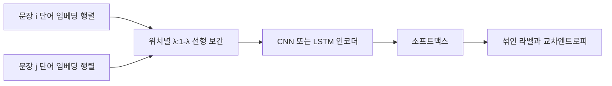
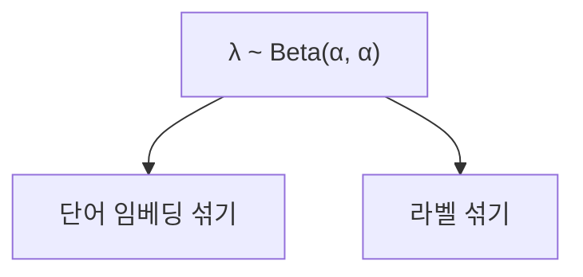

# wordMixup

> 문장 분류에서 두 문장의 **단어 임베딩 행렬을 단어 위치별로 선형 보간**하고 라벨도 같은 비율로 섞어 새 학습 샘플을 만드는 Mixup 변형이다(Guo et al., arXiv 1905.08941).

## 쉽게 말하면
두 문장을 길이가 같게 맞춘 뒤, 첫 번째 단어끼리, 두 번째 단어끼리 "0.7 : 0.3"처럼 물감 섞듯 섞는다. 정답 라벨도 "긍정 70% + 부정 30%"처럼 같은 비율로 섞어 모델에게 준다.

## 자세히
- 원조 Mixup(이미지): 샘플 쌍 (x_i, y_i), (x_j, y_j)를 x̃ = λx_i + (1−λ)x_j, ỹ = λy_i + (1−λ)y_j로 섞는다. λ는 Beta(α, α)에서 뽑으며 α=1이면 균등분포다.
- wordMixup: 모든 문장을 0으로 패딩해 길이를 맞춘 뒤, 문장을 N×d 행렬 B(행 = 단어 임베딩)로 보고 **각 단어 위치 t마다 B̃_t = λB_t^i + (1−λ)B_t^j**를 계산한다. 섞은 행렬을 CNN·LSTM 인코더에 넣고 섞은 라벨로 교차엔트로피를 최소화한다.
- 같은 미니배치 안에서 한 샘플을 무작위 짝과 섞는 방식으로 계산 비용이 낮다.
- 논문 설정: α=1, 데이터 TREC·SST-1·SST-2·Subj·MR 5종, 10회 평균. 드롭아웃·L2는 원 Mixup처럼 쓰지 않았다.
- 결과(RandomTune 임베딩, 정확도 %, 논문 Table 2·3): CNN 기준 Subj 90.6 → 92.9, MR 75.5 → 78.0, TREC 90.2 → 90.9. LSTM 기준 TREC 86.5 → 90.5, SST-2 84.4 → 86.3.
- 한계: 위치별로 섞기 때문에 서로 다른 문장의 단어 순서가 어긋나 문법적으로 말이 안 되는 "문장"이 된다. 임베딩 공간의 연속 벡터라서 사람이 읽을 수 있는 텍스트가 아니다(해석). 또 섞은 결과가 임베딩 학습 방식(고정/학습)에 따라 다르게 작동해 논문도 네 가지 설정을 비교했다.

## 그림으로 보기

## 예시
- 영화 리뷰 감성 분류(MR): 긍정 리뷰와 부정 리뷰의 임베딩을 λ=0.6으로 섞고 라벨을 [0.6, 0.4]로 학습.
- 교육: "텍스트는 이어 붙이거나 바꾸는 것만 증강인 줄 알았는데, 벡터를 섞어도 증강이 된다"는 예.

## 헷갈리는 것과 비교
| 개념 | 차이 |
|---|---|
| wordMixup | 입력 단계(단어 임베딩)에서 섞음 |
| [senMixup](#senmixup) | 인코더가 만든 문장 벡터에서 섞음 |
| 이미지 Mixup | 픽셀을 섞음 |
| [텍스트용 Mixup](#mixup-for-text) | 상위 개념 |

## 더 읽을거리
- [Augmenting Data with Mixup for Sentence Classification: An Empirical Study](https://arxiv.org/abs/1905.08941) — 2~3장과 Table 2·3 PDF 텍스트로 읽음.
