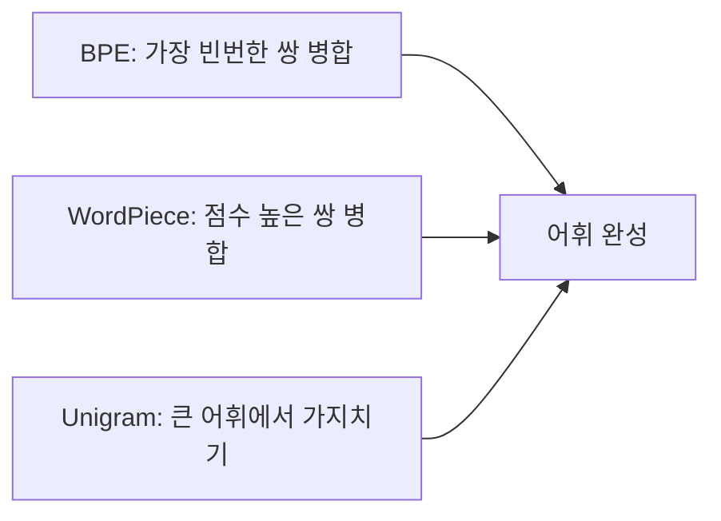
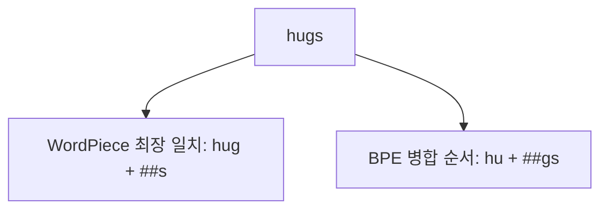

# WordPiece와 Unigram

> **WordPiece**와 **Unigram**은 BPE와 다른 서브워드 어휘 학습 방식이다. WordPiece는 BERT용으로 쌍을 **점수**로 고르고, Unigram은 큰 어휘에서 **가지치기**로 줄여 간다.

## 쉽게 말하면
BPE가 "자주 붙는 블록부터 접착"한다면, WordPiece는 "붙였을 때 정말 의미 있는 조합"을 고르고, Unigram은 일단 블록을 잔뜩 만든 뒤 쓸모없는 것부터 버린다.

## 자세히
(Hugging Face LLM 코스 6장 확인)
- **WordPiece**: Google이 BERT 사전학습용으로 개발(DistilBERT, MobileBERT 등이 재사용). 단어를 글자로 나누고 첫 글자 이후에 `##` 접두어를 붙인다(`w ##o ##r ##d`). 병합 쌍을 **빈도가 아니라 "쌍 빈도 ÷ 두 부분 빈도의 곱"** 으로 점수화해, 각 부분이 드문 쌍을 먼저 합친다. 최종 어휘만 보관하고 병합 규칙은 보관하지 않는다. 토큰화는 **최장 일치**: 앞에서부터 어휘에 있는 가장 긴 조각을 취하고 나머지에 `##`을 붙여 반복. 예: "hugs" → `hug ##s`(BPE 규칙 순서 적용이면 `hu ##gs`). 일치가 없으면 **단어 전체가 [UNK]**(BPE는 해당 글자만 미등록). 구글이 학습 코드를 공개하지 않아 설명은 문헌 기반이며 정확하지 않을 수 있다.
- **Unigram**: 병합이 아니라 **큰 초기 어휘(모든 부분 문자열 또는 BPE 결과)에서 제거**한다. 각 토큰을 제거했을 때 코퍼스 손실이 얼마나 오르는지 계산해 영향이 적은 토큰을 라운드마다 10~20% 제거, 목표 크기까지 반복. 기본 글자는 지우지 않아 모든 단어를 쪼갤 수 있다. 토큰을 독립으로 보고 분할 확률 = 토큰 확률의 곱이라 토큰 수가 적은 분할이 유리하며, **비터비 알고리즘**으로 최고 점수 분할을 찾는다.
- **SentencePiece**: 공백을 포함한 원시 문자열로 다뤄 띄어쓰기 없는 언어도 처리. ALBERT·T5·mBART·Big Bird·XLNet이 Unigram을 쓴다.

## 그림으로 보기



## 예시
```python
from transformers import AutoTokenizer
tok = AutoTokenizer.from_pretrained("bert-base-uncased")  # WordPiece
print(tok.tokenize("tokenization"))   # ## 접두어 조각 확인
```

## 헷갈리는 것과 비교
| 방식 | 어휘 만드는 법 | 대표 모델 |
|---|---|---|
| BPE | 빈번한 쌍 병합 | GPT-2 등 |
| WordPiece | 점수 기반 병합 | BERT |
| Unigram | 큰 어휘 가지치기 | T5, ALBERT 등 |
| [토큰화](#tokenization) | 이 방식들을 쓰는 상위 개념 | |

## 더 읽을거리
- [HF LLM 코스: WordPiece](https://huggingface.co/learn/llm-course/chapter6/6)
- [HF LLM 코스: Unigram](https://huggingface.co/learn/llm-course/chapter6/7)
