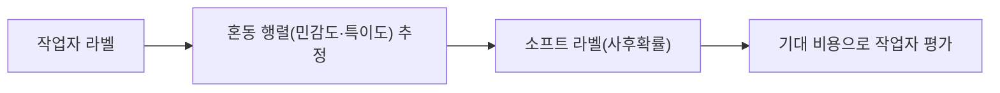
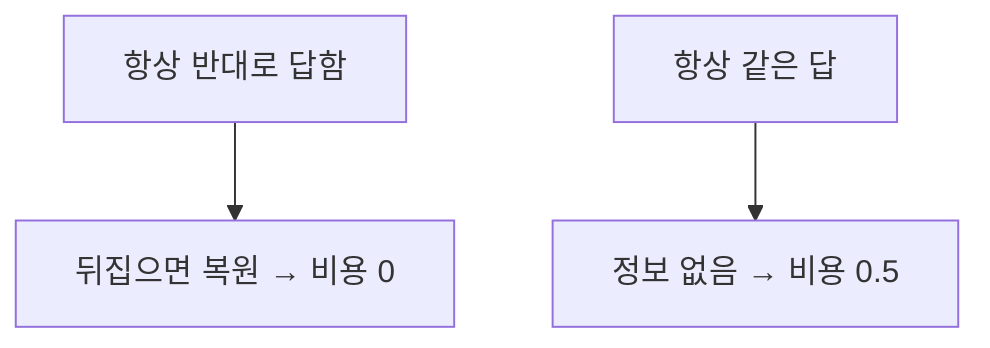

# 작업자 편향 재보정

> 작업자의 라벨에 체계적 편향(항상 반대로 답하거나 한쪽으로 치우침)이 있어도 그 습관을 추정해 뒤집어 쓰면 쓸모 있는 정보가 된다. 오류율만 보고 작업자를 내치면 이런 "편향됐지만 성실한" 작업자를 잃는다.

## 쉽게 말하면
항상 정답과 반대로 말하는 사람의 말은 정반대로 해석하면 완벽한 정보다. 반면 아무 말이나 하는 사람은 아무 정보도 없다. 편향과 무작위는 다르다.

## 자세히
(Raykar 외 JMLR 2010과 Wang & Ipeirotis NYU 워킹페이퍼 2013을 하위 에이전트가 원문으로 읽은 노트 기준. 2010 HCOMP 논문은 열지 못해 미확인.)
- **Raykar 외 "Learning From Crowds"**: 작업자 j를 **민감도 α_j = Pr[y_j=1|y=1]**와 **특이도 β_j = Pr[y_j=0|y=0]**로 모델링(절대 정답 없이). EM으로 분류기·α·β·숨은 라벨을 함께 학습. E단계의 사후확률 μ_i = Pr[y_i=1|라벨, x]가 **소프트 확률 라벨**이다. 로그오즈 통찰: logit(μ_i) = w'x + c + Σ_j y_j^i [logit(α_j) + logit(β_j)] — 라벨의 가중 결합이며 가중치는 logit(α_j)+logit(β_j).
- **실험**: 시뮬레이션 5명 영상의학과 의사(전문가 2·초보 3), AUC가 다수결 대비 약 3.5% 높음(추정 정답 기준 약 3%), 다수결은 3명인 초보를 따라간다. 유방 MRI(병변 75개, 악성 28·양성 47, 의사 4명, 특징 8개)에서 교차검증 AUC 약 6% 높음.
- **Wang & Ipeirotis**: 작업자별 혼동 행렬을 EM으로 추정하고 하드 라벨을 **소프트 라벨**(사전확률×혼동 확률을 정규화)로 바꾼다. 소프트 라벨 p의 기대 비용 ExpCost(p) = min_j Σ_i p_i·c_ij, 작업자 비용은 평균 ExpCost. 예: 항상 반대로 답하는 작업자 A는 비용 0(복원 가능한 편향), 항상 "포르노"라고만 답하는 스패머는 <0.5, 0.5>로 정보가 없어 비용이 가장 높은 쪽(0.5).
- **Snow 외 2008의 방식**: 소량 골드로 편향을 추정해 가중 투표(평균 +0.6%, RTE +4.0%).
- **운영(제안)**: 골드 문항으로 작업자별 혼동 행렬을 주기적으로 갱신하고, 비용 기준으로 작업자를 평가한다.

## 그림으로 보기

## 예시
- 한 라벨러가 "중립"을 늘 "부정"으로 적으면 혼동 행렬로 보정해 라벨을 되살린다.
- 교육 활용: 거짓말쟁이의 말을 뒤집어 진실을 알아내는 퍼즐로 소개.

## 헷갈리는 것과 비교
| 개념 | 차이 |
|---|---|
| 편향 재보정 | 체계적 오류를 추정해 교정 |
| 스패머 | 정보 없는 무작위/고정 답 |
| [Dawid-Skene](#dawid-skene) | 같은 계열의 추정 모델 |

## 더 읽을거리
- [Learning From Crowds (JMLR 11)](https://www.jmlr.org/papers/volume11/raykar10a/raykar10a.pdf) — 민감도·특이도 모델.
- [A Framework for Quality Assurance in Crowdsourcing (NYU)](https://archive.nyu.edu/bitstream/2451/31833/4/Framework%20for%20QA%20in%20Crowdsourcing.pdf) — 소프트 라벨·기대 비용.
