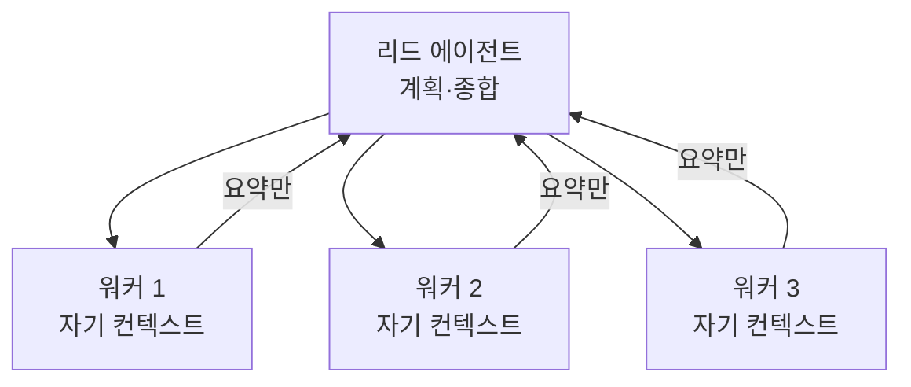
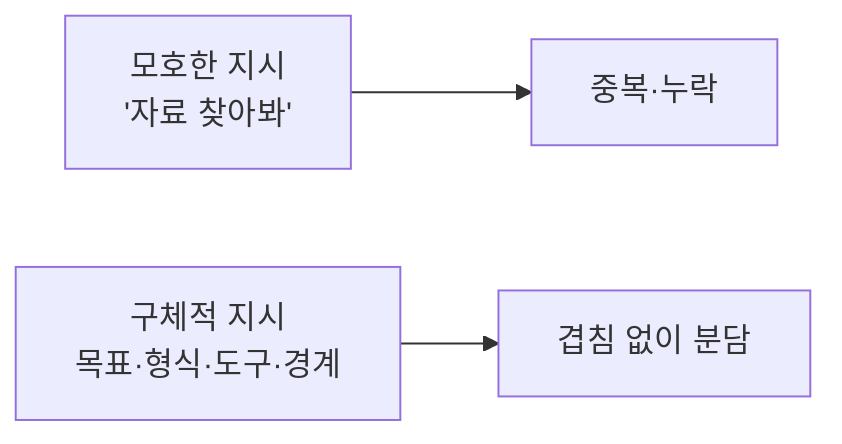

# 워커의 컨텍스트 분리

> 오케스트레이터-워커 구조에서 **각 워커(하위 에이전트)가 자기만의 깨끗한 컨텍스트 창에서 일하고, 결과 요약만 돌려주게 하는** 설계. 메인 에이전트의 컨텍스트가 검색 결과·로그로 부풀지 않고, 워커가 서로의 정보에 오염되지 않으며, **병렬 처리**도 가능해진다.

## 쉽게 말하면
팀장이 조사원 세 명에게 서로 다른 주제를 맡기면, 각자 자기 책상에서 자료 수십 장을 읽고 와서 "핵심 한 장"만 팀장 책상에 올린다. 팀장 책상은 깨끗하고, 조사원끼리 자료가 섞이지 않는다.

## 자세히
(Anthropic Engineering, "How we built our multi-agent research system" 요약)
- **구조**: 리드 에이전트(문서 기준 Claude Opus 4)가 계획을 세우고 **병렬 하위 에이전트**(Claude Sonnet 4)를 띄운다. **각 하위 에이전트는 자기 컨텍스트 창**을 가진다.
- **보고된 효과**(Anthropic 내부 평가, 해당 시스템·모델·시점 기준):
  - 내부 연구 평가에서 단일 Opus 4 에이전트보다 **90.2% 더 좋은 성능**.
  - BrowseComp에서 성능 분산의 **95%** 를 세 요인이 설명했고, 그중 **토큰 사용량만 80%**. 즉 **컨텍스트를 분산해 더 많은 토큰을 쓸 수 있게 하는 것**이 성능의 큰 부분이라는 해석.
  - 복잡한 질의에서 병렬화로 연구 시간을 **최대 90%** 줄였다.
- **비용**: 멀티 에이전트는 채팅의 약 **15배 토큰**을 쓴다(단일 에이전트는 약 4배). 성능과 비용의 교환이다.
- **분리가 잘 작동하려면 — 위임 지시가 구체적이어야 한다**: 모호한 작업 설명은 **중복 작업과 누락**을 낳았다. 각 하위 에이전트에게 **명확한 목표, 출력 형식, 도구 사용 안내, 작업 경계**를 준다.
- **노력 규모 규칙**(문서 예): 단순 사실 확인은 에이전트 1개·도구 호출 3~10번, 직접 비교는 하위 에이전트 2~4개·각 10~15회, 복잡한 연구는 10개 이상으로 책임을 나눔. 초기 시스템은 단순한 질의에 하위 에이전트 50개를 띄우는 실수도 했다.
- **함정**: ① 리드가 하위 에이전트를 **동기적으로** 기다리면 병목, ② 워커가 서로 같은 일을 반복, ③ 워커의 반환 요약이 길면 리드 컨텍스트가 다시 참(요약 길이 제한 필요), ④ 격리된 만큼 **공유 맥락**(전체 목표, 용어)을 지시문에 일부러 넣어야 함.
- Claude Code의 서브에이전트도 같은 원리다([서브에이전트](#subagents)): 별도 컨텍스트에서 일하고 요약만 반환.

## 그림으로 보기



## 예시
```markdown
# 워커 위임 지시 (예시)
- 목표: 2024~2026년 국내 AI 교육 정책 변화를 조사
- 출력: 항목별 3줄 요약 + 출처 URL (최대 300단어)
- 도구: 웹 검색만 사용, 유료 DB 접근 금지
- 경계: 해외 사례는 다른 워커가 담당 — 다루지 말 것
```
- 교육 포인트: 팀 프로젝트에서 "각자 맡은 범위·산출물 형식·경계"를 먼저 정하는 것과 같다.

## 헷갈리는 것과 비교
| 개념 | 차이 |
|---|---|
| 컨텍스트 분리 | 워커마다 별도 창, 요약만 공유 |
| 공유 컨텍스트 | 모든 에이전트가 같은 대화를 봄(오염·비대) |
| [서브에이전트](#subagents) | 실제 구현 수단 |
| [오케스트레이터-워커](#orchestrator-workers) | 이 분리를 쓰는 상위 패턴 |

## 더 읽을거리
- [Anthropic: How we built our multi-agent research system](https://www.anthropic.com/engineering/multi-agent-research-system) — 구조·수치·교훈.
