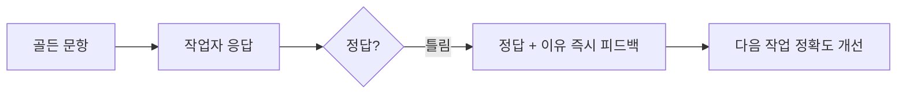
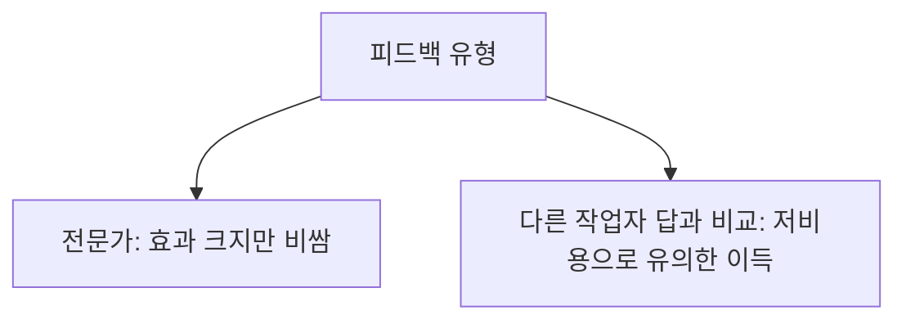

# 작업자 피드백 루프

> 작업자 피드백 루프는 작업자가 골든 문항이나 검수에서 틀렸을 때 정답과 이유를 알려 줘서, 점검이 곧 교육이 되게 만드는 순환이다. 판정만 하고 끝내는 점검보다 장기 품질이 오를 수 있다.

## 쉽게 말하면
퀴즈를 채점만 하고 돌려주지 않으면 학생은 왜 틀렸는지 모르고, 정답과 이유를 알려 주면 다음 퀴즈 점수가 오른다.

## 자세히
- **연구 근거(직접 초록 확인, Mamykina 외 2016, "Learning from the Crowd")**: 이전 연구는 정확도 피드백이 작업자 성능을 높일 수 있다고 보였지만, 특히 전문가가 만든 피드백은 비싸고 확장하기 어렵다. MTurk 작업자가 식사의 영양 구성을 추정하는 과제에서 전문가 피드백, 오류 설명이 있는 직접 정확도 평가, 다른 작업자들의 해답과의 비교라는 세 방식을 비교했다. 전문가 피드백이 정확도를 크게 올렸고, 다른 사람들의 다양한 해답과 그 빈도를 보며 자신의 답을 비교하는 방식도 정확도를 유의하게 높였다. 후자는 저비용이라 매력적이라고 한다.
- **검색 결과로 확인한 다른 연구(요약만)**: Shepherd(CSCW 2012)는 적시의 과제별 피드백이 작업자의 학습·지속·결과 품질을 돕는지를 시험했고, 한 AAAI 연구는 이미지 관련도 과제에서 피드백이 정확도를 올렸고(평균 0.81→0.87 vs 피드백 있을 때 0.86→0.89) 피드백이 품질에 부정적이라는 증거는 충분하지 않았다고 한다. 본문은 열어 보지 않았다.
- **한계(직접 확인한 다른 연구)**: 장기 데이터 연구(arXiv 1609.04855)는 작업자 품질이 시간이 가도 매우 일정하고, 기준 미만 작업자는 노력을 늘리기보다 떠난다고 보고한다. 피드백이 효과를 내는 환경과 그렇지 않은 환경이 있다는 뜻이므로 내 데이터에서 직접 시험해야 한다(해석).
- **루프 설계(해석)**: ① 골든에서 틀리면 즉시 정답과 한 줄 이유를 보여 줌 ② 비용을 낮추려면 "다른 작업자들의 답 분포와 내 답 비교" 같은 자동 피드백 ③ 반복해서 틀리는 클래스는 [주석자 품질 통계](#annotator-quality-stats)의 `worst_class`로 모아 맞춤 교육 ④ 골든 유출 위험이 있으므로 이유 설명이 정답 외우기로 변하지 않게 풀을 교체([골든 유출과 교체](#golden-leak-rotation)) ⑤ 피드백 유무로 소규모 A/B를 해 효과를 확인.

## 그림으로 보기

## 예시
- 골든 문항에서 틀린 작업자에게 "정답은 중립입니다. 이유: 긍정 표현이 없음" 팝업과 함께 다른 작업자 80%의 선택 분포를 보여 준다.
- 교육 활용: 피드백을 주는 조와 안 주는 조의 다음 라벨링 정확도를 비교한다.

## 헷갈리는 것과 비교
| 개념 | 차이 |
| --- | --- |
| 작업자 피드백 루프 | 점검을 교육에 연결 |
| [스패머 탐지](#spammer-detection) | 부정직한 작업자를 거름 |
| [라벨러 훈련 라운드](#annotator-training-rounds) | 사전 교육·시험 반복 |
| [골든 유출과 교체](#golden-leak-rotation) | 피드백 시 생기는 암기 위험 관리 |

## 더 읽을거리
- [Learning from the Crowd: Observational Learning in Crowdsourcing Communities (Mamykina 외, 2016)](https://www.eecs.harvard.edu/~kgajos/papers/2016/mamykina16learning.pdf) — 전문가·동료 비교 피드백의 효과
- [A Glimpse Far into the Future (arXiv 1609.04855)](https://arxiv.org/abs/1609.04855) — 장기 작업자 품질
