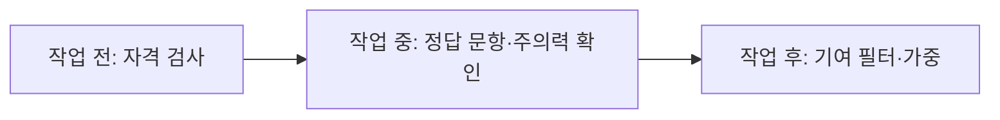
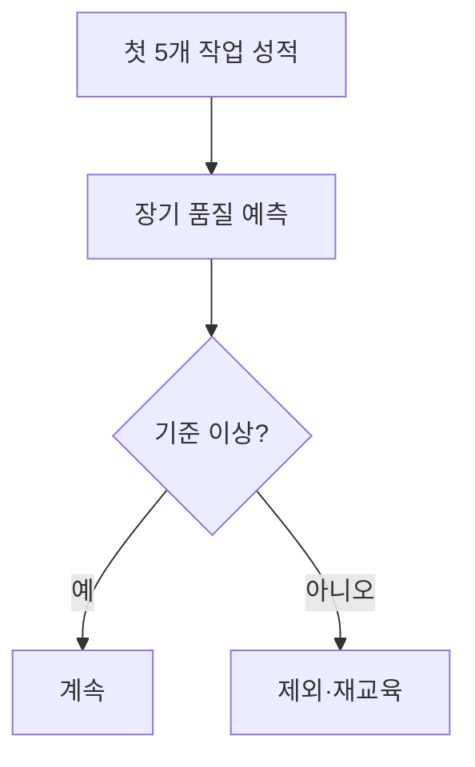

# 작업자 품질 관리

> 작업자 품질 관리는 크라우드소싱 라벨링에서 작업 전(자격 검사)·작업 중(정답 문항·주의력 확인)·작업 후(기여 필터링) 단계로 나눠 믿을 만한 작업자의 라벨만 쓰도록 거르는 일이다.

## 쉽게 말하면
식당 아르바이트를 뽑을 때 면접(작업 전), 근무 중 확인(작업 중), 근무 평가 후 재계약(작업 후)을 하는 것과 같다. 한 단계만으로는 불성실한 사람을 다 걸러 내기 어렵다.

## 자세히
- **세 단계(arXiv 검색 결과 요약, 일부 논문 초록만 직접 확인)**: 작업 전은 교육·자격 평가, 작업 중은 정답(gold) 문항과 주의력 확인, 작업 후는 기여분 필터링이다. 정답 문항 비교는 흔한 필터링 방식이고, 검증 점수는 일정 기간의 최근 문항 비율로 구하며 한 번의 부주의로 바로 거절하지 않는 운영 사례가 있다. 이 부분은 검색 요약이며 수치는 확인하지 못했다.
- **직접 열어 본 논문(arXiv 1609.04855)**: MTurk 작업자 약 900만 개 라벨(세 개의 장기 데이터)을 분석했더니, 반복 작업을 오래 해도 작업자의 품질은 매우 일정했다. 품질 기준을 달리한 실험에서 기준 이상 작업자는 평소 품질을 유지했고 기준 미만 작업자는 노력을 늘리기보다 스스로 떠났다. 처음 5개 작업 성적이 장기 품질을 예측한다.
- **한계(검색 요약)**: 단순한 주의력 확인은 일반 문항과 구분하기 쉬워서 확인만 통과하고 실제 작업은 부실한 경우가 있다. 정답 문항은 전문가가 필요해 비싸고, 소수 정답으로는 작업자 추정이 부정확할 수 있다.
- **운영(해석)**: ① 시작 시 소규모 자격 시험 ② 작업 중 정답 문항을 일반 문항과 섞고 이동 평균으로 판단 ③ 초반 몇 개 성적으로 이른 선별(위 연구 근거) ④ 낮은 작업자의 라벨은 삭제하지 말고 가중치를 낮추거나 재검수([주석자 품질 통계](#annotator-quality-stats)).

## 그림으로 보기

## 예시
- 라벨링 1,000건당 정답 문항 50건을 섞어 최근 30개 정답 문항 정확도를 이동 평균으로 본다(정책 예시).
- 교육 활용: 학습자 일부에게 일부러 쉬운 정답 문항을 섞어 주고 통과율을 비교한다.

## 헷갈리는 것과 비교
| 개념 | 차이 |
| --- | --- |
| 작업자 품질 관리 | 사람을 거르거나 가중 |
| [과반 판정 임계값](#majority-vote-threshold) | 라벨을 합치는 규칙 |
| [주석자 품질 통계](#annotator-quality-stats) | 사후 통계로 사람 평가 |
| [CROWDLAB](#crowdlab) | 작업자 신뢰도를 반영한 합의 추정 |

## 더 읽을거리
- [A Glimpse Far into the Future: Understanding Long-term Crowd Worker Quality (arXiv 1609.04855)](https://arxiv.org/abs/1609.04855) — 약 900만 라벨 분석, 첫 5개 작업 예측력
