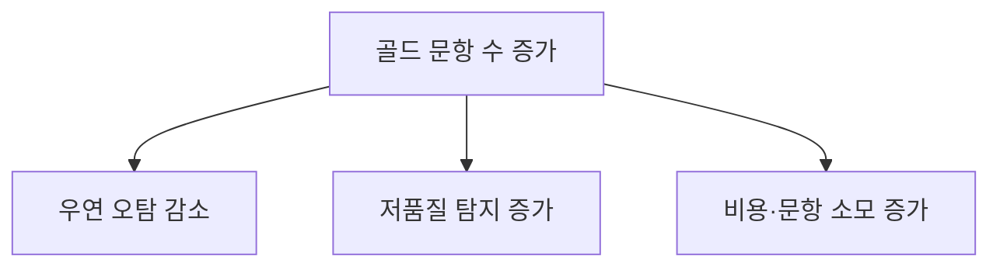

# 작업자 품질 골드 문항

> 정답이 이미 확실한 문항(골드 문항)을 작업 중에 섞어 넣고, 라벨러가 그 문항을 얼마나 맞히는지로 라벨러별 정확도를 추적하는 품질 관리 방법이다. 기준 미달 라벨러는 교육하거나 제외하고, 그 정확도로 라벨을 보정할 수도 있다.

## 쉽게 말하면
운전면허 도로주행 시험 중간중간에 시험관이 정답을 아는 상황(예: 신호등이 빨간불)을 끼워 넣어 응시자가 제대로 반응하는지 보는 것과 같다. 모든 걸 일일이 채점하지 않아도 몇 개의 확실한 문제로 응시자의 신뢰도를 알 수 있다.

## 자세히
(Snow 등 EMNLP 2008 논문 PDF 본문 5절을 직접 확인하고, 표본 크기별 탐지 성능은 직접 시뮬레이션.)
- **라벨러 품질은 편차가 크다(논문)**: 매우 정확한 사람, 부주의한 사람, 아주 잡음 많은 소수가 섞여 있고, 일부 소수가 작업의 대부분을 하는 경우가 많다. 그래서 고물량·저품질 작업자를 찾아내 통제하면 전체 품질이 오를 수 있다.
- **품질을 높이는 세 방법(논문)**: ① 더 많은 작업자(앞 절, [항목당 라벨 수](#redundant-annotation-count)) ② 성과가 좋은 작업자에게 보너스, 신뢰할 수 없는 작업자에게 지급 거부(범위 밖) ③ **골드 기준 라벨을 이용한 편향 보정** — 소량의 전문가 라벨로 비전문가 개개인의 편향을 교정, 즉 작업자의 응답을 전문가 행동에 가깝게 **재보정(recalibrate)**. Dawid와 Skene의 다항 모델과 비슷한 방식으로 라벨러별 응답 확률을 모델링한다. 한 문헌(Albert & Dodd)은 정답이 없는 모델의 한계를 지적하며 골드 스탠더드의 중요성을 강조했다고 소개한다.
- **직접 시뮬레이션(작업자 20명, 실제 정확도 중 4명이 0.7 미만, 합격선 0.7)**: 골드 문항 수 k에 따라 낮은 품질 작업자를 잡는 정도(300회 평균)
  | 골드 문항 수 | 잡은 저품질(4명 중) | 억울하게 걸린 정상(16명 중) |
  |---|---|---|
  | 5 | 2.99 | 3.32 |
  | 10 | 2.87 | 1.44 |
  | 20 | 3.35 | 1.11 |
  | 50 | 3.79 | 0.52 |
  골드가 적으면 우연으로 정상 작업자도 많이 걸린다. 50개쯤에서야 저품질 3.8명을 잡고 오탐이 0.5명으로 줄어든다. 합격선·정확도 분포는 가정이다(제안).
- **운영 요령(제안)**: ① 골드 문항은 전체의 5~10%를 눈에 띄지 않게 섞기 ② 쉬운 문항만 있으면 변별력이 없으니 어려운 문항도 포함 ③ 골드가 노출되면 외워 버리므로 주기적으로 교체 ④ 점수 미달 작업자는 즉시 차단보다 재교육 후 재평가 ⑤ 결과는 [Dawid-Skene 집계](#dawid-skene-aggregation)의 가중치에도 활용 ⑥ 골드 문항의 정답이 틀렸을 수 있으니 이의 제기 경로 마련(라벨 오류 → [라벨 오류 탐지](#label-error-detection)).
- 같은 구조: 사내 [보정 문항](#calibration-items)은 라벨러끼리 일치도를, 골드 문항은 정답 대비 정확도를 본다.

## 그림으로 보기

## 예시
- 크라우드 라벨러 30명, 문항 1,000개 중 골드 80개 → 골드 정확도 0.7 미만이면 해당 라벨러의 라벨은 가중치를 낮추고 담당자가 확인.
- 교육 활용: "품질 관리를 숫자로 어떻게 하는가" — 숨겨진 검사 문항의 개념 설명.

## 헷갈리는 것과 비교
| 개념 | 차이 |
|---|---|
| 골드 문항 | 정답이 확정된 문항으로 라벨러 정확도 측정 |
| [보정 문항](#calibration-items) | 라벨러끼리 일치도 측정(정답 없음) |
| [Dawid-Skene 집계](#dawid-skene-aggregation) | 정답 없이 라벨러 신뢰도 추정 |
| 시험 세트 | 모델 평가용. 라벨러 점검과 목적 다름 |

## 더 읽을거리
- [Cheap and Fast — But is it Good? (EMNLP 2008)](https://aclanthology.org/D08-1027/) — 라벨러 편향 보정·골드 기준(PDF 본문 확인).
