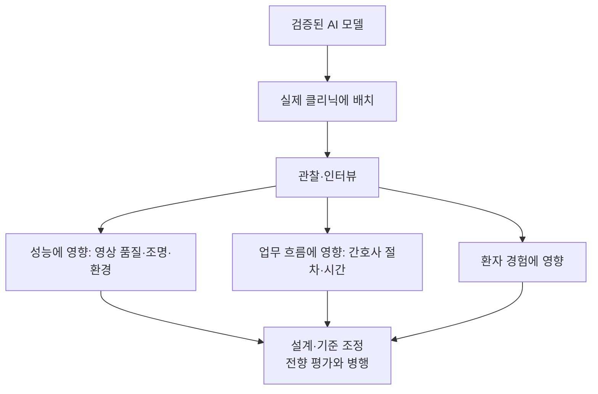

# 워크플로 통합 연구

> AI의 정확도만 보는 것이 아니라, 실제 현장의 사람·장비·절차 속에서 AI가 **어떻게 쓰이고 업무 흐름과 환자 경험을 어떻게 바꾸는지**를 관찰·인터뷰로 평가하는 연구. 인간 중심 평가(human-centered evaluation)라고도 한다.

## 쉽게 말하면
실험실에서 잘 달리는 신발이 비 오는 산길에서도 좋은 신발인지는 신어 봐야 안다. 시험 환경의 정확도와 달리, 진료실의 조명·인터넷·시간 압박 속에서 AI가 어떻게 돌아가는지를 지켜보는 연구다.

## 자세히
출처 한계: Google Research 논문 페이지(초록·메타데이터, 열어서 읽음). 전체 논문(ACM)은 403으로 열지 못해 수치와 세부 결과는 확인하지 못했다.
- **대표 사례**: Beede 외, "A Human-Centered Evaluation of a Deep Learning System Deployed in Clinics for the Detection of Diabetic Retinopathy", **CHI 2020**. 태국의 **11개 클리닉**에서 당뇨망막병증 선별용 딥러닝 시스템을 쓰는 간호사를 관찰·인터뷰했다.
- **발견(초록)**: 사회·환경적 요인이 **모델 성능, 간호사의 업무 흐름, 환자 경험**에 영향을 줬다. 모델의 데이터 품질 기준이 자원이 제한되고 불완전한 현장의 영상 촬영 조건과 **충돌**했다.
- **권고(페이지 요약)**: 인간 중심 연구와 **전향적 정확도 평가**를 함께 하고, 임상의·환자의 일상 실무를 연구해 설계에 반영하며, 평가에 **실제 임상 데이터**를 쓰고, 널리 배치하기 전에 시스템이 진료에 어떻게 맞는지 이해하라.
- **연구 방법의 특징(일반 설명)**: 정량 지표(민감도·특이도)에 더해 관찰, 인터뷰, 업무 시간 측정, 사용자 경험 평가를 결합한다. 대조군이 꼭 필요한 것은 아니다.
- **이 노드와 RCT의 차이**: [AI의 RCT](#randomized-controlled-trial-ai)는 결과 차이를 인과적으로 보이는 데 강하고, 워크플로 통합 연구는 왜 그런 결과가 나왔는지, 현장에서 무엇이 막히는지를 설명하는 데 강하다.

## 그림으로 보기

## 예시
- 선별 AI가 영상 품질 기준을 못 맞추면 재촬영 요청이 늘어 간호사의 업무와 환자 대기가 달라질 수 있다(이 연구가 다룬 방향, 구체 수치는 확인하지 못함).
- 점검 질문: "AI의 입력 품질 기준이 현장 장비와 맞는가? 결과를 환자에게 누가 어떻게 전달하는가? 오류 시 대체 절차는?"

## 헷갈리는 것과 비교
| 개념 | 차이 |
|---|---|
| 워크플로 통합 연구 | 현장에서의 사용 방식·영향을 질적·양적으로 평가 |
| [AI의 RCT](#randomized-controlled-trial-ai) | 무작위 배정으로 효과를 인과적으로 입증 |
| [외부 검증](#external-validation) | 다른 데이터에서의 성능 확인 |
| [후향·전향 연구](#retrospective-vs-prospective) | 데이터를 모으는 시점의 구분 |

## 더 읽을거리
- [A Human-Centered Evaluation of a Deep Learning System Deployed in Clinics for the Detection of Diabetic Retinopathy (Google Research, CHI 2020)](https://research.google/pubs/a-human-centered-evaluation-of-a-deep-learning-system-deployed-in-clinics-for-the-detection-of-diabetic-retinopathy/) — 초록과 메타데이터(열어서 확인, 본문은 열지 못함)
