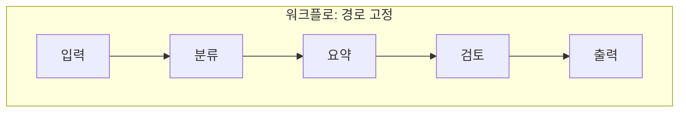
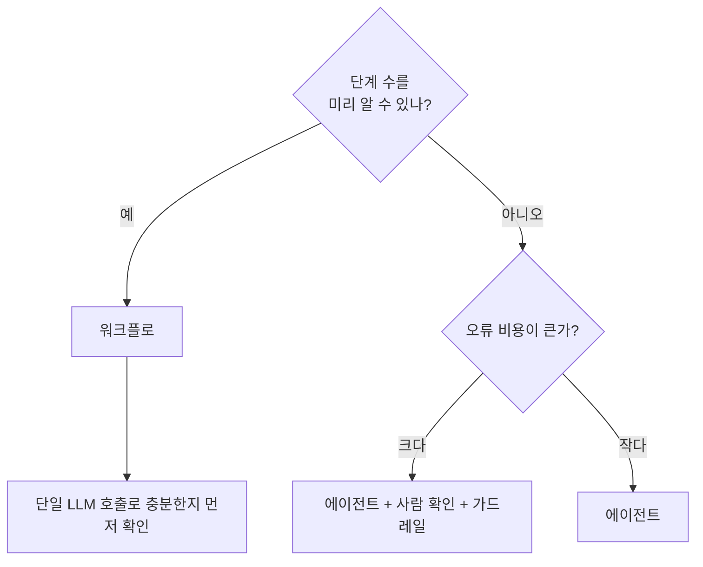

# 워크플로 vs 에이전트

> 워크플로는 사람이 코드로 정해 둔 경로를 따라 AI를 부르는 방식이고, 에이전트는 AI가 스스로 다음 단계와 도구를 정하는 방식이다.

## 쉽게 말하면
워크플로는 **지하철 노선도**다. 정거장 순서가 정해져 있어 예측이 쉽고 틀릴 일이 적다. 에이전트는 **택시 기사에게 목적지만 말하는 것**이다. 길은 기사가 정하니 유연하지만, 돌아가거나 요금이 더 나올 수 있다. 일이 정해진 순서로 반복되면 노선도, 어떤 길이 필요할지 모르면 택시가 맞다.

## 자세히
Anthropic "Building effective agents" 기준:
- **워크플로**: LLM과 도구를 코드로 정의된 경로로 엮는다. 예측 가능성이 장점.
- **에이전트**: LLM이 스스로 단계와 도구 사용을 정하고 과제 완료까지 통제권을 가진다. [에이전트 루프](#agent-loop)를 돈다.
- **워크플로의 다섯 패턴**: [프롬프트 연쇄](#prompt-chaining)(순서대로) / [라우팅](#routing-pattern)(분류 후 전문 경로로) / 병렬화(독립 작업을 동시에 또는 여러 번 돌려 비교) / [오케스트레이터-워커](#orchestrator-workers)(중앙 LLM이 쪼개 위임) / [평가자-최적화자](#evaluator-optimizer)(생성과 비평을 반복).
- **선택 원칙**: 되는 가장 단순한 방법부터. 많은 경우 검색과 예시를 붙인 LLM 호출 한 번으로 충분하다. 에이전트는 지연·비용을 치르고 성능을 사는 것이므로 측정 가능한 이득이 있을 때만 쓴다.
- **에이전트의 대가**: 비용 증가, 오류 누적. 샌드박스 테스트와 가드레일이 필요하다.
- 현실에서는 둘을 섞는다: 큰 틀은 워크플로, 한 단계 안에서만 에이전트.

## 그림으로 보기

## 예시
- 워크플로: 고객 문의 메일 → 분류(결제/기술/기타) → 유형별 답장 초안 → 사람 검토. 순서가 항상 같다.
- 에이전트: "이 저장소의 실패하는 테스트를 고쳐 줘." 몇 번 고칠지, 어떤 파일을 볼지 미리 알 수 없다.

## 헷갈리는 것과 비교
| 개념 | 차이 |
| --- | --- |
| 워크플로 | 경로를 코드가 정함. 예측 가능, 저렴 |
| 에이전트 | 경로를 모델이 정함. 유연, 비쌈, 오류 누적 |
| [LangGraph](#langgraph) | 둘 다 그래프로 그리는 도구. 고정 엣지=워크플로, 조건부 엣지·루프=에이전트 쪽 |
| [RPA와 AI 자동화](#rpa-vs-ai-automation) | RPA는 화면 조작 규칙을 고정하는 전통 자동화 |

## 더 읽을거리
- [Building effective agents (Anthropic)](https://www.anthropic.com/research/building-effective-agents) — 정의, 다섯 패턴, 선택 기준
