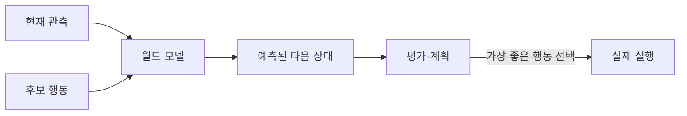
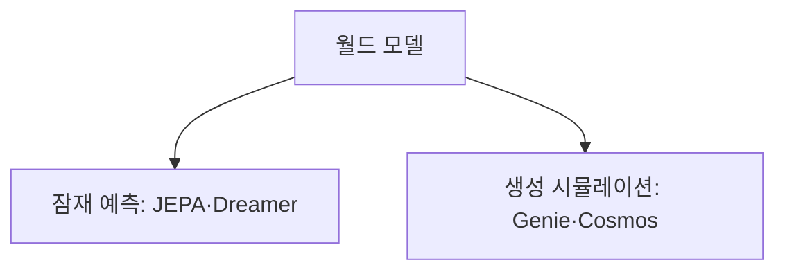

# 월드 모델

> 월드 모델은 환경이 **행동에 따라 어떻게 변할지 예측·시뮬레이션**하는 내부 모델이다. 에이전트가 직접 해 보기 전에 머릿속에서 먼저 시험해 계획을 세우게 해 준다. 정의는 AI·로보틱스·인지과학에서 아직 논쟁 중이다.

## 쉽게 말하면
체스 선수가 말을 옮기기 전에 "내가 이렇게 두면 상대는 이렇게 두겠지"를 머릿속으로 돌려 본다. 그 상상 속 체스판이 월드 모델이다. 로봇은 실패 비용이 크니 현실에서 부딪쳐 보기 전에 상상으로 먼저 시험하면 이득이다.

## 자세히
- **잠재 공간 예측형(JEPA, Dreamer)**: 픽셀을 그대로 복원하지 않고 추상 표현(임베딩) 공간에서 "다음에 무엇이 일어날지"를 예측. JEPA는 인코더가 관측을 임베딩으로, 예측기가 현재 임베딩+행동으로 미래 임베딩을 예측한다. 로봇 계획·실시간 제어용으로 거론되며 V-JEPA 2가 로봇 모델 예측 제어 사례로 소개된다.
- **생성형 시뮬레이션(Genie, Sora, Cosmos)**: 미래 장면 자체를 만들어 낸다. DeepMind Genie는 라벨 없는 인터넷 영상에서 상호작용 환경을 학습했고 Genie 3는 탐험 가능한 3D 세계를 실시간 생성한다. 데이터 합성·시각화에 적합.
- 한계: 예측 오차가 긴 시간에 걸쳐 누적돼, 짧은 롤아웃은 괜찮아도 길어지면 무너지기 쉽다. Dreamer 계열은 계산 비용이 크다는 평가(모두 2차 해설 기준, 논문 확인 권장).

## 그림으로 보기

## 예시
- 로봇이 컵을 밀면 어디로 떨어질지 상상한 뒤 안전한 동작만 실행.
- 자율주행 회사가 생성형 월드 모델로 드문 사고 장면을 합성해 학습 데이터를 늘림.

## 헷갈리는 것과 비교
| 개념 | 차이 |
|---|---|
| 월드 모델 | 행동의 결과를 예측 |
| [VLA 모델](#vla-model) | 행동을 직접 출력 |
| [Sim-to-real](#sim-to-real) | 사람이 만든 시뮬레이터 이식. 월드 모델은 학습된 시뮬레이터 |
| [LLM](#llm-basics) | 다음 단어 예측. 물리 예측은 별개 문제 |

## 더 읽을거리
- [World model (Wikipedia)](https://en.wikipedia.org/wiki/World_model_(artificial_intelligence)) — 개념과 계보
- [JEPA architecture explained (DataCamp)](https://www.datacamp.com/blog/jepa-architecture-explained) — JEPA 해설
