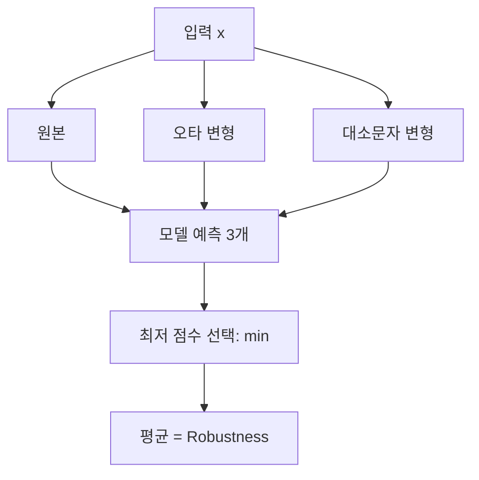
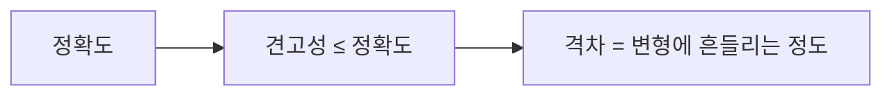

# 섭동 최악 사례 정확도

> 입력 하나에 여러 가지 가벼운 변형(오타·대소문자·방언 등)을 가하고, **그중 가장 나쁜 결과만 점수로 삼는** 견고성 지표다. 모든 변형에서 맞아야 "맞았다"고 센다.

## 쉽게 말하면
시험 문제를 글자체만 바꿔 3번 내서, 3번 모두 맞혀야 정답으로 인정하는 방식이다. 우연히 한 번 맞은 것은 점수가 안 된다. 한 번이라도 틀리면 그 문제는 틀린 것이다.

## 자세히
(HELM 논문 「Holistic Evaluation of Language Models」(TMLR 2023-08, arXiv 2211.09110) 본문 §4.5와 부록 C.3을 PDF로 직접 읽어 확인.)
- **정의(논문)**: 기본 지표 m(정확도, F1 등)과 변형 T_1…T_k가 있을 때, **Robustness = (1/n) Σ_i min_j m(model(T_j(x_i)), y_i)**. 즉 입력마다 변형 중 최저 점수를 취해 평균한다. 정확도라면 **모든 변형에서 정답을 낸 경우에만 맞은 것**으로 센다.
- **항등 변환 포함**: 변환 집합에 항상 원본(identity)을 넣으므로 **견고성 ≤ 정확도**가 보장된다.
- **두 종류의 변환(논문)**: 
  - **Invariance(불변)**: 의미를 안 바꾸는 가벼운 변형(대소문자, 흔한 오탈자 등). 목표는 예측이 안 바뀌는 것. 장문 생성·언어 모델링은 정답 기준이 모호해 분류·QA·정보 검색 시나리오에만 적용한다.
  - **Equivariance(등변)**: 의미를 바꾸는 변형. 일반적인 생성법이 어려워 **Contrast Sets**(Gardner 외 2020)을 이용한다. 이 자원이 있는 BoolQ와 IMDB에서 측정한다.
- **공정성에도 재사용(논문)**: 같은 방식에 방언 변경 같은 **집단 관련 변형**을 적용하면 counterfactual fairness 지표가 된다. 변형된 입력에서 집단별 정확도와 최악 정확도를 본다.
- **왜 "자연스럽고 가벼운" 변형만**: 현실에서 나올 법한 변형(오타 등)이 성능을 크게 바꾸는지가 목적이다. **적대적 견고성**은 적응형 질의가 많이 필요해 대규모 평가에서 비현실적이라 제외했다고 논문이 밝힌다.
- **수치 예(HELM 보고, 기존 지식 노드 인용)**: NarrativeQA에서 TNLG v2(530B)가 표준 72.6%에서 섭동 시 38.9%로 하락. 이번에 본문 표까지는 열어 보지 못했다.
- **한계(해석)**: 최악 하나가 점수를 끌어내려 변형을 늘릴수록 점수가 떨어진다(k에 의존). 변형 집합 선택이 결과를 좌우하므로 목록을 공개해야 한다.

## 그림으로 보기

## 예시
- 고객 문의 분류기에 오타·띄어쓰기 변형 4종을 넣어, 모두 맞은 문의 비율을 견고성으로 보고한다.
- 교육 활동: 같은 질문을 말투 3가지로 바꿔 모델에 묻고 "3번 모두 맞은 것만 정답" 표를 만들어 본다.

## 헷갈리는 것과 비교
| 개념 | 차이 |
|---|---|
| 최악 사례 정확도 | 변형 중 최저를 취하는 지표 |
| 평균 정확도 | 변형 평균. 약점이 가려진다 |
| [견고성 곡선](#robustness-curve) | 강도별 변화 전체 모양 |
| [최악 프롬프트 성능](#worst-prompt-performance) | 말바꿈 프롬프트 중 최저 점수 |
| 적대적 견고성 | 모델을 겨냥한 최적 공격. HELM은 제외 |

## 더 읽을거리
- [Holistic Evaluation of Language Models (arXiv 2211.09110)](https://arxiv.org/abs/2211.09110) — Robustness 정의, invariance/equivariance, Contrast Sets(PDF 직접 확인).
