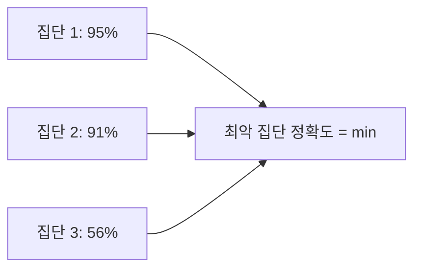
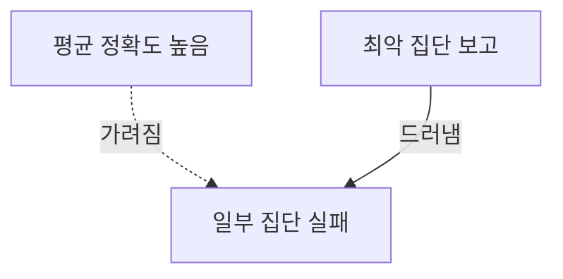

# 최악 집단 정확도

> 집단별 정확도 중 가장 낮은 값이다. 평균 정확도가 높아도 특정 집단에서 크게 무너지는 것을 드러내는 지표로, WILDS의 CivilComments 같은 과제에서 쓴다.

## 쉽게 말하면
반 평균이 90점이어도 한 학생이 30점이면 그 학생에게는 실패한 수업이다. 평균 대신 가장 낮은 점수를 보는 평가다.

## 자세히
(WILDS arXiv 2012.07421과 Sagawa 외 Group DRO arXiv 1911.08731을 하위 에이전트가 원문으로 읽은 노트 기준.)
- **정의(WILDS)**: 시험 데이터의 집단들에 대한 정확도 중 **가장 낮은 값**. CivilComments-WILDS는 정체성 × 독성 라벨의 **16개 겹치는 집단**을 쓴다.
- **격차(표 1)**: CivilComments 평균 정확도 비교 기준 92.2(0.1) vs OOD 최악 집단 **56.0**(3.6), 차이 36.2. FMoW는 최악 지역 정확도가 ID 58.0 → OOD 31.9~32.8.
- **Group DRO(Sagawa 외 2020)**: 집단별 기대 손실의 **최댓값**을 최소화. R̂(θ)=max_g E_{P^g}[loss]. 집단 정보는 학습 때 알려져 있고 시험 때는 몰라도 된다. 과대매개변수 신경망에 그대로 쓰면 학습 손실이 0이 되어 실패하지만, **강한 L2 정규화·조기 종료**를 쓰면 MultiNLI·CelebA·Waterbirds에서 최악 집단 정확도가 **10~40%p** 오르고 평균 정확도는 높게 유지된다.
- **주의(WILDS)**: 최악 집단 정확도는 거짓양성과 거짓음성을 같게 취급한다. 집단이 너무 작으면 불확실성이 크다([작은 집단의 불확실성](#small-subgroup-uncertainty)).

## 그림으로 보기

## 예시
- 모델 보고서에 평균 정확도와 함께 최악 집단 정확도·해당 집단명을 병기.
- 교육 활용: 평균 vs 최솟값 두 지표로 같은 모델을 비교.

## 헷갈리는 것과 비교
| 개념 | 차이 |
|---|---|
| 최악 집단 정확도 | 가장 낮은 집단 값 |
| 평균 정확도 | 데이터 비중에 가중 |
| [소집단 변화](#subpopulation-shift) | 이 지표로 평가하는 시나리오 |

## 더 읽을거리
- [WILDS (arXiv 2012.07421)](https://arxiv.org/abs/2012.07421) — 지표 정의·표 1.
- [Distributionally Robust Neural Networks (arXiv 1911.08731)](https://arxiv.org/abs/1911.08731) — Group DRO.
