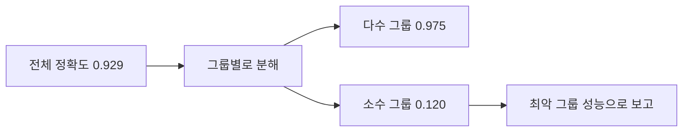
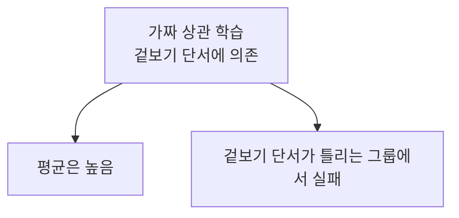

# 최악 그룹 성능

> 평균 정확도가 높아도 특정 그룹에서는 크게 틀릴 수 있다. 그룹별 점수를 따로 구해 가장 낮은 그룹(worst-group)의 점수를 함께 보고해야 모델이 누구에게 실패하는지 보인다.

## 쉽게 말하면
전교 평균이 93점이어도 특정 반만 12점일 수 있다. 평균만 보면 학교가 훌륭해 보이지만, 그 반 학생에게는 형편없는 학교다. 반별로 따로 보고 가장 낮은 반의 점수를 같이 적어야 어디가 문제인지 안다.

## 자세히
- **정의와 배경(Sagawa 외, group DRO 논문 초록, 열람)**: 과대 매개변수 신경망은 평균 정확도는 높아도 비전형적 그룹에서 실패하는 경우가 많다. 평균에서는 성립하지만 그 그룹에서는 틀리는 가짜 상관(spurious correlation)을 배우기 때문이다. 이 논문은 정해진 그룹들 가운데 최악 손실을 줄이는 group DRO를 제안했고, 강한 정규화(큰 L2 또는 조기 종료)와 함께 쓰면 세 과제에서 최악 그룹 정확도가 10~40%p 올랐다고 보고한다.
- **직접 해 본 합성 실험**: 학습 데이터 4,000개에서 95%는 "겉보기 단서"가 라벨과 맞고(다수 그룹), 5%는 반대로 틀리게 되어 있다(소수 그룹). 겉보기 단서가 진짜 단서보다 강한 설정에서 로지스틱 회귀를 학습하고 새 데이터 20,000개로 평가했다. 전체 정확도 0.929, 다수 그룹 0.975, 소수 그룹 0.120(표본 1,070개)이었다. 평균은 높지만 소수 그룹은 무작위보다 훨씬 나빴다. 이 데이터는 일부러 가짜 상관을 크게 만든 설정이다.
- **보고 방법(해석)**: ① 그룹별 정확도를 표로 ② 최저 그룹과 하위 분위수 ③ 그룹별 표본 수(작은 그룹은 [잡음](#small-group-noise)) ④ 평균과 최저 그룹의 격차를 한 줄로.
- **해결의 방향(논문)**: 그룹을 알면 그룹 균형 학습·group DRO를 쓰되 정규화가 중요하다. 그룹 정의 자체가 불확실한 경우가 많아 이 부분은 이 글에서 다루지 않았다.
- **한계**: 그룹 라벨이 없으면 계산할 수 없고, 그룹을 너무 잘게 나누면 표본이 부족하다.

## 그림으로 보기

## 예시
- 이력서 분류기: 전체 정확도 90%여도 특정 경력 유형 지원자 그룹에서 60%이면 그룹별 표로 드러내 개선 대상으로 삼는다.
- 교육 활용: 평균 점수만 있는 보고서와 그룹별 표가 붙은 보고서를 나란히 두고 어느 쪽이 위험을 보여 주는지 토론.

## 헷갈리는 것과 비교
| 개념 | 차이 |
| --- | --- |
| 평균 정확도 | 다수 그룹에 좌우됨 |
| 최악 그룹 성능 | 가장 낮은 그룹의 점수 |
| [그룹 크기 불균형](#group-size-imbalance) | 폴드 크기 문제 |
| [작은 그룹의 점수 노이즈](#small-group-noise) | 표본이 적은 그룹의 불확실성 |

## 더 읽을거리
- [Distributionally Robust Neural Networks for Group Shifts (Sagawa 외, 2019)](https://arxiv.org/abs/1911.08731) — 평균 대 최악 그룹 정확도와 group DRO
