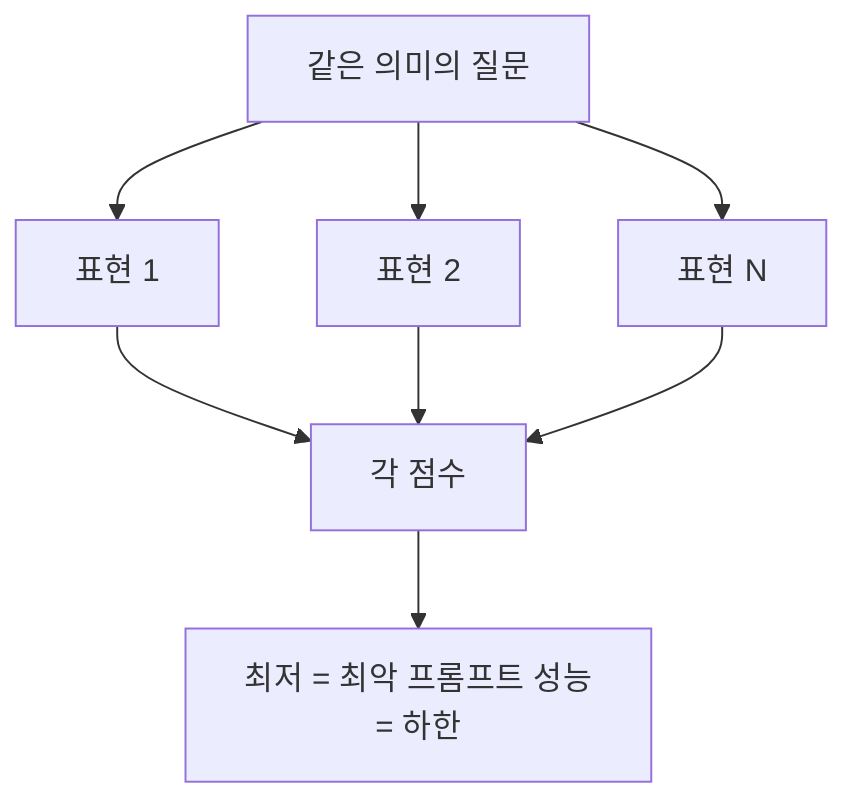

# 최악 프롬프트 성능

> 같은 뜻을 가진 여러 가지 질문 표현을 모델에 던졌을 때 **가장 나쁜 점수**로 모델의 하한 능력을 보는 평가 관점이다. 평균이나 최고 점수는 운 좋은 표현을 반영하지만, 실제 사용자는 아무 표현이나 쓴다.

## 쉽게 말하면
식당 평점을 "가장 맛있게 먹은 날"로 매기면 안 된다. 가장 실망했던 날도 같은 식당의 얼굴이다. 모델도 같은 질문을 10가지로 말해 보고 **가장 못한 답**이 어떤지 봐야 믿고 맡길 수 있다.

## 자세히
(Cao·Cai·Zhang·Zou·Lam, 「On the Worst Prompt Performance of Large Language Models」(arXiv 2406.10248, NeurIPS 2024 채택, v4 2024-10-30) 초록을 WebFetch로 직접 확인. 패러프레이즈 생성·검증의 세부와 지표 정의는 초록에 없어 확인하지 못했다.)
- **문제의식(논문)**: 기존 견고성 연구는 **작업 수준의 지시문**(task-level instruction)의 변화를 주로 봤고, 사용자가 실제로 쓰는 **사례 수준 질의**(case-level query)의 다양성은 덜 다뤘다.
- **벤치마크(논문)**: **RobustAlpacaEval** — 의미가 같은 사례 수준 질의들로 구성. (기존 노드 [예측 일관성 지표](#prediction-consistency-metric)는 본문을 직접 열어 "GPT-4가 만든 10개 말바꿈을 사람이 검수해 질의당 11개 프롬프트"라고 정리했다.)
- **주장(논문)**: **최악 프롬프트 성능**이 모델 능력의 **하한**을 더 잘 나타낸다.
- **결과(논문)**: ChatGPT와 Llama·Mistral·Gemma 계열 6개 오픈 모델 모두 표현 변화에 따라 성능이 크게 흔들린다. **Llama-2-70B-chat은 최고와 최저 성능의 차이가 45.48%**이고 **최악일 때 9.38%**까지 떨어진다.
- **결론(논문)**: ① 최악의 프롬프트는 **모델 무관/모델 의존 어느 관점으로도 찾기 어렵다**(지름길이 없다). ② 기존 프롬프트 엔지니어링·일관성 방법은 최악 성능을 개선하는 효과가 제한적이다. ③ 다양한 프롬프트에서 안정적인 **더 탄탄한 모델**이 필요하다.
- **실무 의미(해석)**: 평가 보고서에 평균과 함께 최악값을 넣고, 배포 전 "사용자가 말할 수 있는 다양한 표현"으로 하한을 확인한다. → [섭동 최악 사례 정확도](#worst-case-over-perturbations)

## 그림으로 보기

```mermaid
flowchart LR
  B["최고 점수"] --- A["평균"] --- L["최저 점수"]
  B -.45.48%p 격차 예.-> L
```

## 예시
- 고객지원 챗봇 평가: 같은 의도를 가진 질문 11개 표현으로 답변 품질을 매겨 최저 점수와 평균 점수를 함께 보고한다.
- 교육 활동: 같은 요청을 말투(공손/반말/키워드형)로 바꿔 모델 답이 어떻게 달라지는지 비교.

## 헷갈리는 것과 비교
| 개념 | 차이 |
|---|---|
| 최악 프롬프트 성능 | 말바꿈 질의 중 최저 점수 |
| 평균 성능 | 표현에 따른 변동이 숨겨짐 |
| [섭동 최악 사례 정확도](#worst-case-over-perturbations) | 오타 등 변형 중 최저 정확도 |
| [Judge Sensitivity Score](#judge-sensitivity-score) | 심사위원의 판정 일치도 |

## 더 읽을거리
- [On the Worst Prompt Performance of Large Language Models (arXiv 2406.10248)](https://arxiv.org/abs/2406.10248) — RobustAlpacaEval, 최악 프롬프트 성능과 결론(초록 확인).
