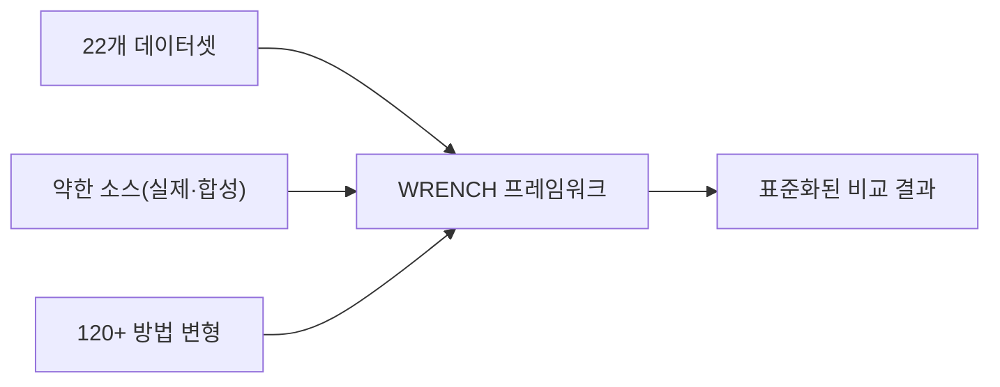
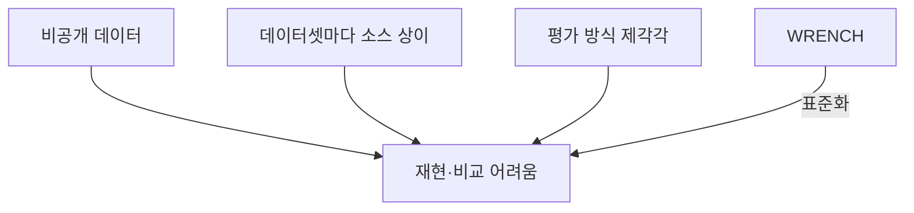

# WRENCH 벤치마크

> 약한 지도(weak supervision) 방법을 같은 조건에서 비교하려고 만든 표준 벤치마크 플랫폼이다(NeurIPS 2021 Datasets and Benchmarks). 22개 실제 데이터셋과 여러 약한 신호 소스, 방법 구현을 모았다.

## 쉽게 말하면
요리 대결에서 각자 다른 재료·심사표를 쓰면 승부가 안 난다. WRENCH는 같은 재료와 같은 심사표를 제공하는 대회 운영본부다.

## 자세히
(Zhang 외, arXiv 2109.11377 초록을 직접 열어 확인.)
- **문제의식**: ① 비공개·자체 데이터 ② 같은 이름의 데이터셋인데 라벨·약한 소스가 논문마다 다름 ③ 평가 프로토콜이 제각각.
- **구성**: **22개** 실제 데이터셋, 분류와 시퀀스 태깅 과제, 실제·합성·절차적으로 생성한 약한 소스, 모듈형 확장 프레임워크와 대표 WS 방법 구현. **120개 이상의 방법 변형**을 비교했다고 한다.
- **코드**: GitHub `JieyuZ2/wrench`.
- **주의**: 초록은 구체 순위·결론을 싣지 않는다. 이 노드는 개별 결과 수치를 확인하지 않았다.
- **활용(제안)**: 새 LabelModel을 제안하는 논문은 WRENCH의 같은 데이터·소스로 기존 방법과 비교하면 재현성이 높다. 업무에서 약한 지도 도입을 판단할 때도 비슷한 공개 데이터로 먼저 비교 실험.

## 그림으로 보기

## 예시
- 새 라벨 병합 알고리즘을 WRENCH 데이터셋 몇 개에서 다수결·LabelModel과 비교.
- 교육 활용: "공정한 비교란 같은 데이터·같은 평가"를 연구 사례로 설명.

## 헷갈리는 것과 비교
| 개념 | 차이 |
|---|---|
| WRENCH | 약한 지도 방법 벤치마크 |
| [Snorkel](#programmatic-labeling-snorkel) | 약한 지도 도구·프레임워크 |
| 일반 NLP 벤치마크(GLUE 등) | 모델 성능 평가(약한 라벨 소스 비교는 아님) |

## 더 읽을거리
- [WRENCH (arXiv 2109.11377)](https://arxiv.org/abs/2109.11377) — 초록, GitHub 링크.
