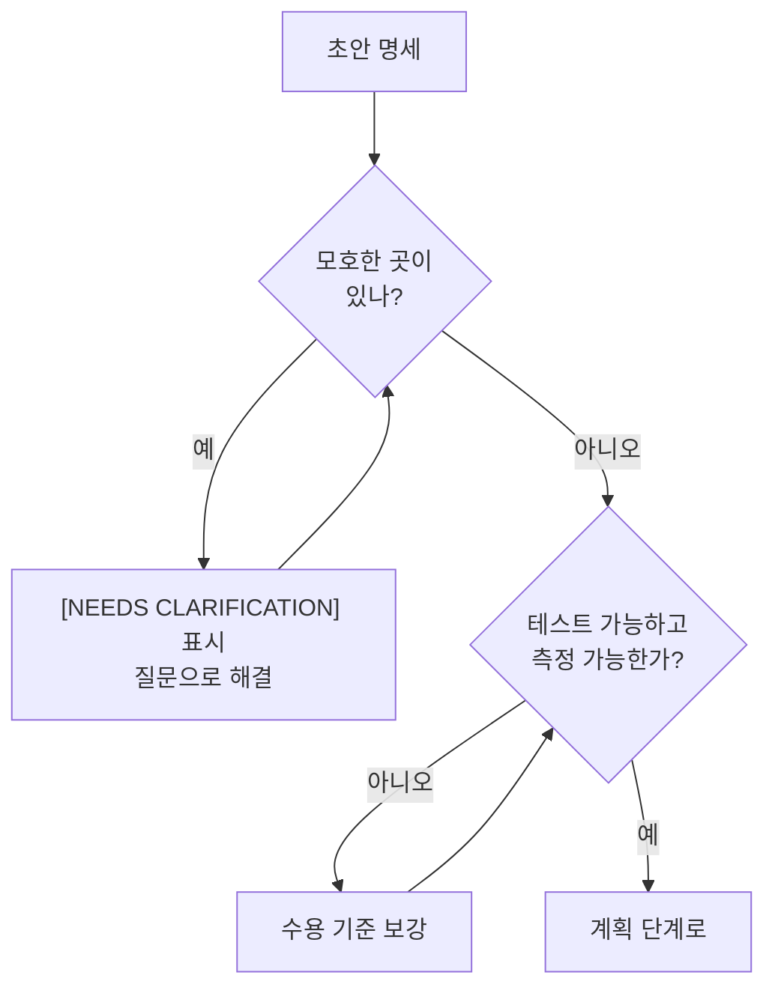
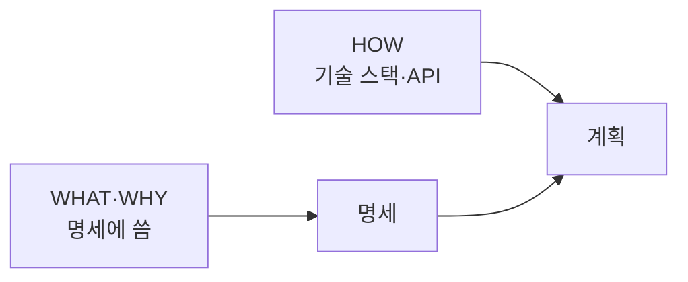

# 좋은 명세 쓰는 법

> AI가 만들 것을 정확히 만들도록, "무엇을·왜"를 중심으로 쓰고, 모호한 곳은 추측하지 않고 질문으로 드러내며, 검증 가능한 기준을 함께 적는 명세 작성 요령.

## 쉽게 말하면
맞춤 정장을 주문할 때 "멋지게 해 주세요"라고만 하면 재단사는 추측해서 만든다. "회사 면접용, 짙은 남색, 단추 두 개, 어깨 라인은 슬림하게, 이번 주 금요일까지"라고 말하면 결과가 달라진다. 다만 원단 종류까지 일일이 지시하기보다 필요와 이유를 정확히 말하고, 정해지지 않은 것은 "이건 아직 안 정했다"라고 밝히는 편이 낫다.

## 자세히
GitHub Spec Kit의 `spec-driven.md`가 설명하는, 템플릿으로 LLM을 좋은 명세로 이끄는 방식이다.
1. **무엇(WHAT)과 왜(WHY)에 집중, 어떻게(HOW)는 제외**: 기술 스택·API 같은 구현 결정은 명세에 넣지 않는다. 기술이 바뀌어도 명세가 안정적으로 유지된다. 구현 방법은 [계획 단계](#spec-kit)에서 정한다.
2. **모호함은 표시하고 추측 금지**: `[NEEDS CLARIFICATION]` 같은 표지를 달게 한다. 예를 들어 로그인 기능이면 인증 방식을 이메일·비밀번호로 가정하지 말고 질문으로 남긴다. "Don't guess"가 원칙이다.
3. **명세 자체를 점검하는 체크리스트**: "[NEEDS CLARIFICATION]이 남아 있지 않은가", "요구사항이 테스트 가능한가", "성공 기준이 측정 가능한가". 명세의 단위 테스트처럼 쓴다.
4. **추측성 기능 금지**: "나중에 필요할지도"라는 추가를 막는다. 모든 기능은 구체적 사용자 이야기(user story)로 거슬러 올라가야 한다.
5. **명확한 인수 기준**: 기능마다 사용자 이야기에 연결된 수용 기준을 둔다. "사진은 최대 20장, 장당 10MB, 초과하면 안내 문구 표시"처럼 숫자와 조건으로 쓴다.
6. **범위 밖 명시**: 하지 않을 일을 적어 두면 AI가 임의로 범위를 넓히지 않는다(이 항목은 Spec Kit 문서에서 확인된 것이 아니라 실무 권장).

**나쁜 명세 vs 좋은 명세**
- 나쁨: "사진 공유 기능 추가해 줘."
- 좋음: "가입한 사용자가 앨범을 만들고 사진을 올려 친구를 이메일로 초대할 수 있다. 공유 링크는 7일 뒤 만료. 인증 방식은 [NEEDS CLARIFICATION]. 범위 밖: 동영상."

## 그림으로 보기




## 예시
```
# 기능: 주간 보고서 자동 요약
## 사용자 이야기
팀장은 월요일 아침에 지난주 팀원 보고서를 한 장으로 보고 싶다.
## 수용 기준
- 팀원 10명 분량을 1분 안에 요약한다.
- 요약에는 결정 필요 사항 3개 이내를 맨 위에 둔다.
- 원문 보고서 링크를 항목마다 단다.
## 미정
- 요약 언어: [NEEDS CLARIFICATION] 한국어만인지, 영어 병행인지
## 범위 밖
- 외부 공유, 편집 기능
```

## 헷갈리는 것과 비교
| 개념 | 차이 |
|---|---|
| 명세(WHAT·WHY) | 무엇이 필요하고 왜인지, 성공 기준 |
| 계획(HOW) | 기술 스택·구조·제약을 정하는 단계 |
| [헌장](#sdd-constitution) | 모든 기능에 공통인 원칙 |
| 프롬프트 | 한 번의 지시. 명세는 오래 두고 갱신하는 문서 |
| [TDD](#tdd) | 코드 수준 테스트를 먼저. 명세의 수용 기준이 테스트의 출발점이 될 수 있음 |

## 더 읽을거리
- [spec-driven.md (github/spec-kit)](https://github.com/github/spec-kit/blob/main/spec-driven.md) — 템플릿이 명세를 제약하는 방식
- [Spec-driven development with AI (GitHub Blog)](https://github.blog/ai-and-ml/generative-ai/spec-driven-development-with-ai-get-started-with-a-new-open-source-toolkit/) — Specify 단계의 목적
