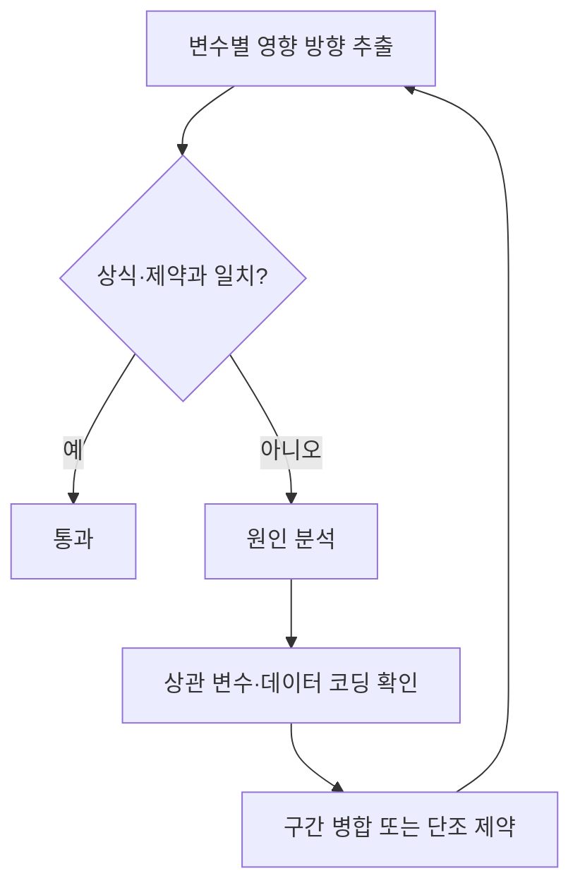

# 잘못된 부호 진단

> 모델이 학습한 변수의 영향 방향(부호)이 도메인 상식이나 건 제약과 어긋나는지 점검하는 작업. 예: 연체가 늘수록 부도 확률이 낮아지는 계수.

## 쉽게 말하면
체중계 눈금이 거꾸로 달려 있는지 확인하는 것이다. 숫자가 그럴듯해도 방향이 틀리면 설명(이유 코드)이 엉뚱해진다.

## 자세히
이 노드의 진단 절차는 신용 스코어링·회귀 모델링의 일반 실무를 정리한 것이며, 단일 출처로 확인한 것은 아니다. 제약 관련 사실은 XGBoost·LightGBM 문서(2026-11-15 확인)에 근거한다.
- **원인 후보**: ① 변수 간 높은 상관(다중공선성)으로 계수 부호가 뒤집힘 ② 표본·구간이 적어 노이즈 ③ 데이터 정의 오류(코딩 방향 반대) ④ 선택 편향(예: 승인된 사람만 관측) ⑤ 실제로 도메인 가정이 틀림.
- **점검 방법**: 로지스틱 회귀 계수 부호 표, WoE 구간의 사건률 단조성 표([WoE 구간화](#woe-binning)), 부분 의존 곡선, 제약 모델과 무제약 모델의 성능 비교.
- **대응 선택지**: 상관 변수 제거·결합, 구간 병합, 단조 제약 적용([단조 제약 설정법](#monotone-constraints)), 데이터 정의 재확인, 근거가 있을 때는 가정 수정(문서화).
- **주의**: 부호를 억지로 맞추면 성능이 떨어지거나 진짜 신호를 숨길 수 있다. 제약 성능 하락이 큰지 확인하고 도메인 전문가가 검토한다.
- **통지와의 연결**: 부호가 맞아야 [이유 코드](#reason-codes) 문구("연체가 많아서")가 모델 거동과 일치한다.

## 그림으로 보기

## 예시
- 로지스틱 회귀에서 `late_cnt` 계수가 음수(연체↑ → 부도↓)로 나옴 → `late_cnt`와 `util_ratio` 상관 0.8 확인 → 하나를 제거하거나 합쳐 재학습 → 부호 정상화.

## 헷갈리는 것과 비교
| 개념 | 차이 |
|---|---|
| 잘못된 부호 | 방향이 상식과 어긋남 |
| 성능 저하 | 정확도 하락 |
| [단조 제약](#monotonic-constraints) | 방향을 미리 강제하는 방법 |

## 더 읽을거리
- [XGBoost: Monotonic Constraints](https://xgboost.readthedocs.io/en/stable/tutorials/monotonic.html) — 제약 모델과 규칙 위반 비교 예
- [OptBinning tutorial](https://gnpalencia.org/optbinning/tutorials/tutorial_binary.html) — 구간별 사건률·WoE 단조성
