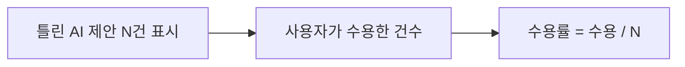
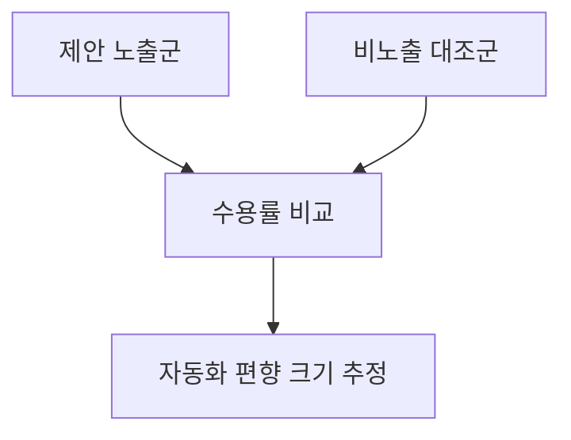

# 틀린 제안 수용률

> AI가 낸 제안이 틀렸는데도 사람이 그대로 받아들인 비율이다. 사전 라벨·추천 도입 효과를 평가하는 핵심 지표다.

## 쉽게 말하면
자동 완성이 틀린 단어를 제안했을 때 몇 번이나 그냥 엔터를 눌렀는지 세는 것이다. 수용률이 높으면 AI의 실수가 사람의 실수가 된다.

## 자세히
(Bansal 외 CHI 2021 arXiv 2006.14779, Buçinca 외 arXiv 2102.09692를 직접 읽고 확인. 그 밖의 연구는 초록·스니펫만 확인해 미확인.)
- **측정 정의(제안)**: 틀린 AI 제안이 표시된 건 중 사용자가 그 제안을 따른 건의 비율. 분모는 "틀린 제안이 보인 건"이어야 하며, 가능하면 제안을 보이지 않은 대조군과 비교한다.
- **Buçinca 외(2021)**: 단순 설명 조건에서 탄수화물 원천 판별 과제의 틀린 AI 제안 수용(과신) **0.64**, 인지 강제 장치 조건 0.48([AI 과신](#overreliance-on-ai)).
- **Bansal 외(2021)**: 감성 분류와 LSAT 과제에서 AI 설명이 "정답 여부와 상관없이 AI 추천을 받아들일 가능성을 높였다". Beer 데이터에서 팀 정확도는 확신도만 보여줄 때 0.89, 설명을 붙였을 때 0.88(유의하지 않음), AI 단독 0.84, 사람 단독 0.82. 틀린 제안 수용률의 명시 수치는 논문 그림에만 있어 확인하지 못했다.
- **미확인 보고**: 파서 출력 수정에서의 앵커링 효과(Berzak 외 2016, 초록만), LLM 제안이 주석 시간을 줄이지 못하고 레이블 분포를 바꿨다는 ACL 2025 Findings(스니펫만), 영상 사전 주석 파일럿에서 사전 주석 24.2%가 수정 없이 승인(스니펫만). 이들은 원문을 열지 못했다.
- **운영 방법(제안)**: 일부 작업에 일부러 틀린 제안(함정)이나 제안 없음(대조)을 섞어 수용률을 월별로 모니터링([편향 대시보드](#bias-dashboard)).

## 그림으로 보기

## 예시
- 사전 라벨 승인 작업 100건 중 5건에 일부러 틀린 제안을 넣고 몇 건이 승인되는지 측정.
- 교육 활용: "AI가 90% 맞으면 사람은 10%를 잡아낼까?" 질문의 토론.

## 헷갈리는 것과 비교
| 지표 | 의미 |
|---|---|
| 틀린 제안 수용률 | 오류 전파 위험 |
| 전체 수용률 | 제안의 정확도와 과신이 섞임 |
| 정확도 | 최종 라벨의 맞힘 비율 |

## 더 읽을거리
- [Does the Whole Exceed its Parts? (arXiv 2006.14779)](https://arxiv.org/abs/2006.14779) — 설명이 수용을 높임.
- [To Trust or to Think (arXiv 2102.09692)](https://arxiv.org/abs/2102.09692) — 과신 0.64 대 0.48.
