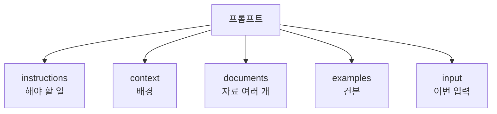

# XML 태그로 프롬프트 구조화

> 지시·자료·예시·입력을 `<instructions>`, `<document>` 같은 태그로 감싸 모델이 각 덩어리의 역할을 헷갈리지 않게 하는 기법이다.

## 쉽게 말하면
서류 가방에 계약서·영수증·메모를 한꺼번에 던져 넣으면 찾기 어렵다. 칸막이 파일에 "계약서", "영수증"이라 라벨을 붙이면 누구나 바로 이해한다. 태그는 프롬프트 속 **라벨 붙은 칸막이**다.

## 자세히
Anthropic 공식 문서(2026-11 확인):
- 지시·맥락·예시·가변 입력이 섞인 복잡한 프롬프트에서 오해를 줄인다. 내용 종류마다 자기 태그(`<instructions>`, `<context>`, `<input>`)로 감싼다.
- 모범 사례: 프롬프트 전체에서 **일관되고 설명적인 태그 이름**을 쓴다. 계층이 있으면 중첩한다(`<documents>` 안에 `<document index="1">`).
- 마법의 태그 이름은 없다. 특정 "정식" 태그 목록이 아니라 의미가 분명한 이름이면 된다.
- 효과: 사용자 입력에 섞인 문장이 지시로 오인되는 일을 줄여 준다(다만 [프롬프트 주입](#prompt-injection) 방어를 대체하진 못한다는 점은 주의: 주장이 아니라 일반적 보안 상식).
- 출력에도 쓴다: "답은 `<answer>` 태그로 감싸" 하면 프로그램이 파싱하기 쉽다.

## 그림으로 보기


## 예시
```
<context>우리는 B2B 교육 회사이고 독자는 인사 담당자다.</context>
<document index="1"><source>회의록.txt</source><content>...</content></document>
<instructions>회의록에서 결정 사항만 불릿 5개로 정리하고 <summary> 태그에 담아라.</instructions>
```

## 헷갈리는 것과 비교
| 개념 | 차이 |
|---|---|
| XML 태그 | 내용을 구분하는 라벨(문법 검증은 없음) |
| 마크다운 헤더 | 사람이 읽기 좋은 구분. 짧은 프롬프트엔 충분 |
| [few-shot](#few-shot-prompting) | 예시를 `<example>`로 감싸 지시와 분리 |
| [JSON 스키마 출력](#json-schema-output) | 출력 형식을 기계적으로 강제 |

## 더 읽을거리
- [Prompting best practices — Structure prompts with XML tags](https://platform.claude.com/docs/en/build-with-claude/prompt-engineering/claude-prompting-best-practices) — 일관된 이름·중첩 권고.
