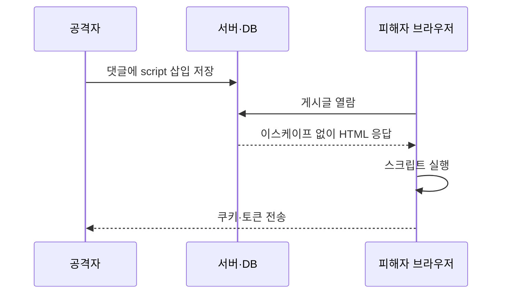
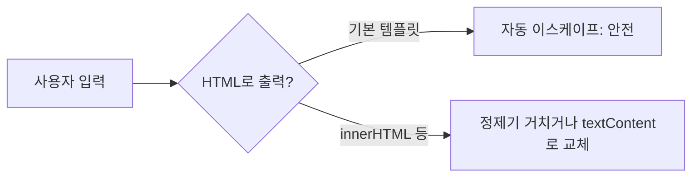

# XSS(교차 사이트 스크립팅)

> 신뢰할 수 없는 데이터가 브라우저에서 **코드로 해석되어 실행**되는 취약점이다. 공격자 스크립트가 피해자의 로그인 상태로 돌아가 쿠키·토큰 탈취, 화면 조작을 할 수 있다.

## 쉽게 말하면
게시판 **방명록**에 누군가 "이 글을 읽는 사람은 지갑을 열어라"라는 지시문을 적었는데, 방문자 안내 로봇이 방명록 내용을 지시로 착각해 그대로 따르는 상황이다. 문제는 글(데이터)과 명령(코드)을 구분하지 않은 것이다.

## 자세히
- **유형**(일반적 분류): 저장형(댓글처럼 서버에 저장돼 다른 사용자에게 실행), 반사형(URL 파라미터가 응답에 그대로 반영), DOM 기반(브라우저 JS가 입력을 위험한 곳에 넣음. 서버·WAF가 못 봄).
- **핵심 방어 = 컨텍스트별 출력 인코딩**(OWASP): HTML 본문은 엔티티 인코딩, 속성은 따옴표 + 속성 인코더, URL은 퍼센트 인코딩. JS·CSS 안에 데이터를 직접 끼우지 않는다. 데이터가 페이지에 들어가는 **모든 지점**에 적용해야 하며 한 곳만 빠져도 뚫린다.
- **프레임워크 기본값을 믿되 탈출구를 조심**: React·Vue 등은 기본 이스케이프한다. 위험한 곳은 `dangerouslySetInnerHTML`, `v-html`, `innerHTML`, `bypassSecurityTrust*`. HTML을 꼭 보여줘야 하면 DOMPurify 같은 정제기를 거치고, 안전한 대안은 `textContent`.
- **CSP·WAF는 보조**: Content-Security-Policy는 심층 방어일 뿐 주 방어가 아니다. Trusted Types는 DOM 싱크를 보호하지만 검증 자체는 하지 않는다.
- **피해 줄이기**: 인증 쿠키에 `HttpOnly`를 걸어 스크립트가 못 읽게 한다([세션과 JWT](#jwt-session)). 이 때문에 토큰을 localStorage에 두면 XSS에 취약하다.
- AI가 만든 코드에서 자주 보이는 실수: 마크다운·사용자 HTML을 `innerHTML`로 그대로 렌더링.

## 그림으로 보기



## 예시
```jsx
// 위험
<div dangerouslySetInnerHTML={{__html: comment}} />
// 안전(기본 이스케이프)
<div>{comment}</div>
```
프롬프트 예: "사용자 입력을 HTML로 렌더링하는 곳을 모두 찾아 innerHTML·dangerouslySetInnerHTML 사용 여부를 점검하고, 필요한 곳엔 DOMPurify를 적용해 줘."

## 헷갈리는 것과 비교
| 개념 | 차이 |
|---|---|
| XSS | 피해자 브라우저에서 공격자 **스크립트**가 실행 |
| CSRF | 피해자의 로그인 상태를 이용해 **요청**을 위조(스크립트 실행 불필요) |
| SQL 인젝션 | 서버 **DB 질의** 구조를 바꿈([파라미터화 쿼리](#parameterized-query)) |
| 입력 검증 | 들어오는 값 거르기. XSS 핵심은 **출력 시 인코딩** |

## 더 읽을거리
- [OWASP XSS Prevention Cheat Sheet](https://cheatsheetseries.owasp.org/cheatsheets/Cross_Site_Scripting_Prevention_Cheat_Sheet.html) — 컨텍스트별 인코딩과 위험 API 목록.
