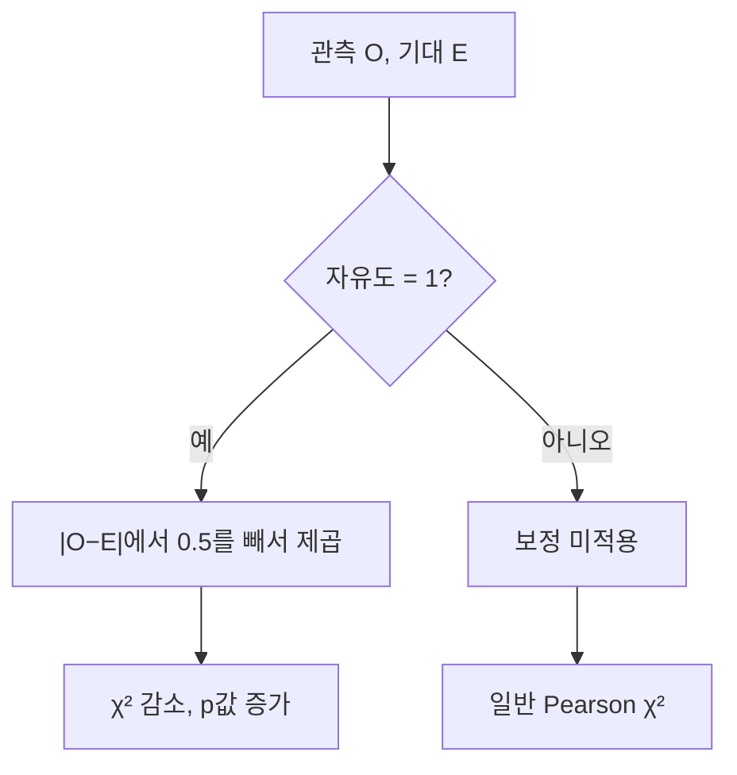

# Yates 연속성 보정

> 카이제곱 검정에서 이산적인 빈도를 연속 분포(카이제곱)로 근사할 때 생기는 과대 유의를 줄이려고, **각 관측 빈도를 기대 빈도 쪽으로 0.5만큼 당긴 뒤** 통계량을 계산하는 보정. SciPy에서는 **자유도가 1일 때만** 적용된다.

## 쉽게 말하면
계단 모양의 자료를 매끈한 곡선으로 어림하면 계단 끝부분에서 오차가 난다. Yates 보정은 계단의 반 칸(0.5)만큼 안쪽으로 당겨서 어림이 지나치게 "유의하다"고 말하지 않도록 한다.

## 자세히
출처: SciPy 공식 문서 `scipy.stats.chi2_contingency`(열어서 읽음) + 이 세션의 직접 계산(scipy 1.17.1).
- **정의(문서)**: `correction=True`(기본)일 때 Yates 연속성 보정은 자유도가 1일 때만 적용되며, **각 관측값을 기대값 쪽으로 0.5만큼 이동**한다.
- **공식(일반 정의, 이 세션에서 값 일치 확인)**: χ²_Yates = Σ (|O − E| − 0.5)² / E.
- **직접 계산(합성 2×2 표 [[8,2],[3,7]], 이 세션)**: 보정 없음 χ² = **5.051**, p = 0.0246. Yates 보정 χ² = **3.232**, p = 0.0722. 위 공식으로 손계산한 값도 3.232로 `chi2_contingency(correction=True)`와 일치했다. Fisher 정확 검정은 p = 0.0698로 보정한 값이 정확 검정에 더 가까웠다([Fisher 정확 검정](#fisher-exact-test)). 한 표의 결과다.
- **자유도 > 1 표에서**: 2×3 표 [[20,30,10],[15,25,30]](자유도 2)에서는 `correction=True`와 `False`의 통계량이 모두 10.4615로 **같았다**. 문서 설명대로 자유도 1이 아니면 보정이 적용되지 않았다.
- **논쟁(일반 설명, 이번 출처로 확인하지 못함)**: Yates 보정이 너무 보수적이라는 비판이 있어 많은 현대 통계 교재는 정확 검정을 대안으로 권한다. 이 주장은 SciPy 문서에는 없으므로 별도 출처 확인이 필요하다.
- **드리프트 점검에서**: 2×2 표(예: 두 기간의 이진 특성 비율 비교)에서 표본이 작을 때 사용한다. 표본이 크면 보정 유무 차이가 거의 없다.

## 그림으로 보기


## 예시
```python
from scipy.stats import chi2_contingency
chi2_contingency(table, correction=True)   # 자유도 1이면 Yates 보정
chi2_contingency(table, correction=False)  # 보정 없음
```
- 점검: 소표본 2×2 표에서는 보정 유무와 Fisher 정확 p값을 함께 보고 결론이 바뀌는지 확인.

## 헷갈리는 것과 비교
| 개념 | 차이 |
|---|---|
| Yates 보정 | 자유도 1 표의 연속성 보정, 과대 유의 완화 |
| Fisher 정확 검정 | 근사 없이 정확한 p값 |
| [기대 빈도 5 이상 규칙](#expected-frequency-rule) | 근사가 믿을 만한 조건 |
| [카이제곱 드리프트 검정](#chi-square-drift) | 상위 개념 |

## 더 읽을거리
- [scipy.stats.chi2_contingency (SciPy 문서)](https://docs.scipy.org/doc/scipy/reference/generated/scipy.stats.chi2_contingency.html) — correction 옵션(열어서 확인)
