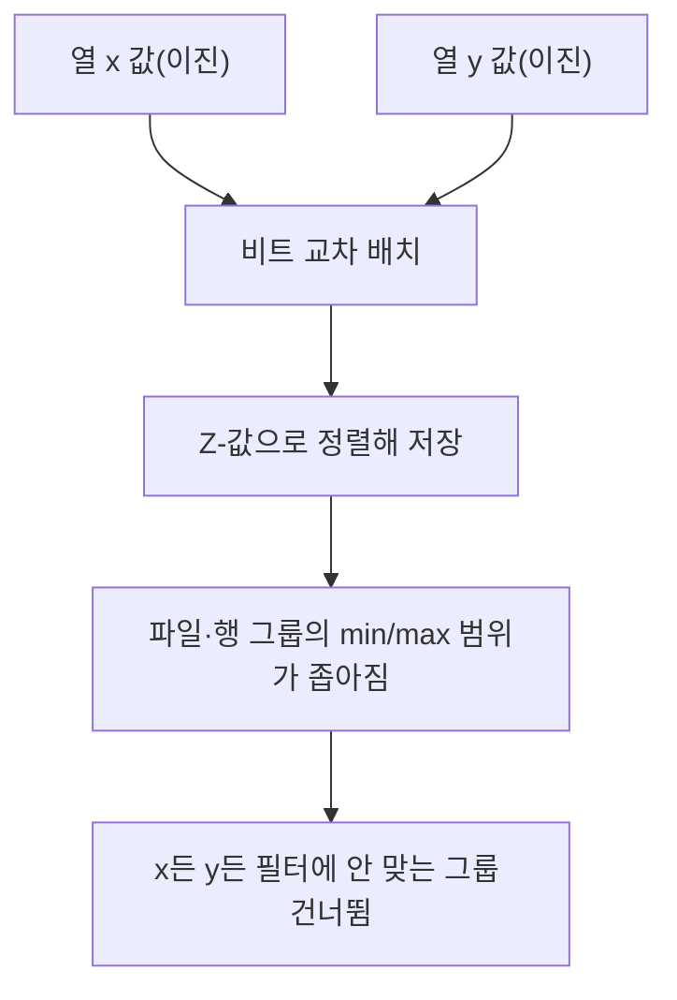
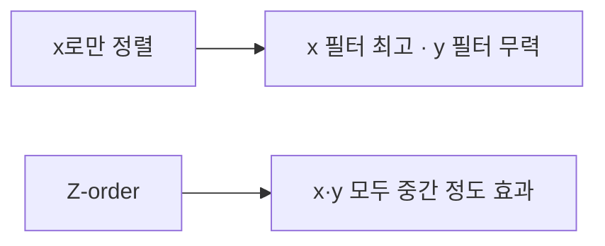

# Z-order 클러스터링

> Z-order는 **여러 열의 값을 하나의 정렬 키로 엮어(비트 인터리빙)** 데이터를 저장해, 어느 열로 걸러도 파일·행 그룹별 최소·최대 통계로 건너뛸 수 있게 하는 다차원 정렬 기법이다. 한 열로만 정렬하는 방식이 다른 열 필터에 약한 점을 보완한다.

## 쉽게 말하면
도서관 책을 "저자순"으로만 꽂으면 제목으로 찾기는 서가 전체를 뒤져야 한다. Z-order는 저자와 제목이 비슷한 책이 가까이 모이도록 꽂아서, 저자로 찾든 제목으로 찾든 몇 칸만 보면 되게 한다. 어느 쪽에도 최고는 아니지만 둘 다 꽤 괜찮다.

## 자세히
- **데이터 스킵의 원리(Databricks 문서, 직접 확인)**: Delta Lake 등은 파일별 최소·최대·널 개수·행 수 통계를 쓰기 때문에 질의 시 필터와 맞지 않는 파일을 건너뛴다. 통계는 외부 테이블에서 기본으로 앞 32개 열에 대해 수집된다. Z-ordering은 관련 값을 같은 파일에 모아 건너뛰기 효과를 높인다. 구문 예: `OPTIMIZE events WHERE date >= ... ZORDER BY (eventType)`. 권장: **질의 조건에 자주 나오는 카디널리티 높은 열**에 쓴다. 열이 늘수록 효과가 떨어지고, 통계가 수집되지 않은 열은 낭비다. 멱등하지 않으며 변하지 않은 파티션에 재실행해도 소용없다. 행 수 기준 균형이라 넓은 행은 파일 크기가 편향될 수 있다. 문서는 **새 테이블에는 liquid clustering을 권장**하며 ZORDER와 함께 쓸 수 없다고 말한다(확인 시점의 안내).
- **직접 해 본 모의실험(이 세션, 가상 데이터)**: 정수 열 x, y(각 0~1023) 100만 행을 행 그룹 50,000행(총 20개)으로 Parquet에 쓰고, Parquet 행 그룹 최소·최대 통계로 **필터에 맞을 가능성이 있는 행 그룹 수**를 셌다(범위 200~210 필터).

| 정렬 방식 | x만 필터 | y만 필터 | x와 y 필터 |
|---|---|---|---|
| 무작위 | 20/20 | 20/20 | 20/20 |
| x로 정렬 | 2/20 | 20/20 | 2/20 |
| x→y로 정렬 | 2/20 | 20/20 | 2/20 |
| Z-order(x,y 비트 인터리빙) | 8/20 | 6/20 | 3/20 |

  숫자는 "읽어야 할 행 그룹 수/전체"다. x로 정렬하면 x 필터에 최고(2개)지만 y 필터에서는 아무것도 못 건너뛴다(20개 모두). Z-order는 x에 8개, y에 6개로 **둘 다 상당히 건너뛰되 한 열 정렬만큼 날카롭지는 않다**. (하나의 난수 시드와 이 데이터 분포에서의 결과이며 일반 수치가 아니다. 정렬 구현은 이 글이 직접 만든 비트 인터리빙이고 Databricks의 구현과 같다고 보장하지 않는다.)
- **언제 쓰나(해석)**: 서로 다른 열로 번갈아 거르는 질의가 많고 한 열로 지배적이지 않을 때. 한 열이 압도적으로 자주 쓰이면 그 열을 파티션 키나 단일 정렬로 쓰는 편이 낫다([파티셔닝과 가지치기](#data-partitioning-pruning)).

## 그림으로 보기

## 예시
- 이벤트 로그를 사용자 ID와 이벤트 유형 두 열로 자주 거르는 테이블에 `ZORDER BY (user_id, event_type)`을 적용(구문은 Databricks 문서).
- 교육 소재: 작은 표를 그려 비트를 번갈아 배치해 Z-값을 손으로 계산해 보는 활동.

## 헷갈리는 것과 비교
| 개념 | 차이 |
|---|---|
| 파티셔닝 | 폴더로 굵게 분할 |
| 한 열 정렬 | 그 열 필터에 최적 |
| Z-order | 여러 열을 함께 정렬 |
| liquid clustering | Databricks가 새 테이블에 권장하는 방식 |

## 더 읽을거리
- [Databricks: Data skipping](https://docs.databricks.com/aws/en/delta/data-skipping) — 통계·ZORDER 지침(직접 확인).
- [DuckDB: Hive partitioning](https://duckdb.org/docs/2.0/data/partitioning/hive_partitioning.html) — 파티션 필터 푸시다운(직접 확인).
