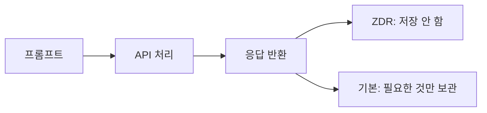
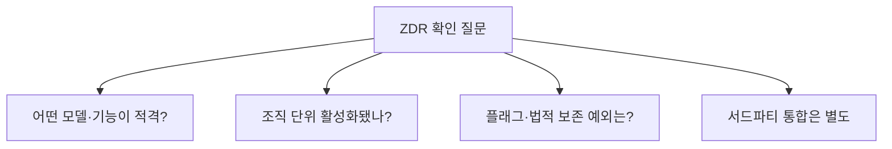

# 제로 데이터 보관

> 공급사가 **입력(프롬프트)과 출력을 응답 후 저장하지 않는** 옵션(ZDR). 민감 데이터를 AI API로 처리할 때 계약으로 확인할 핵심 항목이다. (Anthropic API·데이터 보존 문서 열람 2026-11-28)

## 쉽게 말하면
식당에서 주문 내용을 영수증에 남기지 않고 요리가 끝나면 메모를 바로 폐기하는 것과 같다. 대신 "모든 메뉴, 모든 지점"이 해당되는 것은 아니다.

## 자세히
(아래는 Anthropic 문서 기준이며 다른 공급사는 각자 약관을 확인해야 한다.)
- **기본 약속**: 보관되는 데이터는 명시적 허락 없이 모델 학습에 쓰지 않고, 기능이 작동하는 데 기술적으로 필요한 것만 보관. 대화 내용은 기본적으로 보관하지 않으나 일부 모델(문서가 "Covered Models"라 부름)은 **30일 보관을 요구**한다.
- **Legacy ZDR**: 응답이 반환된 뒤 고객의 프롬프트·응답을 **저장하지 않는다.** 조직 단위로 활성화되고 영업팀 문의로 요청하며, 새 조직마다 따로 켠다.
- **적용 범위**: Messages·Token Counting API(목록의 적격 기능), API 키로 쓰는 Claude Code(상업 조직), AWS 플랫폼·Google Cloud(Anthropic 관리형)도 요청 시 가능. 단 Claude Code의 지표 로깅을 켜면 사용 통계는 보관될 수 있다.
- **비적용**: Claude Console(플레이그라운드 포함), Managed Agents(세션 기록이 삭제 전까지 유지), 소비자 플랜(Free·Pro·Max 등), Teams·Enterprise 제품 인터페이스, Claude for Excel, 서드파티 통합. 코드 실행처럼 `/v1/messages`를 쓰지만 표에서 "No"인 기능도 제외. 30일 보관이 필요한 일부 모델(Fable 5.2 등)은 명시 승인 없이는 Legacy ZDR 대상이 아니다.
- **예외**: 플래그된 콘텐츠와 법적 보존 의무는 계약과 별개로 적용될 수 있다(문서의 "Retention regardless of arrangement" 항목).
- **제약**: ZDR 조직은 브라우저에서 API를 직접 호출할 수 없고(CORS 거부) 자체 백엔드를 거쳐야 한다.
- 최신 적격 여부는 계약 조건이나 담당자 확인이 필요하다고 문서가 강조한다.
- 한계: 이 글은 한 공급사의 문서만 읽었다. 다른 공급사와의 비교는 하지 않았다.

## 그림으로 보기

## 예시
- 의료·금융 문서를 API로 요약하기 전에 계약서와 문서의 적격 표에서 해당 기능이 ZDR 대상인지 확인.
- 교육: 사내 AI 도구 검토 체크리스트에 "데이터 보관 정책" 칸을 넣는 실습.

## 헷갈리는 것과 비교
| 개념 | 차이 |
|---|---|
| 제로 데이터 보관 | 응답 후 저장 안 함(계약·조직 단위) |
| 학습 미사용 약속 | 저장하더라도 학습에 안 씀 |
| [DPA](#dpa) | 개인정보 처리 위탁 조건을 정한 계약 |

## 더 읽을거리
- [API and data retention (Claude 문서)](https://platform.claude.com/docs/en/manage-claude/api-and-data-retention) — ZDR 범위(읽음).
