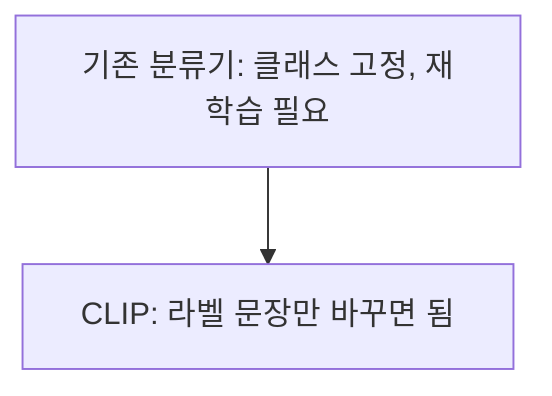

# CLIP 제로샷 분류

> 제로샷 분류는 분류용 라벨로 따로 학습하지 않고, 후보 라벨을 문장("a photo of a cat")으로 만들어 이미지와 가장 유사한 문장을 고르는 방식이다.

## 쉽게 말하면
사진을 보여 주고 "고양이/강아지/자동차 중 어떤 설명이 가장 어울려?"라고 묻는 것이다. 그 질문 목록은 언제든 바꿀 수 있어서 새 클래스를 위해 다시 학습할 필요가 없다.

## 자세히
HF CLIP 문서 기준:
- CLIP은 고정된 물체 범주로 학습하는 한계를 넘으려는 모델로, 4억 쌍의 (이미지, 텍스트)를 함께 학습해 **제로샷 전이**가 가능하다. 이미지·텍스트 특징이 같은 차원의 잠재 공간으로 사영되고 **내적이 유사도**다.
- 사용: `pipeline("zero-shot-image-classification", model="openai/clip-vit-base-patch32")`에 `candidate_labels`를 넘긴다. 직접 쓰면 모델 출력의 `logits_per_image`(이미지 수 × 텍스트 수의 스케일된 유사도)에 softmax를 취해 확률을 얻는다.
- 라벨은 단어보다 "a photo of a …" 같은 문장 템플릿이 흔히 쓰인다(문서의 예시도 이 형태).
- 한계(일반적 지적): 후보 목록에 정답이 없으면 그중 가장 가까운 것을 고르고, 세밀한 분류나 개수 세기에는 약하다. 프롬프트가 [77토큰](#clip-77-token-limit)을 넘으면 잘린다.

## 그림으로 보기



## 예시
```python
from transformers import pipeline
clip = pipeline("zero-shot-image-classification", model="openai/clip-vit-base-patch32")
labels = ["a photo of a cat", "a photo of a dog", "a photo of a car"]
clip("http://images.cocodataset.org/val2017/000000039769.jpg", candidate_labels=labels)
```
상품 이미지를 "정상/파손/오염" 같은 업무용 라벨로 대충 분류해 보는 첫 시도에 좋다.

## 헷갈리는 것과 비교
| 개념 | 차이 |
|---|---|
| 제로샷 | 학습 없이 라벨 문장으로 분류 |
| 파인튜닝 분류기 | 라벨 데이터로 학습, 정확도는 더 높을 수 있음 |
| [텍스트 인코더](#clip-text-encoder) | 라벨 문장을 벡터로 바꾸는 부품 |
| 임베딩 검색 | 같은 공간을 검색에 활용 |

## 더 읽을거리
- [HF CLIP 문서](https://huggingface.co/docs/transformers/model_doc/clip) — pipeline·모델 사용 예와 구조 설명.
