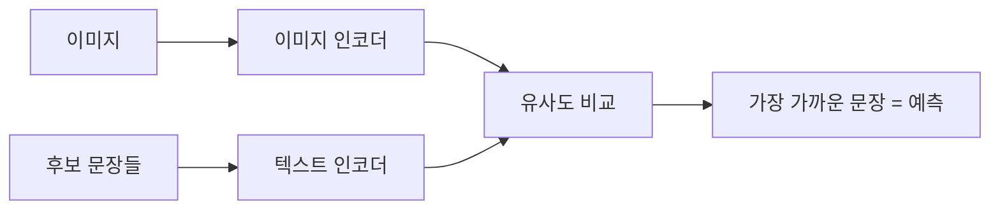
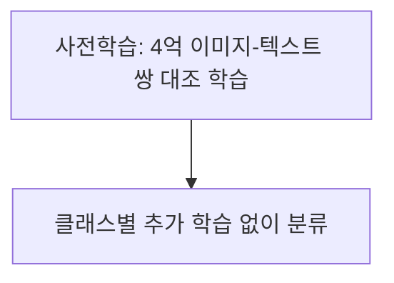

# 제로샷 이미지 분류

> **제로샷 이미지 분류**는 그 클래스로 따로 학습하지 않고, **"a photo of a dog" 같은 후보 문장과 이미지의 유사도**를 비교해 가장 가까운 문장을 답으로 고르는 방식이다. CLIP이 널리 알렸다.

## 쉽게 말하면
새로운 분류표를 가르칠 필요 없이 "고양이 / 개 / 자동차" 라벨 카드를 펼쳐 놓고, 사진과 가장 어울리는 카드를 집는 것이다. 카드를 바꾸면 분류 기준도 바로 바뀐다.

## 자세히
(CLIP, Radford 외, arXiv 2103.00020 초록 확인)
- **학습**: 인터넷에서 모은 **4억 개의 (이미지, 텍스트) 쌍**으로 "어떤 캡션이 어떤 이미지에 맞는가"를 맞히며 시각 표현을 학습(대조 학습).
- **제로샷 전이**: 사전학습 후 자연어로 학습된 시각 개념을 가리키거나 새 개념을 설명해 **데이터셋별 학습 없이** 하위 과제에 적용. 30개 넘는 비전 벤치마크에서 완전 지도학습 기준선과 자주 경쟁했다.
- **ImageNet**: 원래 ResNet-50의 학습 예시 128만 장을 쓰지 않고도 **제로샷으로 ResNet-50 정확도에 맞먹었다**.
- 사용법(일반 지식): 클래스 이름을 문장 템플릿에 넣어 텍스트 임베딩을 만들고, 이미지 임베딩과 코사인 유사도가 가장 큰 클래스를 선택. 프롬프트 문구에 따라 성능이 달라진다.
- 한계(일반 지식): 세밀한 분류·특수 도메인(의료 영상 등)·글자 인식에서 약할 수 있어 샘플 검증이 필요.

## 그림으로 보기



## 예시
```python
# 개념 코드 (open_clip)
text = tokenizer(["a photo of a cat", "a photo of a dog"])
probs = (100 * img_feat @ model.encode_text(text).T).softmax(dim=-1)
```
- 매장 선반 사진을 "빈 선반 / 가득 찬 선반"으로 학습 없이 분류해 보기.

## 헷갈리는 것과 비교
| 개념 | 차이 |
|---|---|
| 제로샷 분류 | 라벨 학습 없이 문장 유사도로 |
| 지도 학습 분류 | 클래스별 라벨 데이터로 학습 |
| 퓨샷 | 소수 예시로 적응 |
| [VLM](#vlm-architecture) | 이미지 보고 글을 생성 |

## 더 읽을거리
- [Learning Transferable Visual Models From Natural Language Supervision (CLIP)](https://arxiv.org/abs/2103.00020)
