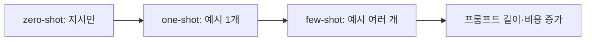
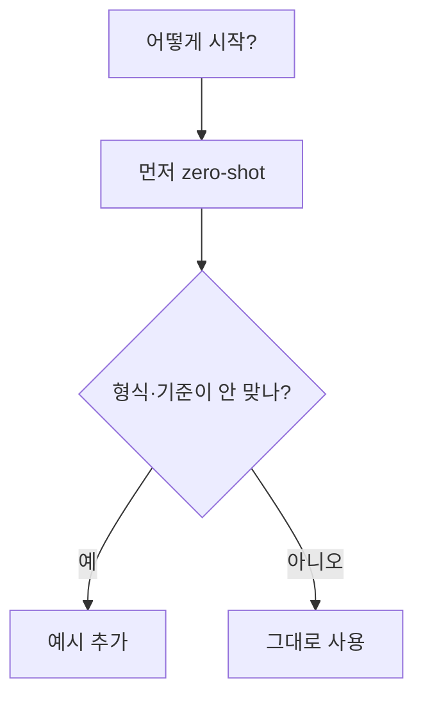

# zero-shot·one-shot·few-shot 비교

> 프롬프트에 **예시를 0개·1개·여러 개** 넣는 방식의 차이. 예시가 늘면 보통 모델이 형식과 의도를 더 잘 맞추지만 프롬프트가 길어져 비용이 는다.

## 쉽게 말하면
요리 지시서에 사진이 없는 것(zero), 완성 사진 한 장(one), 여러 장(few)의 차이다. 사진이 많을수록 따라 하기 쉽지만 설명서가 두꺼워진다.

## 자세히
- 출발점: Brown 외 *Language Models are Few-Shot Learners*(GPT-3, arXiv 2005.14165, 초록 읽음). **1,750억 파라미터** 자기회귀 모델 GPT-3는 과제와 몇 개의 시연을 **텍스트 프롬프트만으로** 받고 **기울기 업데이트·미세조정 없이** 수행한다. 번역·질의응답·빈칸 채우기, 단어 순서 복원·새 단어 문장 사용·3자리 연산 같은 즉석 추론 과제에서 좋은 성능을 보였다고 한다.
- 한계(초록): 일부 데이터셋에서는 few-shot이 여전히 어렵고 대규모 웹 코퍼스 학습에 방법론적 우려가 있다.
- 구분(일반 정의): zero-shot = 설명만, one-shot = 예시 1개, few-shot = 예시 여러 개. 이름은 GPT-3 논문 용어로 대중화됐다.
- 비용: 예시가 입력 토큰에 더해지므로 요청마다 비용·지연이 늘어난다. 같은 예시를 반복 전송하면 [프롬프트 캐싱](#cache-breakpoint)으로 줄일 수 있다.
- 오늘날: 지시를 잘 따르는 모델은 zero-shot으로도 충분한 경우가 많지만, 출력 형식·말투·판정 기준이 까다로우면 예시가 도움이 된다(경험칙, 이번 출처로 검증하지 못함). 예시 선택에 따라 모방 편향이 생길 수 있어 [예시 다양성](#example-diversity)을 고려한다.

## 그림으로 보기



## 예시
```text
[few-shot] 문장: "배송이 빨라요" → 긍정
문장: "포장이 엉망이에요" → 부정
문장: "가격이 적당해요" →
```
- 교육: 같은 분류 과제를 0·1·3·5개 예시로 돌려 정확도와 토큰 비용을 표로 비교.

## 헷갈리는 것과 비교
| 개념 | 차이 |
|---|---|
| few-shot(프롬프트) | 예시를 프롬프트에 넣음, 학습 없음 |
| 미세조정 | 가중치를 업데이트함 |
| [LoRA](#fine-tuning-open-model) | 가중치 일부만 업데이트 |

## 더 읽을거리
- [Language Models are Few-Shot Learners](https://arxiv.org/abs/2005.14165) — GPT-3 논문(초록 읽음).
