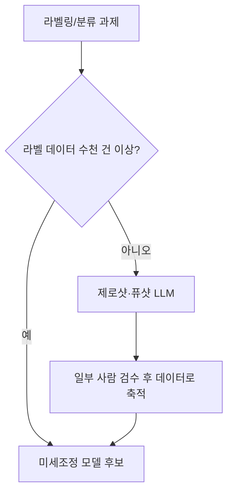
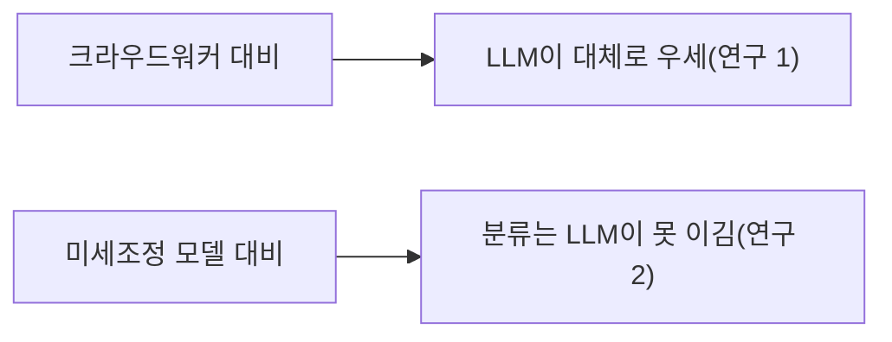

# 제로샷 LLM vs 미세조정 모델

> 라벨링·분류 과제에서 **프롬프트만 주는 제로샷 LLM**과 **정답 데이터로 따로 학습시킨 미세조정 모델** 중 무엇을 쓸지의 선택. 근거 연구들은 "LLM이 사람 수준 보조 주석자"와 "분류 정확도는 미세조정 모델이 여전히 앞섬"을 함께 보여 준다.

## 쉽게 말하면
처음 보는 업무를 설명서만 읽고 바로 하는 만능 신입(제로샷 LLM)과, 같은 업무 사례 수천 건으로 훈련받은 전문 직원(미세조정 모델)의 비교다. 사례가 적고 빨리 시작하려면 신입이, 사례가 많고 정확도가 최우선이면 전문 직원이 유리한 경우가 많다.

## 자세히
- **연구 1 — 트윗 주석(Gilardi 외, arXiv 2303.15056, 초록 확인)**: 2,382개 트윗 표본에서 제로샷 ChatGPT의 정확도가 5개 과제 중 **4개에서 크라우드워커를 능가**했고, 주석자 간 일치도는 모든 과제에서 크라우드워커·훈련된 주석자보다 높았으며, 주석당 비용이 **$0.003 미만(MTurk의 약 1/20)** 이었다. 비교 대상은 크라우드워커이지 미세조정 모델이 아니다.
- **연구 2 — 계산사회과학 25개 벤치마크(Ziems 외, arXiv 2305.03514, 초록 확인)**: 13개 언어 모델을 25개 영어 벤치마크에 제로샷으로 평가. **분류(분류체계 라벨링)에서는 LLM이 최고 성능의 미세조정 모델을 이기지 못했지만** 사람과 "공정한 수준의 일치"에 도달했다. **생성(자유 서술 코딩)** 에서는 LLM이 쓴 설명이 크라우드워커의 정답 기준보다 높게 평가되는 경우가 많았다. 권고: 사람 주석 팀의 제로샷 주석 보조, 어려운 생성 과제 지원, 사회과학 분석의 협업자.
- **두 결과의 접점**: 크라우드워커 대비로는 LLM이 낫지만 "전용으로 학습한 모델 대비"로는 분류에서 뒤진다. 비교 기준이 다르면 결론이 다르다.
- **선택 기준(권장 휴리스틱)**
  | 상황 | 권장 |
  |---|---|
  | 라벨 데이터 없음, 빠른 시작 | 제로샷/퓨샷 LLM |
  | 라벨 수천 건 이상, 정확도·지연·단가 중요 | 미세조정 모델(또는 소형 모델) |
  | 규칙이 자주 바뀜 | LLM(프롬프트 수정) |
  | 대량·저지연 서빙 | 미세조정한 소형 모델로 증류 |
  | 어려운 경계 사례 | LLM으로 라벨 → 사람 검수 → 미세조정 |
- **하이브리드**: LLM으로 초벌 라벨 → 일부 사람 검증 → 그 데이터로 소형 모델 미세조정(라벨 비용과 서빙 비용을 모두 절감).
- **주의**: 두 연구 모두 영어 텍스트·특정 과제·당시 모델에서 나온 결과다([일반화 한계](#llm-annotation-domain-generalization)). 내 데이터로 검증 부분집합에서 구간과 함께 확인해야 한다.

## 그림으로 보기

## 예시
- 고객 문의 5개 분류: 라벨 0건 → 제로샷 LLM으로 시작해 200건을 사람이 검수, 정확도 구간 확인 → 2,000건이 쌓이면 소형 모델을 미세조정해 비용 절감.
- 비교 실험 설계: 같은 검증 세트에서 LLM과 미세조정 모델의 정확도·F1을 [짝지은 부트스트랩](#paired-bootstrap-model-comparison)으로 비교.

## 헷갈리는 것과 비교
| 방식 | 장점 | 단점 |
|---|---|---|
| 제로샷 LLM | 데이터 불필요, 규칙 변경 쉬움 | 호출 비용·지연, 분류 정확도 한계 |
| 퓨샷 LLM | 예시로 성능↑ | 프롬프트 길이 비용 |
| 미세조정 | 정확·저렴한 서빙 | 라벨 데이터 필요, 재학습 |
| 크라우드워커 | 유연 | 품질 편차 |

## 더 읽을거리
- [Gilardi 외, ChatGPT outperforms crowd-workers (arXiv 2303.15056)](https://arxiv.org/abs/2303.15056) — 트윗 주석 결과(초록 열어 확인).
- [Ziems 외, Can LLMs Transform Computational Social Science? (arXiv 2305.03514)](https://arxiv.org/abs/2305.03514) — 25개 벤치마크(초록 열어 확인).
