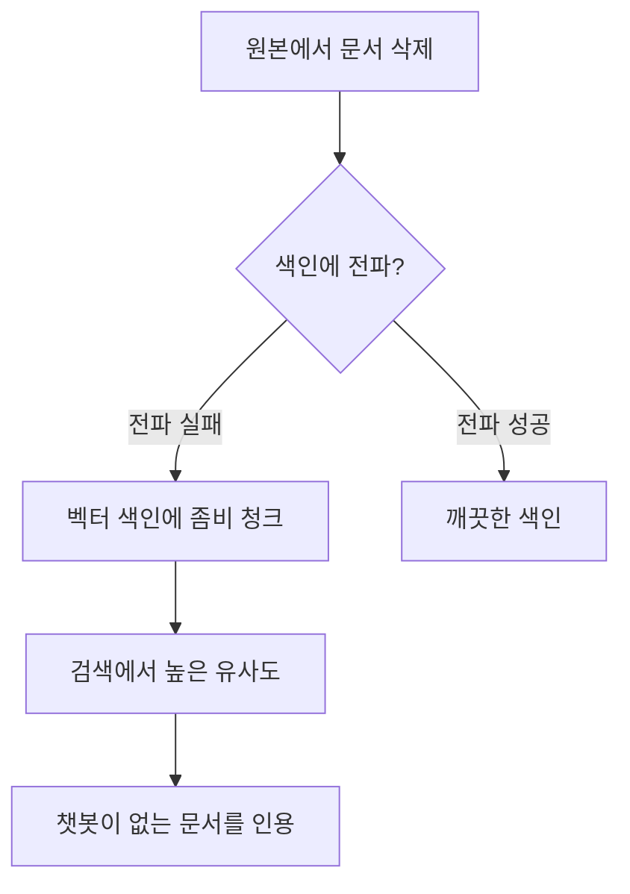

# 좀비 문서

> 원본(드라이브·위키·DB)에서는 이미 지웠는데 **RAG 벡터 색인에는 조각(청크)이 남아서** 검색 결과에 계속 나타나는 문서다. 챗봇이 존재하지 않는 문서를 자신 있게 인용하게 만든다.

## 쉽게 말하면
도서관이 책을 폐기했는데 도서 검색 카드는 그대로 남아 있어, 안내 직원이 "이 책에 그렇게 나와 있어요"라고 자신 있게 말하는 것이다. 책은 이미 없으니 확인도 안 된다.

## 자세히
(벤더 문서·개인 블로그 중심이라 표준이 아닌 실무 사례로 읽는다.)
- **왜 생기나(tianpan.co 글, 직접 확인)**: ① HNSW 기반 인덱스는 보통 **논리 삭제**(tombstone)를 하여 정리 작업 전까지 노드가 다시 나올 수 있다(Weaviate 기본 `cleanupIntervalSeconds` 300초라고 소개) ② 문서 하나가 여러 청크라 청크 ID가 안정적이지 않으면 일부를 놓친다 ③ 야간 배치 동기화는 삭제된 내용을 최대 24시간 검색 가능하게 둔다. 검색 요약에서는 문서→청크 매핑 분실, 아카이브 문서를 동기화가 건너뜀, GDPR 삭제 문서가 몇 달 남은 사례도 언급되나 원문 확인은 못 했다.
- **연쇄 실패(같은 글)**: 삭제된 출처의 청크가 높은 유사도를 유지해 모델이 확신을 갖고 인용한다("항상 자신 있는 오답이지 시끄러운 오류가 아니다"). 편집 시 옛 청크를 안 지우면 새·옛 버전이 공존한다. 물리 삭제가 그래프 연결을 끊어 재현율이 조용히 떨어질 수도 있다.
- **완화책(같은 글)**: 수집 시 안정적인 문서·청크 ID, **문서→청크 사이드카 매핑 표**로 정확한 ID를 지우기, 고위험 코퍼스는 크론 대신 변경 데이터 캡처(CDC), 모델에 넘기기 전 원본 존재 확인, 청크의 `last_verified_at`과 문서 유형별 신선도 기준, 주기적 전체 재구축으로 tombstone 청소. 먼저 할 감사: 지난주 삭제 문서 약 50개를 표본으로 그럴듯한 질의의 상위 50개 결과에 그 청크가 나오는지 확인.
- **테스트 설계(QASkills 글, 직접 확인, 블로그)**: tombstone을 "이 문서 버전은 서빙하면 안 된다는 영속 증거"로 정의. 문서를 불변 버전으로 두고 후보를 **현재 활성 버전 집합**과 대조(벡터 메타데이터의 불리언 복사본은 낡을 수 있음), 삭제를 멱등으로, 필터는 over-fetch 후 활성 집합 확인 뒤 top-k, 캐시·재시작·경합·리랭킹·요약 같은 파생물까지 점검. 삭제 후 카나리 문서가 응답이나 인용에 나오는지 합성 프로브로 경보. 일관성 허용 구간을 정의하고 대화 기록 처리는 제품·컴플라이언스 결정으로 문서화.
- **한계**: 삭제 정책별 효과 수치는 소개 글의 설명이며 독립 벤치마크는 찾지 못했다. Oracle 개발자 블로그의 드리프트 감지 글은 접근이 막혀 확인하지 못했다.

## 그림으로 보기

## 예시
- 폐지된 휴가 규정 문서가 위키에서 삭제됐는데 사내 챗봇이 계속 옛 규정을 안내: 삭제 문서 표본 50개 감사로 좀비 청크 확인.
- 교육 소재: "AI가 지웠다고 알려진 정보를 계속 말하는 이유"를 색인 동기화 관점에서 설명.

## 헷갈리는 것과 비교
| 개념 | 차이 |
|---|---|
| 좀비 문서 | 원본에서 삭제됐으나 색인에 남음 |
| [조용한 버전 드리프트](#silent-version-drift) | 갱신본이 옛 버전과 공존 |
| [임베딩 모델 불일치](#embedding-model-mismatch) | 모델 교체 후 재색인 없음 |
| [RAG 인덱스 버전](#rag-index-versioning) | 색인 생성 조건 기록 |

## 더 읽을거리
- [Retrieval Cascade Failure (tianpan.co)](https://tianpan.co/blog/2026/05/09/retrieval-cascade-failure-document-deletion-rag) — 삭제 전파 실패·완화책(직접 확인, 개인 블로그).
- [Testing RAG deleted document tombstones (QASkills)](https://qaskills.sh/blog/testing-rag-deleted-document-tombstones) — tombstone 설계·테스트 항목(직접 확인).
